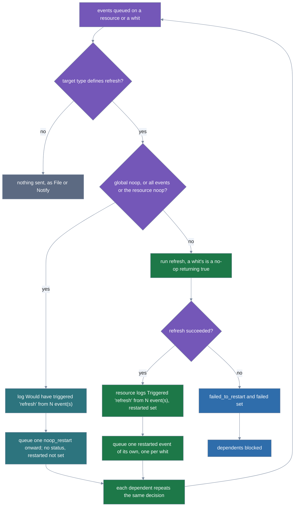

# Maintainer notes: the apply spine

For maintainers. Back to the [README](../../README.md).

`voxagent apply --catalog <file>` reads a Puppet catalog, refuses anything it
cannot fully implement, applies the rest, writes a `report_format 12` report,
and exits on a contract that matches measured Puppet.

Terms used throughout:

- **G1, G2, G3, G5** are the differential gates:
  G1 is `dev:report-diff`, G2 is `dev:idempotence`, G3 is `dev:state-diff`, and
  G5 is `dev:report-diff-container` (its per-type halves are the scripts
  `tests/spine/<type>/g5.sh`).
  Run one with `task dev:<name>`.
  [docs/dev/gates.md](../dev/gates.md) lists the gates and what each needs,
  such as the `fleet-node-el` image.
- **Tier 3** types are the ones applied through the extension host; see
  [extension-host.md](extension-host.md).
- **Ruby citations** such as `type/file.rb:1119` are file and line in Puppet's
  Ruby source (`lib/puppet/`), in the Puppet or openvox version named by the
  measurement beside them.

## The divergence register

The design of the apply spine rules out bug-for-bug parity with Ruby. A divergence is
defensible only if it is enumerated rather than accidental, so every place
voxagent *knowingly* differs is listed here with its reason and with whatever
pins it — and where nothing pins it, the row says so, because a row claiming a
test it does not have is worse than one admitting it has none.

**A divergence not in this table is a defect.** That is what makes the table
falsifiable rather than decorative. The standing rule is to match the original
implementation completely first and optimise afterwards, so where voxagent could
have been "more informative" than Ruby it matches Ruby instead. The G1, G2 and G3
differentials closed every difference they found rather than adding rows here.
Puppet behaviour that is matched but should eventually change goes in
[the improvements log](improvements.md), not in this table.

The property-attribution round closed six more the same way. Not one of them had
been *chosen* — each was found by reading the Ruby that governs it, and each now
does what Ruby does:

- **A created path's metadata is applied silently.** `type/file.rb:1119`'s
  `property_fix` calls `thing.sync` directly rather than going through
  `sync_if_needed`, so nothing records what it did, and a failure inside it
  surfaces as an `ensure` failure. Silent is not unapplied: the metadata really
  is set. voxagent used to emit `owner`/`group` events Puppet does not.
  Pinned by `internal/units/file/file_test.go:TestFileCreatedMetadataIsAppliedButNotReported`
- **`owner` and `group` render as names in the message while the event keeps the
  raw ids.** `type/file/owner.rb:44` and `:48`, and `group.rb:42` and `:46`,
  override `is_to_s`/`should_to_s` to print names; `previous_value` stays the
  integer. Measured: an `owner` event carrying `previous_value` `1000` with a
  message reading `'llm'`. Pinned by
  `internal/units/file/file_test.go:TestFileOwnershipRendersNamesButKeepsRawValues`
- **`ensure => absent` reports the path's actual type**, `file` or `link`, not
  the constant `"present"`. Ruby reads the `ensure` property's `retrieve`, which
  answers what the path *is*. Under `links => manage`, the default,
  the type comes from `Lstat`, so a symlink answers for itself rather than for
  its target; under `follow` it comes from `Stat` (`type/file.rb:895-903`).
  Pinned by `internal/units/file/file_test.go:TestFileAbsentRemovesDanglingSymlink`
  and `TestFileFollowAbsentReportsTheTargetsType`
- **A failed resource is still refreshed.** `transaction.rb:288` calls
  `process_events` unconditionally — only `skip?` guards it, and
  `event_manager.rb`'s `process_callback?` tests noop and never failure. The one
  place failure does gate is `transaction.rb:269`, on the *outgoing* queue.
  Measured in a container, because the host Ruby cannot fork under Puppet:
  `exec`'s `refresh` parameter decoupled the two commands, and the apply command
  failed while the refresh command ran anyway. Pinned by
  `internal/transaction/transaction_test.go:TestFailedResourceIsStillRefreshed`
- **`exec`'s failure is attributed to `returns`.** `type/exec.rb:86` declares
  `newproperty(:returns, :array_matching => :all, :event => :executed_command)`,
  so the event name is `executed_command`, `desired_value` is the accepted list
  as strings — it is the property's should value and owes nothing to whether the
  command ran — and a success message reads `executed successfully`. Pinned by
  `internal/units/exec/exec_test.go:TestExecNonZeroExitFailsTheReturnsProperty` and
  `TestExecSuccessEventMatchesPuppetsExecutedCommand`
- **An unprivileged run warns instead of failing on ownership.**
  `type/file/owner.rb:35` reports the property in sync with a `warnonce` when the
  process is not root, so `owner` never syncs and no event is recorded.
  `group.rb` has no such guard and still attempts the `chown`, so the asymmetry
  is Puppet's, not a transcription error. Pinned by
  `internal/units/file/file_test.go:TestFileOwnerChangeUnprivilegedWarnsAndReportsNoChange`
  and `TestFileGroupChangeUnprivilegedFails`

Tier 1 `package` closed one more after it shipped. It was registered as D-14
and the number is retired rather than reused:

- **A versioned install is verified, and fails when the result is not in
  sync.**
  - openvox's `yum.rb:312-321` re-runs `query` after any install that carried a
    declared version and raises `Failed to update to version X, got version Y
    instead` unless the *provider's* `insync?` accepts the result, which
    `newvalue(/./)` re-raises as `Could not update: …`.
  - The query falls back to `--whatprovides` (`allow_virtual` defaults to true)
    and raises `Could not find package` when both queries fail.
  - Measured in the container with `kernel-core`, which is installonly: 266
    installed, `ensure => '6.12.0-267.el10'`, and dnf adds 267 *beside* 266.
    Ruby fails the resource on the first run and on every run after, because
    the re-query reads `266; 267` and `yum.rb:46` refuses any joined value.
    voxagent reported a successful change both times.
  - After the fix, all three cases (upgrade, install from absent, re-run)
    compare 81 leaves with 0 divergent, and the failure and log texts match
    byte for byte.
  - Pinned by
    `internal/units/package/package_test.go:TestPackageVersionInstallLeavingTwoVersionsFails`,
    `TestPackageMultiversionWithADeclaredVersionAlwaysSyncs` and the
    `TestPackageVersionCheck*` tests.
  - **No gate reaches the failure path**: G5's versioned resources take the
    check's success path, but its fixture has no installonly package, and the
    measurement script is under `.test-output/package-oracle/d14/`, which is
    gitignored

| # | Divergence | Reason | Pinned by |
|---|---|---|---|
| D-1 | `voxagent apply --catalog` honours `--detailed-exitcodes`; Ruby's ignores it | `Puppet::Application::Apply#run_command` dispatches `--catalog` to `apply`, which calls `apply_catalog` and discards its return value; the `exit` call exists only in the manifest path. Measured: a catalog with a failing resource exits 0 while the stored report says `failed=1` | `cmd/voxagent/main_test.go:TestApplyExitCodes` |
| D-2 | An unfinalised report is could-not-run; Ruby exits 255 | `report.rb` returns -1 when metrics are absent, and Ruby's `exit(-1)` surfaces as 255. That is an artifact of the return value, not a contract anything consumes | `internal/report/report_test.go:TestUnfinalizedReportIsCouldNotRun` |
| D-3 | Could-not-run is `2` in plain mode; Ruby exits `1` in both | Plain mode's `0` is already spoken for by every completed outcome, so `2` is the value it leaves free. Matches `voxdiff` and the fleet gates, which a wrapper reads alongside this | `cmd/voxagent/main_test.go:TestPreflightRefusesAndChangesNothing` |
| D-4 | Retired. A symlinked path used to be refused; it now reproduces Puppet's `links` | The file-attribute work added `links => manage \| follow` (`type/file.rb:272-281, 895-903`). Under `manage` a link is replaced by `ensure => file` or `directory` through `removeExisting`, satisfies `present`, keeps its mode (`type/file/mode.rb:133`) and is `lchown`ed (`provider/file/posix.rb:99-144`). Under `follow` the target decides type and mode, `chmod` and `chown` go through the link, and a content write replaces the link by renaming a temp file over it (I-5). Nothing else goes through a link. The title is still cleaned first (`type/file.rb:66-73`), so `File['/d/link/']` acts on the link exactly as `File['/d/link']` does | `internal/units/file/file_test.go:TestFileManageReplacesALinkWithAFile`, `TestFileEnsureFileWithoutContentReplacesALink`, `TestFileDirectoryReplacesALink`, `TestFileManageLeavesALinksModeAlone`, `TestFilePresentIsSatisfiedByALink`, `TestFileFollowContentReplacesTheLinkNotItsTarget`, `TestFileFollowModeChangesTheTarget`, `TestFileNonCleanTitleOverSymlinkActsAsTheCleanTitle`; `internal/units/file/file_fs_test.go:TestFileOwnershipOnALinkLchownsUnderManageAndChownsUnderFollow`; `cmd/voxagent/main_test.go:TestTrailingSlashTitleOverASymlinkReplacesTheLink`; G1's `lnf`, `lnfollow`, `lnmode`, `lnfmode` and `lnd` fixtures |
| D-5 | Retired. An explicit `ensure => absent` on a directory used to fail; it now reproduces Puppet | `force` was outside the bounded set and decides whether a directory may be removed. The file-attribute work added `force` and `removeExisting` (`type/file.rb:1022-1049`): with `force` the tree is removed (`RemoveAll`, which never follows a link); without it Puppet's notice is logged once and a successful `ensure: removed` event is reported while the directory stays, every run (I-1). A purged child behaves the same and inherits the parent's `force` (`type/file.rb:595-600`). A purge over an unmanaged directory is therefore not idempotent, under either agent | `internal/units/file/file_test.go:TestFileAbsentWithoutForceNoticesAndReportsRemoved`, `TestFileAbsentForceRemovesTheTree`; `internal/units/file/file_recurse_test.go:TestFilePurgedDirectoryReportsRemovedAndStays`; G1's `rmdir`, `keepdir` and `pur` fixtures |
| D-6 | `corrective_change` is always `false`, and the ` (corrective)` message suffix is never produced; and voxagent never writes `state.yaml` | Both come from `@persistence`, Puppet's `state.yml`: `resource_harness.rb:169` compares the current value against the value the *last run recorded*, not against the catalog, and `:170` appends the suffix when they differ. voxagent has no counterpart to that store, so it has nothing to derive the distinction from. Nor does it write Puppet's other run state under `--vardir`. Natively it has no store at all. The extension host's harness records each Tier 3 resource's `checked` and `synced` times in `Puppet::Util::Storage` (`resource_harness.rb:66-71`), but only in memory: `Catalog#apply` is what loads and stores `state.yaml` (`resource/catalog.rb:234`, `:248`), and `Transaction#evaluate` is what saves the transaction store (`transaction.rb:155`), and the host calls neither (read, not measured). A Ruby run later on the same vardir therefore finds what the last *Ruby* run stored, not this run's times | Nothing pins the difference. `dev:report-diff` compares the leaf and sees `false` on both sides — but only because the fixture's `vardir` is a fresh `mktemp -d`, so Ruby has no persisted value there either. See *The failure-detail elision has a latent fragility* under "Traps this project keeps hitting" below |
| D-7 | `audited` is always `false` and `historical_value` is never carried, so `sync_if_needed`'s audit branch has no analogue | `audit` is in no provider's attribute set and not in `engineAttrs`, so voxagent refuses a catalog that declares it during pre-flight, rather than running and silently dropping the auditing requirement. The report fields exist only so the two implementations agree on the keys | `internal/ral/ral_test.go:TestEngineAttrsCoverRelationshipMetaparameters`, which asserts `audit` is not engine-handled |
| D-8 | Retired. A `Sensitive` value used to be written in full where Ruby writes `[redacted]`, with `redacted` always the zero value. It is now redacted as Ruby does, outside the text D-78 redacts beyond Ruby | Measured 2026-11-17 on openvox 8.33.0 (puppet 8.10.0 source for the rules). A top-level `Sensitive` reaches the catalog as the plain value plus a sibling `sensitive_parameters` array, which `catalog.Resource` now reads. `ral.MarkSensitive` applies `set_sensitive_parameters` (`type.rb:2389`): only a *property* is marked; `File` `content` also marks `ensure`, and `source` marks `content` and `ensure`, while a link `target` marks only itself; any of `Exec`'s `command`, `unless` and `onlyif` marks the three present ones. A marked property's event has `previous_value` and `desired_value` `[redacted]`, `historical_value` null, `redacted: true` and the message and log `changed [redacted] to [redacted]` (`resource_harness.rb:182`, `property.rb:260`), under `--noop` `current_value [redacted], should be [redacted] (noop)`, and on failure `change from [redacted] to [redacted] failed: <error>`. A name that cannot be marked (a parameter such as `cwd`, an unknown or unassigned one) is warned on the console only, `Warning: /Exec[x]: Unable to mark 'cwd' as sensitive: …`, printed by `applyCatalog` (`voxagent: ` prefixed under `apply`) and never put in the report. A host override's `sensitive` list is kept and concatenated with the catalog's (`Resource.MarkSensitive`), so `concat`'s generated `File` is redacted like Ruby's. An override's `ContentMark` sets `content`'s flag as Ruby's parameter flag instead (`Resource.SetSensitivity`, concat design §5.4): sensitive marks `content` only, with no `ensure` cascade; not sensitive gives `redacted: false` with the ordinary message; unset gives `null`. The last two also drop a catalog `content` mark, keeping the `ensure` mark its cascade made, set directly so it holds when the `File` has no `ensure` parameter (`type/file.rb:989`). Children a native `File` recursion generates carry no marks, as in Ruby. Notify's and Exec's log text is `Sensitive [value redacted]`, `[command redacted]`, `[output redacted]`. voxagent shows no diffs, so `show_diff`'s `[diff redacted]` has nothing to redact. The two gates that held this back are now compared in full: `concat` with a `Sensitive` fragment is in `report-diff-extension.sh`, and `File[/etc/chrony.keys]`'s six registered leaves are gone from `tests/spine/allowlist.json` (the SIMP gate compares them). Before the allowlist entries were removed the SIMP gate was red on exactly those six leaves. Ruby leaks a marked value in error text; voxagent does not, D-78 | `internal/ral/sensitive_test.go:TestMarkSensitive`; `internal/transaction/sensitive_test.go:TestMarkedPropertyEventIsRedacted`, `TestMarkedPropertyNoopEventIsRedacted`, `TestMarkedPropertyFailureIsRedacted`; `internal/transaction/evalgen_test.go:TestOverrideSensitiveMarksTheTarget`; `cmd/voxagent/generation_test.go:TestMergeGenerationKeepsSensitive`; `internal/units/file/file_recurse_test.go:TestFileGenerateChildrenCarryNoSensitiveMarks`; `internal/units/exec/exec_test.go:TestExecOnlyUnlessMarkedRedactsCommand`; `cmd/voxagent/main_test.go:TestApplyWarnsOnAnUnmarkableSensitiveParameter`, `TestApplyDoesNotWarnOnAMarkableSensitiveProperty`; `cmd/voxagent/agent_test.go:TestAgentWarnsOnAnUnmarkableSensitiveParameter`; `cmd/voxagent/sensitive_test.go:TestNoSensitiveMarkerLeaks` (no marker value appears in the report, the logs or the console of a run). Gates: `dev:report-diff-container` (`Sensitive` and `Exec` cases), `dev:report-diff-extension` (a `Sensitive` `concat` fragment), `dev:report-diff-simp` (no D-8 allowlist entry) |
| D-9 | Go and Ruby render the same errno differently — `chown <p>: operation not permitted` against `Operation not permitted @ apply2files - <p>` | **Unclosable.** It is each runtime's own error text, not voxagent's; matching it would mean hand-writing errno strings that then drift from the syscall producing them. `internal/gatekit/reportcmp`'s `elideFailureDetail` masks exactly that span and keeps the `change from X to Y failed: ` prefix, the `Could not set 'V' on P: ` wrapper and the `(file: F, line: N)` suffix compared — those three *are* the attribution the gate exists to check | `dev:report-diff`, whose fixture now contains a failing resource, so the elision runs on every green rather than being dead code |
| D-10 | A noop message of `service` or `package` never carries a trailing ` (noop)`, where `resource_harness.rb:243` appends one (`Package.sync` under noop returns the plain `ensureMessage`, `internal/units/package/package.go`); `file`'s, `notify`'s and `exec`'s do since the concat gates ([`concat_file` and `concat_fragment`](not-implemented.md#concat_file-and-concat_fragment)) | A report-shape decision for whichever round measures `service` or `package` noop end to end. **The evidence for `service` and `package` is weaker than the rest of this table and must not be read as equal to it:** it rests on reading `:243`. The other three are measured: the concat measurements' `noop.txt` (openvox 8.33.0) show `defined content as '{sha256}…' (noop)`, `created (noop)`, `removed (noop)`, `content`/`owner`/`group`/`mode changed … (noop)`, `defined 'message' as '…' (noop)` and `executed successfully (noop)`, and G5's concat `--noop` pass and the extension gate's `--noop` recursion pass compare them. Native `File.Apply` appends the suffix to every change that is not a failure; `Notify` adds it and logs no bare `Puppet` notice (message's sync never runs); `Exec`'s noop event is Ruby's: `previous_value` `notrun`, `desired_value` the accepted list, message `executed successfully (noop)` | `internal/units/file/file_test.go:TestFileNoopMessagesEndInNoop`; `internal/units/notify/notify_test.go:TestNotifyNoopStillReportsTheChange`; `internal/units/exec/exec_test.go:TestExecNoopChangeDoesNotFabricateExitCode` |
| D-11 | On a created path the collapsed metadata failure is wrapped as `Could not set 'V' on ensure: …` unconditionally; Ruby wraps only some | `property.rb:490` re-raises a `Puppet::Error` untouched and `:492` wraps every other `StandardError`. A `chown` failing inside `property_fix` raises `Puppet::Error` (`provider/file/posix.rb:110` for owner, `:142` for group) and is **not** wrapped, while an unresolvable owner *name* is a bare `RuntimeError` from `type/file/owner.rb:29` and **is**. voxagent's collapse runs after the raise and cannot tell the two layers apart, so it wraps both. Reachable only when a created path's metadata fails, which the spine fixture does not do; `task check` is unaffected | `internal/units/file/file_test.go:TestFileCreatedMetadataFailureCollapsesOntoEnsure` |
| D-12 | Provider selection is not implemented. voxagent is dnf and only dnf, so voxagent refuses, during pre-flight, a catalog that names another provider, where Ruby selects at runtime among the forty-three files under `provider/package/` | Selection is suitability and specificity evaluated against the host, and reproducing it means reproducing the confines, features and `defaultfor` of providers none of which exists here. Bounding it is also what keeps the retrospective's "no suitable provider" gap unforced: Puppet's failed-with-zero-events shape — `transaction.rb:132-135`, then one `Puppet.err` per type at teardown (`:146`) — is unrepresentable in a contract whose bare `err` always synthesizes a `resource_error`, and a refusal that happens before the walk means nothing ever needs it. **One half of the design is not implemented as written:** a host with no usable `dnf` is *not* refused at pre-flight. `Prefetch` resolves both commands with `exec.LookPath` (`internal/units/package/package.go:287` and `:291`) and a failure there is the type-wide prefetch failure instead — one `err` log, one `resource_error` per package resource, `failed` and `skipped` together — while every other type in the catalog still applies, which is the half-converged node the value-level refusal exists to prevent | `internal/units/package/package_test.go:TestPackageSupportsValue` pins the provider refusal in both directions (`dnf` accepted, `gem` and `yum` refused) and `internal/ral/preflight_test.go:TestPreflightRefusesAnUnimplementedAttributeValue` pins the mechanism. **Nothing pins the absent-`dnf` path.** No test drives `LookPath` into failure, and no gate can: every container G3 and G5 start has dnf |
| D-13 | Four `ensure` values are pre-flight refusals: `purged`, `disabled`, `held`, and every version **range** (`>=8.1`, `>8.1 <9.0`) | Four refusals for four different reasons, and the differences are the point. `purged` (`type/package.rb:107`) needs `:purgeable`, which is method-derived (`:47-51`, `:methods => [:purge]`) and which `provider/package/yum.rb:355` satisfies — so Ruby really does purge, and this is voxagent declining a value Puppet implements, for the feature-confinement machinery nothing else here needs. `disabled` (`:111`) needs `:disableable` (`:67-69`), whose `:methods => [:disable]` only `dnfmodule.rb:128` defines, so no yum-family provider has it and Ruby refuses the value too; this row is about *when* the refusal lands, not whether, and where Ruby's lands is unmeasured. `held` is not an `ensure` value at all — holding is the `mark` property (`:664`, values at `:676`) — so Ruby's catch-all `newvalue(/./)` (`:136`) would read it as a version and hand dnf `nano-held`; refusing it by name is what keeps voxagent from reproducing that. Ranges are implemented and real: `dnf.rb:14` declares `:version_ranges` and `best_version` resolves them by running `dnf list <name> --showduplicates` and taking the greatest available version inside the range (openvox `yum.rb:199-228`, called at `:283`; the gem's are `:201` and `:288` — the line numbers differ between the trees, the behaviour does not). All four are refused at pre-flight rather than at apply because `ensure` carries an open-ended version string: an apply-time refusal applies the rest of the catalog first and leaves the node half-converged | `TestPackageSupportsValue` asserts all four refused **and** each implemented value accepted, so it cannot pass against a provider that supports nothing; `internal/units/package/package_test.go:TestPackageRefusesAVersionRange` pins the leading-operator test and the multiversion string (`6.12.0-1.el10; 6.12.0-2.el10`) it must *not* catch; `TestPreflightRefusesAnUnimplementedAttributeValue` pins the `Package[foo]: ensure => "purged" is not implemented` form |
| D-15 | Non-adjacent multiversion grouping: where one name appears twice in `rpm -qa` with another package between, voxagent joins every version into one `previous_value` and Ruby reports only the last adjacent group's | One of the predictions recorded when the apply spine was designed (made by reading Ruby's source before running it), still unmeasured, registered here rather than decided in code. `rpm.rb:238-242` flushes its accumulator whenever the name changes, so it groups **adjacent** lines only and a non-adjacent repeat becomes two entries in the instance list; `provider/package.rb:7-14`'s prefetch then does `packages[prov.name] = prov` once per instance, so the **last** entry wins. voxagent's `parseInstalled` (`internal/units/package/dnf.go:52`) keys a `map[string]string` and groups globally. Keeping the global map because it is the more useful answer is exactly the improvement the standing directive forbids making before parity. Read further, the case may not be reachable at all: `rpm.rb:70` pipes the bulk query through `| sort`, and sorting makes every line sharing a `name ` prefix contiguous, so Ruby's adjacency requirement is satisfied by Ruby's own command line. That second reading is a stronger kind than the first: whether `| sort` is in the command line is a question about **which code path runs**, which reading source answers reliably, where the first reading is about **what ends up in the output**, which is the form this project has been wrong about repeatedly. So the likeliest state of the world is that the two implementations cannot disagree here. It stays a register row rather than being closed because nobody has produced the input and watched, and an unreachable divergence that is later made reachable -- by a query that drops the sort, say -- would otherwise become a silent defect | **Nothing pins the difference.** `internal/units/package/dnf_test.go:TestParseInstalledJoinsMultipleVersions` and `TestParseInstalledSkipsRepeatedVersions` pin voxagent's own side only, and the captured `internal/units/package/testdata/rpm-qa.txt` is sorted, so it cannot exhibit the input that would separate the two |
| D-16 | One `Could not check for updates` per run is reached by a different mechanism than Ruby's, while the output matches | Ruby's `latest_package_version` (openvox `yum.rb:91-101`) memoises `check_updates` into a class-level `@latest_versions` keyed `[disablerepo, enablerepo, disableexcludes]`, so the first `latest` resource to reach `insync?` pays for the call and every later one reads the cache. The warning itself (openvox `yum.rb:128`, the gem's `:129`) is plain `warning`, which does not dedupe at all — the single entry is an artifact of the memo, not of logging. voxagent resolves the updates map once in `Prefetch`, the only place that can see "some `latest` resource is already installed" before any `Apply`, and returns the stored warning from every `latest` resource with `Warning.DedupeClass` set to `Puppet::Type::Package::ProviderDnf`, which the transaction collapses on class-plus-message (`internal/transaction/transaction.go:205-212`). Both halves are needed: dedupe alone would still spawn N subprocesses, which `dev:state-diff` can see and no report differential can; eager resolution alone would log N times. The observable counts agree — one warning and one `dnf check-update` per run, zero of each when no installed resource asks (`type/package.rb:165` returns before `provider.latest` for an absent or purged package). What differs is *when*: Ruby's call happens lazily at the first `latest` resource, voxagent's before any resource is applied. That is not observable in any compared report leaf; it shows in `evaluation_time`, which no gate compares (D-57) | Ruby's side is measured — three installed `latest` resources against an unreachable repo emit exactly one warning (another of the predictions recorded when the apply spine was designed). voxagent's side is pinned by unit test rather than by a differential against that same catalog: `internal/units/package/package_test.go:TestPackageResolveUpdatesRunsOnceForTheWholeRun`, `TestPackageResolveUpdatesSkipsWhenNoInstalledResourceAsks` and `TestPackageLatestOnAPurgedPackageRaisesNoCheckUpdateWarning` for the call count and its guard, `TestPackageCheckUpdateFailureWarnsAndLeavesTheResourceInSync` for `DedupeClass` and the no-change outcome, and `internal/transaction/transaction_test.go:TestWarningCarriesItsOwnSource` for the collapse. **No gate reaches it**: G5's containers have healthy repos, so the branch never fires there |
| D-17 | A catalog_format 2 resource with no `kind` is applied by type; Puppet makes it an inert Component | `resource.rb:515-526` gives Component to anything not `compilable_type`, including a missing kind. Puppet 8 emits kind on every compiled resource, so only hand-written catalogs (test fixtures) omit it, and treating those as Components would make every fixture a no-op | `internal/ral/ral_test.go:TestIsContainerResource` |
| D-18 | `service` runs journalctl as argv, `env LANG=C LC_ALL=C journalctl -n 50 --since '5 minutes ago' -u <name> --no-pager`; Puppet builds an unescaped shell string | `systemd.rb:227` interpolates the unit name into a string that `execute` hands to a shell, so a name with shell metacharacters reaches it. voxagent never gives a unit name to a shell: every built-in command is argv with `--` before the name. The output is the same for any ordinary name | `internal/units/service/service_test.go:TestServiceStartFailureCarriesTheJournal` pins the failure message and the journalctl argv shape; nothing pins a hostile name against Ruby |
| D-19 | `service`'s `start`/`stop`/`restart`/`status` keep the caller's locale and journalctl gets `C`, as Puppet does; but `is-enabled`, `show`, `enable`, `disable` and `unmask` also keep the caller's locale where Puppet forces `C` | The state tokens voxagent parses out of `systemctl` (`enabled`, `disabled`, `static`, `indirect`, `masked`, `yes`) are not localised, so the difference cannot change a decision. It could change the text of a failure from those commands, which is the part not measured. journalctl's text is copied into the failure an operator reads, which is why it alone is pinned to `C` | `internal/units/service/service.go`'s type comment states the split. **Nothing pins the difference against Ruby** |
| D-20 | `service`'s `is-enabled` and `show` are read from combined stdout+stderr; Puppet reads stdout only | `runner().run` returns one combined stream. It matters only if systemctl writes a token to stderr: `static`, `indirect` and `masked` are the ones whose handling depends on the exact word, so stderr noise around them is the case that could mis-parse. Not observed. `show`'s output is scanned for its `NeedDaemonReload=` line rather than split on the last `=` as `systemd.rb:162` does, so noise around that line cannot flip the daemon-reload decision; on `show`'s clean one-line stdout the two readings agree | `internal/units/service/service_test.go` pins `is-enabled`'s token handling on clean output only, and `TestServiceDaemonReloadFindsItsLineAmongOtherOutput` pins `show`'s line scan with extra output before and after. **Nothing pins the stderr case against Ruby** |
| D-21 | A journalctl that cannot start (not installed, not executable) fails with `Execution of '<line>' failed: <err>`; Puppet says `Could not execute posix command: <err>` | Puppet's wording comes from `util/execution.rb`'s spawn rescue and wraps a Ruby `SystemCallError`; voxagent's is its own text around Go's error, which would drift if copied. A journalctl that starts and exits non-zero yields Puppet's `ExecutionFailure` text, which is reproduced | `internal/units/service/service_test.go:TestServiceJournalctlFailureIsExecutionFailure` covers the non-zero exit. **The cannot-start wording is not pinned against Ruby** |
| D-22 | A host whose PID 1 is not systemd refuses the **whole catalog** when it holds a `service`, as a could-not-run before anything is applied; Puppet selects another provider | Provider selection is not implemented (D-12). Checked in `Service.Validate`, not `Prefetch`, because a prefetch failure applies every other type first and leaves the node half-converged, the case the whole-catalog refusal exists to prevent. The test is PID 1's `comm` containing `systemd`, so a container that is not run under systemd is refused | `internal/units/service/service_test.go:TestServiceValidateRequiresSystemdAsInit`; `cmd/voxagent/main_test.go:TestServiceIsRegistered` pins that the pre-flight gap is gone, and `TestServiceOnANonSystemdHostRefusesTheWholeCatalog` pins, at the binary, that a valid `file` beside a `service` is not written and the run exits 2 as could-not-run (skipped where PID 1 is systemd) |
| D-23 | Retired. `service` and `exec` commands used to inherit voxagent's `HOME`, `USER` and `LOGNAME`; no child voxagent starts gets them now, as under Puppet | `util/execution.rb:387` deletes each of `util/posix.rb:11`'s `USER_ENV_VARS` in the child before every command Puppet executes (measured, M10). `exec` builds every child's environment, guards and `refresh` included, from `command.WithoutUserEnv` (`internal/lib/command/command.go`), and `command.RunArgv` (`internal/lib/command/command.go`), which starts `service`'s `systemctl` and `package`'s dnf, applies the same function; `validate_cmd`'s `rubyEnvDropped` holds the same `userEnvVars`. A `user` exec is given no `HOME` either: Puppet sets none. Their `PATH` still differs: D-49 | `internal/units/exec/exec_env_test.go:TestExecChildHasNoUserEnv` (a command, its guard and the `runArgv` runner), `TestWithoutUserEnv`; `task dev:report-diff-systemd` and G5's package cases after the change |
| D-24 | A daemon that a `service` or `exec` command backgrounds can keep writing to stdout after the command returns; under Puppet its next write gets `EPIPE`, and `SIGPIPE` unless it ignores the signal | Puppet captures a command's output through a pipe on POSIX (`util/execution.rb:200`) and closes the read end once the direct child has exited (`:325`), so a backgrounded descendant's later writes reach a pipe with no reader. voxagent's `runCapturingToFile` (`internal/lib/command/command.go`, used by `command.FileOutputRunner` and `Exec.execute`) gives the command a temporary file instead: writes after the command returns land in a file whose name is already removed. Reproducing the pipe would mean killing a service for logging to stdout, an artifact of Puppet's capture rather than a contract | **Nothing pins it.** `TestFileOutputRunnerReturnsWhenABackgroundedChildInheritsStdout` and `TestExecReturnsWhenABackgroundedChildInheritsStdout` pin only that the command returns when its shell exits; no test has the backgrounded child write afterwards, and the systemd gate's custom commands write nothing after they return |
| D-25 | Retired. A generating parent's unit now logs Puppet's whit notice under `--noop`: `Would have triggered 'refresh' from N events` at the parent's title, N the events of the parent and every member (measured: `/tmp/rx/tgt`, N = 3) | Puppet's completed whit is a real vertex whose `process_noop_events` logs the notice; `applyUnit` reproduces it from the unit's aggregate before sending the one event on | Pinned by `TestFileRecursionUnitNoopNotice` and `TestUnitNoopNoticeCountsEvents`; the `--noop` pass of the report-diff gates compares it. The notice is gated on the run's `--noop` only (`applyUnit`, `internal/transaction/transaction.go`): a per-resource `noop => true` in a live run gives no notice, where Ruby's whit may log one (unmeasured) |
| D-26 | A `source` that is a FIFO, socket or device fails the resource; Puppet describes it with a `{none}` checksum. (The symlink part is retired: a link source now reproduces Puppet, see [`file` source, recurse and purge](not-implemented.md#file-source-recurse-and-purge)) | Source metadata is read with `lstat` under `links => manage` (`file_serving/base.rb:79`), and a FIFO or socket is a type Puppet describes rather than refuses. voxagent refuses anything but a regular file, a directory or (below) a link. **Retired part:** under `manage` a symlink source makes the resource a link to the source's raw `readlink` (`type/file/source.rb:170-176`; `file_serving/metadata.rb:118-124`), as `link_created ... created`; under `follow` the source is read with `stat` and its target's content is copied (`file_created`, `defined content as ...`). `links` is consulted when reading a top-level source; a symlink inside a recursed source tree is still refused, as before | `internal/units/file/file_source_test.go:TestResolveSourceRefusesASpecialFile`, `TestFileSymlinkSourceUnderManageMakesALink`, `TestFileSymlinkSourceUnderFollowCopiesTheTarget`; G1's `src-ln` and `src-follow` fixtures; `internal/units/file/file_recurse_test.go:TestFileSymlinkInASourceTreeFailsThatChild` (recursion) |
| D-27 | Retired. A recursion child whose source type differs from what exists used to fail; it now reproduces Puppet | A source directory over a file replaces the file (`directory_created`, `ensure changed 'file' to 'directory'`). A source file over a directory fails the child's ensure with the notice twice (I-3) unless the parent's `force`, inherited by every child, lets it replace the directory (`file_created`, `defined content as ...`; `type/file.rb:791-818`) | `internal/units/file/file_recurse_test.go:TestFileChildTypeConflictReplacesOrFailsByForce`; G1's `fdir`, `nofdir` and `wasfile` fixtures |
| D-28 | Retired. A symlink found by a recursion walk used to get no permission changes and no SELinux relabel; it now gets Puppet's treatment of the link itself | Puppet's `newchild` makes a walked link a `File` like any other (`type/file.rb:583-602`), with the parent's `links`, which is `manage` because `Validate` refuses `follow` with `recurse` (D-32). Its mode is left alone (`type/file/mode.rb:133`), `owner` and `group` are `lchown`ed (`provider/file/posix.rb:99-144`; measured as root on Puppet 8.10.0: `owner changed 'llm' to 'nobody'` and `group changed 'llm' to 'nobody'` on links into the tree, out of it and dangling, no `mode` event, the outside target untouched, and `(noop)` events with nothing changed under noop) and it is relabelled itself (the SELinux gate: `seltype changed 'tmp_t' to 'etc_t'`). Every operation goes through the tree's `rootFS`: `Lchown`, and the `O_PATH\|O_NOFOLLOW` handle the label is read and set through, act on the link and never its target, and `purge` still unlinks it | `internal/units/file/file_recurse_test.go:TestFileWalkedSymlinkIsLchownedAndKeepsItsMode`, `TestFileWalkedSymlinkUnderNoopChangesNothing`; `internal/units/file/file_selinux_test.go:TestSELinuxRelabelsAWalkedLinkItself`, `TestXattrHelpersActOnALinkItselfThroughTheRoot`; the SELinux gate's `tree` fixture, run as root: `tree/ln` and `tree/lnout` (to `lnreal`, outside the tree) are compared with Ruby for their `owner` and `group` events and no `mode` event, `tree/ln` (seeded `tmp_t`) for its `seltype` event, and `tree/lnout`, seeded `etc_t` and so already in sync, for having none; and the ownership listing shows `lnreal` keeping `root:root`. G1's `lnwalk` sees only a mode or group event that should not be there |
| D-29 | Retired. On an SELinux-enabled host a managed `File` used to keep whatever context it had; it now gets the `selabel_lookup` default as Puppet does | Closed by the `sel*` properties, defaults and relabelling, and by reading and writing a recursion child's label through its `os.Root`. `type/file/selcontext.rb:42-48` gives every `File` the four `sel*` properties, defaulted unless `selinux_ignore_defaults`, whenever `Selinux.is_selinux_enabled == 1` (`util/selinux.rb:21-28`); see [`file` SELinux contexts](not-implemented.md#file-selinux-contexts) below. The number is retired rather than reused | `internal/units/file/file_selinux_test.go` (the `TestSELinux*` tests, against a fake host); this container cannot mount `selinuxfs`, so Puppet's side is measured on an enforcing VM (`tests/spine/report-diff-selinux.sh`) |
| D-30 | `links => follow`, `ensure => file` and no `content` or `source` over a dangling link fails the create; Puppet creates the file the link points at | Puppet opens the path in place (`type/file.rb:964-966`), and `File.open` follows the link. voxagent creates such a file with `O_EXCL` and never writes through a link, so the link fails it with `file exists` and nothing is created at its target (measured on Puppet 8.10.0 2026-10-06) | `internal/units/file/file_test.go:TestFileFollowEnsureFileOverADanglingLinkWritesNothingThroughIt` |
| D-31 | A generated recursion child under an inherited `links => follow` whose destination is a symlink is not chmod'ed or chown'ed through it: a declared `mode` fails (`refusing to chmod through it`) and `owner`/`group` are `lchown`ed. Puppet chmods and chowns through the link | Under `follow` Puppet's `mode=` is `File.chmod` and `owner=`/`group=` are `File.chown` (`provider/file/posix.rb:99-144, 155-156`), all following the link. A child is applied through `rootFS`, whose `Chmod` refuses a link and whose `Chown` is `Lchown`, because inside the `os.Root` a link swapped in after the walk must not carry a chmod or chown anywhere, even within the tree. Not reachable from a catalog since `Validate` refuses `links => follow` with `recurse` (D-32), so every generated child is under `manage`; `rootFS` keeps the guarantee for any child applied regardless | `internal/units/file/file_fs_test.go:TestFileFollowChildLinkIsNeitherChmodedNorChownedThroughTheRoot` |
| D-32 | `links => follow` with `recurse => true` is refused before anything is applied (`Validate`, exit 2 could-not-run); Puppet follows a linked source directory and copies its tree | Measured on Puppet 8.10.0: `source => '<dir>/dl', recurse => true, links => follow`, where `dl` links to a directory holding `a`, creates the destination and copies the tree (`File[/d/a]` `file_created`, `defined content as '{sha256}...'`); under `manage` it makes the destination a link and yields no children. voxagent's walk (`walkTree`) is `os.Root`-confined and never follows a link, so following one is a security-sensitive change not made yet. `Validate` refuses it, not a pre-flight `Gap`, because `SupportsValue` sees one attribute at a time and cannot express a combination; it is therefore not in the porting histogram | `internal/units/file/file_source_test.go:TestFileValidateSourceAndCreators` (case `follow and recurse`) |
| D-33 | voxagent reads and writes raw SELinux contexts; Puppet's non-raw calls translate through mcstrans | `selcontext.rb:35-36, 121-122` runs `selrange` through `selinux_category_to_label` and `lgetfilecon` is the translating call, so Puppet compares and writes translated ranges. The two differ only on a host with mcstrans translations configured (`setrans.conf`), which a default RHEL or SIMP install does not have. voxagent's `current` reads `security.selinux` raw and `defaultFor` takes `selabel_lookup`'s non-raw output, which is the same string Puppet's non-raw lookup returns. On a host with translations the effect is not small: voxagent compares a translated default range against a raw label, so every `File` that wants defaults reports a `selrange` change on every run, and writing the translated range, which the kernel does not accept as a raw label, fails as a warning (I-4) | **Nothing pins it**: no mcstrans host here |
| D-34 | `ensure => present` with `content` over a path that is not a regular file omits Puppet's warning | Puppet keeps the path, as voxagent does, and `checksum_insync?` (`type/file/data_sync.rb:31-33`) logs `Ensure set to :present but file type is <ftype> so no content will be synced` at warning level, sourced at the resource (measured on a fifo: `/Stage[main]/Main/File[<path>]`). voxagent's provider warnings carry a fixed source (`ral.Warning`), and a resource-sourced one is not implemented. The disk state and the events agree; only that log line is missing | **Nothing pins it.** `internal/units/file/file_test.go:TestFilePresentWithContentLeavesAFifo` pins the kept fifo and the absence of a blocking read, not the warning |
| D-35 | When the SELinux file-contexts handle does not open, voxagent refuses only a catalog with a `File` that would look a default up; Puppet fails every run | **Measured** 2026-10-06 on the SELinux gate's VM (openvox 8.29.0, enforcing) with `file_contexts` and `file_contexts.bin` moved aside, so `selabel_lookup` prints `ERROR: selabel_open - Could not obtain handle`: `puppet apply --catalog` printed `Error: Could not prepare for execution: Could not create resources for managing OpenVox's files and directories in sections [:main, :agent, :ssl]: Cannot get default context with nil handle`, exited 1, applied nothing (the catalog's notifies and files did not run) and wrote no report. Puppet 8.10.0 has the same path with `Puppet's files` (`settings.rb:1145`, `application.rb:415`). The failure is in Puppet's own settings resources, at setup, so it does not depend on the catalog. voxagent has no settings resources: its `Validate` probes the handle once and refuses the catalog, nothing applied, for each `File` that wants defaults and syncs its SELinux properties on a filesystem with labels, as `File[<path>]: Cannot get default context with nil handle`. A catalog with no such `File` is applied, where Puppet would not run. Before this, voxagent failed each such `File` and applied the rest. Verified in a second run of the same broken VM: voxagent printed `File[/etc/voxgate/i3a]: Cannot get default context with nil handle` for the one `File` wanting defaults (not the one with `selinux_ignore_defaults`), applied nothing and wrote no report; it exits with its own could-not-run code, `2` (README), where Puppet exited `1` | `internal/units/file/file_selinux_test.go:TestFileValidateRefusesTheCatalogWhenNoHandleOpens`, `TestHandleOpensProbesOnceAndReportsANilHandle`. No gate fixture: breaking `file_contexts` would fail every other fixture of the SELinux gate, so it was measured in a separate VM run |
| D-36 | A skipped resource's `evaluation_time` is `0` in voxagent's report and `null` in Ruby's, for a native resource skipped because its provider's prefetch failed and for a Tier 3 resource skipped the same way (the host's `evaluate` or `skip` answers it) | Ruby marks the resource skipped before `apply` runs (`transaction.rb:280-284`), so it is never timed and `evaluation_time` stays `null`. voxagent has no unset float in its report, and for a Tier 3 resource the host's round trip is not Puppet's span, so it writes `0`. `resource_statuses.*.evaluation_time` is in `tests/spine/allowlist.json`'s volatile set, and that pattern is what hides the difference: both spellings of "no time was spent" are dropped before the comparison, so no gate would catch a change in either | `internal/transaction/transaction_test.go:TestPrefetchFailureFailsEveryResourceOfTheTypeAndAppliesNone` (native), `internal/transaction/evaluator_test.go:TestEvaluatorPrefetchSkipBlocksAndIsNotRefreshed` (Tier 3) |
| D-37 | Retired. A Tier 3 resource with no suitable provider used to be answered where voxagent's walk reached it; it is now deferred and answered last, as Puppet does | `relationship_graph.rb:114-145` sets a resource that is not `suitable?` aside, offers it again once the ready queue drains if anything was placed since the last drain, and otherwise hands it to the overly-deferred handler (`transaction.rb:124-136`), which logs `Provider X is not functional on this host` (or records the type for teardown's once-per-type `Could not find a suitable provider for X`) and marks it failed. `graph.Walker` keeps the same deferred list and progress flag; the host answers `unsuitable` without logging and logs at `overly_deferred`. Inside an `eval_generate` unit the resource is still failed at its turn (D-56) | `internal/graph/graph_test.go:TestWalkerDefersToTheEndOfADrain`, `TestWalkerHandsBackEveryOverlyDeferredVertexFirst`; `internal/transaction/evaluator_test.go:TestRunDefersAnUnsuitableResourceToTheEnd`, `TestEvaluatorUnsuitableFailsWithoutEvaluation`; `internal/extension/ruby_test.go:TestRealHostUnsuitableProvider` |
| D-38 | The dependent of an unsuitable Tier 3 resource whose own dependency failed names both failures in its `Dependency ... has failures` lines; Puppet names only the unsuitable resource | Puppet's `propagate_failure` (`transaction.rb:333-349`) builds each resource's failed dependencies from its direct prerequisites, inheriting a prerequisite's own list only when that one was skipped for it. The unsuitable resource is failed rather than dependency-failed, so it stops the inheritance. voxagent blocks the transitive closure of every failure, so the original failure reaches past it. **Measured** 2026-10-07: `vox_value { 'broken': value => 'fail' }`, `vox_conf { 'late': require => Vox_value['broken'] }`, `file { 'after-late': require => Vox_conf['late'] }`: Ruby logs only `Dependency Vox_conf[late] has failures: true`, voxagent also `Dependency Vox_value[broken] has failures: true`. Both skip the file; only the extra notice differs | Nothing; the shape of the unsuitable resource itself is pinned by `internal/transaction/evaluator_test.go:TestEvaluatorUnsuitableWithFailedDependencyIsFailedNotSkipped` |
| D-39 | A type all of whose resources were skipped for failed dependencies has a `metrics.time` entry of `0` in voxagent's report and none in Ruby's | `report.rb:499-510`'s `calculate_time_metrics` adds only a status with an `evaluation_time`, and a skipped resource's is `null` (D-36). voxagent's `Finalize` sums every status not marked `Untimed`, and only the Tier 3 never-evaluated paths (prefetch-skipped and unsuitable) set it; a resource skipped for dependencies, native or Tier 3, is still summed as `0`. Left so to keep native behaviour unchanged in the extension-host work. **Measured** 2026-10-07 in the D-38 catalog: Ruby's `metrics.time` has no `file` entry, voxagent's has `file: 0` | Nothing |
| D-40 | Retired. Under `--noop` the `events` metric had no `noop` entry, where Ruby counts noop events there | `report.rb:467-478`'s `calculate_event_metrics` adds one to `metrics[event.status]` for every event, so a noop run gains a `noop` entry (measured 2026-10-07 on `report-diff-extension.sh`'s catalog under `--noop`: Ruby `["noop","Noop",11]`, voxagent had none). `Finalize` now counts `noop` events and emits the entry when there is one (commit de209e3). The stale part of this row was its claim that no gate runs `--noop`: G5's `--noop` pass compares every report leaf, `events` included (measured, 2026-11-20, openvox 8.33.0: 1500 leaves compared, 0 divergent on the main fixture, and 0 divergent across the concat cases' noop runs), and the extension gate's `--noop` pass over a `File` recursion compares its leaves too (149 leaves, 0 divergent). The gate's tier-3 `--noop` pass over `report-diff-extension.sh`'s main catalog is still not run; the noop recursion pass is one `File` unit, not that catalog | `internal/report/report_test.go:TestEventsMetricCountsNoopEvents`. Gates: `dev:report-diff-container`'s `--noop` pass, `dev:report-diff-extension`'s `--noop` pass |
| D-41 | Retired. Under `--noop` a native `File` that a changed resource notifies used to log `Would have triggered 'refresh' from N event(s)`; it now logs nothing, as Puppet does | `event_manager.rb:73` queues an event only for a target that responds to the callback, and neither `type/file.rb` nor `type/notify.rb` defines `refresh` (among the native types only `exec`, `service` and `package` do). `ral.Refreshing` carries that answer: `File` and `Notify` return false, an extension-host type answers with its type's `refreshable`, and a provider that does not implement it is refreshable. The walk drops a pending refresh silently for a target that is not, so the `File` and `Notify` members of a notified class are not scheduled either. **Measured** 2026-10-07, before the fix, on `report-diff-extension.sh`'s catalog under `--noop`: Ruby logged `Would have triggered` for `Vox_value[refreshed]` and `Vox_value[refuser]` only; voxagent also for `File[$T/notified]`, which `Vox_value[notifier]` notifies. The gates' `--noop` passes now run (D-40) | `internal/transaction/transaction_test.go:TestNoopDoesNotScheduleANonRefreshableNative`, `TestRefreshIntoAContainedClassIsOneEvent`; `internal/units/file/file_test.go:TestFileIsNotRefreshable`; `internal/units/notify/notify_test.go:TestNotifyIsNotRefreshable` |
| D-42 | When an extension-host `eval_generate` makes a new resource, voxagent fails that resource with a resource error, where Puppet applies it, when (a) its type has no provider at all: `resource type <Type> is not implemented`; (b) pre-flight's judgement or the provider's `Validate` refuses it: the first gap, or the validation error; (c) its own generation yields resources: `<ref> generates resources, and resources generated during evaluation that generate further are not implemented` | The walk applies each new resource through its own type's provider (`visitHostUnit`). A type the catalog never named is prefetched at its first generated resource, as `prefetch_if_necessary` prefetches lazily (`transaction.rb:243-260`), so (a) is only a type voxagent's registry does not know. Pre-flight never saw a generated resource, so (b) judges it then; a resource Puppet evaluates in the host is judged only by the metaparameters the walk would have to honour. (c) runs the child's own generation at its turn and refuses it rather than applying it without what it made. Three consequences follow. A nested generator whose turn is skipped, because its parent or a generated ancestor failed, never runs its `eval_generate`, so its logs, `failed_to_generate` and overrides are lost where Puppet's `pre_process` would run it. An override a nested generation makes on a sibling in the same unit is lost, because the walk overrides only catalog resources. A skipped child of a type that was never primed reports no `provider_used` | `internal/transaction/evalgen_test.go:TestGeneratedChildWithNoProviderIsRefused`, `TestGeneratedChildIsJudgedLikeACatalogResource`, `TestGeneratedChildThatGeneratesIsRefused` |
| D-43 | Narrowed. Existing resources an `eval_generate` returns join its unit (native and host), so a member is skipped when its generator is skipped or failed and the generator's subscribers are refreshed through it, as in Ruby; when `eval_generate` itself raises there are no members, as in Ruby. Left: (a) relationship values an `eval_generate` appends (`before`) are not applied; (b) a ready existing member is applied immediately after its generator, where Ruby keeps the member's own catalog priority, so an unrelated resource between the two in priority runs first there (unmeasured); the completion whit's notice follows the member, where Ruby may first run a lower-priority ready resource; (c) a member not ready at the generator's turn keeps its own turn, outside the unit, and loses its dependency on the generator, so a failed or skipped generator no longer skips it, where Ruby keeps the edge and its whit waits for it; (d) Ruby misbehaves when an `eval_generate` returns a catalog resource the generator has no edge to (a `negative number of dependencies` warning, the resource's status missing from the report, a subscriber triggered `from 2 events`: measured, 2026-11-20, openvox 8.33.0, with `vox_evalgen`'s `ge`), and the extension gate's `ge` is given `concat`'s `before` edge to avoid it, so the edgeless shape is unmeasured and not reproduced | `additional_resource_generator.rb:86-117` moves the parent's out-edges onto a `completed_<title>` sentinel that waits for every generated resource, and `made` includes the existing resources (`replace_duplicates_with_catalog_resources`, :80-84), so `connect_resources_to_ancestors` (:119-128) makes each depend on the generator. `visitHostUnit` reproduces the unit: a ready member is applied after the generator and before the unit's one event, so the generator's out-edges wait for it. voxagent's walk order is fixed before the walk and the sentinel is not a vertex, which is why (b) and (c) differ; `ral.Extension.EvalGenerate` still drops the host's `before`, and its overrides are applied to a resource not yet visited. Ruby's `add_resource` (:136-137) does not re-prioritise a resource the catalog already holds, hence (b). Measured: concat's `eval_generate` returns its `File` (M3c, M19: a raise leaves no members) | `internal/transaction/evalgen_test.go:TestExistingMemberKeepsOutEdgesAndRefreshesParentTargets`, `TestExistingMemberAppliedOnceThroughPrimed`, `TestExistingMemberAlreadyVisitedIsNotReapplied`, `TestExistingMemberNotReadyStaysAtItsTurn`, `TestExistingMemberWithFailedPredecessorIsSkipped`, `TestExistingMemberFailureBlocksParentDependents`, `TestExistingMemberOfASkippedParentIsSkipped`, `TestEvalGenerateFailedHasNoMembers`; `internal/ral/extension_test.go:TestExtensionEvalGenerateConvertsTheHostsAnswer`. Gates: the extension gate's `ge` (an existing `File`, with a subscriber) and G5's concat cases |
| D-44 | Retired. Resources no relationship orders used to be applied in byte order of their refs; they are now applied in catalog order, as Puppet applies them | Puppet keys every vertex by its index in the catalog array (`SequentialPrioritizer`, `graph/sequential_prioritizer.rb:17-24`) and always takes the smallest ready key (`relationship_graph.rb:97-99`); generated children slot under their parent (`[p,1]`, `[p,2]`, ...) and a container is walked as its admissible and completed whits, which take its key (`relationship_graph.rb:259-261`). The walk now does the same: catalog-order keys, the unsuitable-provider deferral, generated positions and whits, all measured. `gatekit compare-order` compares the order each resource first logs in, and every report gate runs it. **Measured** 2026-10-08: `walk order agrees over 112 resources` (`dev:report-diff`, whose `wo*` fixtures exercise these cases), `29` and `15` (`dev:report-diff-extension`, first and second apply), `23` (`dev:report-diff-container`), `8` (`dev:report-diff-systemd`) and `22` (`dev:report-diff-selinux`). The earlier byte-order walk fails G1 with `walk order diverges at 0: ruby Notify[spine], voxagent File[$T/a.txt]` | `internal/graph/graph_test.go:TestOrderTakesTheSmallestReadyKey`, `TestOrderFollowsKeysForIndependentResources`; `internal/transaction/build_test.go:TestBuildGraphKeysResourcesByCatalogIndex`, `TestBuildGraphOrdersContainerContentsThroughWhits`, `TestWhitIsAQueueEntryNotASplice`, `TestWhitOrderMatchesPuppet`; `cmd/voxagent/main_test.go:TestWalkOrderAroundARecursedDirectory`; `dev:report-diff` and its siblings through `gatekit compare-order` |
| D-45 | `backup`: a resource's backup warnings are logged before its notices, where Puppet interleaves them; a bucket failure logs one `Puppet` error line fewer; a `fifo`, socket or device inside a directory backed up to a suffix is refused; a link retargeted between its stat and its open can still have a device opened; a directory suffix backup fails closed, and stays refused, where the agent does not own the directories it makes | (a) `remove_existing` runs twice on one failed `ensure => file` over a directory without `force` (I-3), logging warning, notice, warning, notice (measured); `ral.Change` carries `PathWarnings` and `PathNotices` apart, so voxagent logs warning, warning, notice, notice. G1 compares logs as a multiset. (b) Dipper's rescue (`file_bucket/dipper.rb:55-59`) calls `Puppet.log_exception` with `Could not back up <file>: <detail>` before raising it, so a failed bucket write has one more `err` line sourced `Puppet` than voxagent's, which logs the failure as any property failure (read, not measured: no gate fails a bucket write). (c) `FileUtils.cp_r` recreates a fifo or device node (`mkfifo`, `mknod`); `copyTree` fails the backup with `Could not back <path> up: cannot copy <path> of type <ftype>`, so the replacement does not happen, and removes the partial copy (`RemoveAll`, which never follows a link) so the next run is not refused by `Will not remove directory backup` (read). Residual: that removal is by path, so a writer of the copy's parent, when the parent is not sticky, who renames a directory onto `<path><suffix>` between the failure and the removal makes the agent delete that directory's contents (`RemoveAll` never follows a link, so only a renamed-in directory is exposed); the robust form, for later, empties the copy through the descriptor `copyRoot` opened (an `os.Root` on it) and then removes the emptied directory. (d) A link below a directory backed up to the bucket is stat'ed through its directory's checked descriptor, and only a regular file is opened (`openLinkAt`). A writer of that directory who retargets the link at a device between the stat and the `openat` has the device opened, with `O_NONBLOCK|O_NOCTTY`, before the second check refuses it, and opening a device as root can act on it. Puppet has the same gap: `File.file?` stats the path (`util/backups.rb:29`), then Dipper reads it by path (`file_bucket/dipper.rb:39-44`). The robust form, for later, never opens anything but a regular file: `openat` the link with `O_PATH` (which follows it but opens no device), `fstat` that descriptor and refuse anything but a regular file, then reopen it through `/proc/self/fd/<pathfd>` with `O_RDONLY|O_NONBLOCK|O_NOCTTY`. (e) The top of a directory's suffix copy must be owned by the agent's effective user (`copyRoot`). Where the filesystem gives a directory the agent just made to another owner, NFS with `root_squash` being the usual case, the check fails closed: the copy is refused with `Could not back <path> up: <path><suffix> is not the private directory the backup made`, the change it guards does not happen, and the empty `0700` `<path><suffix>` directory is left, because the agent cannot tell it from one a writer of the parent swapped in. Every later run is then refused with `Will not remove directory backup <path><suffix>; use a filebucket` (`remove_backup`, `util/backups.rb:56-79`) until the directory is removed by hand (`rmdir '<path><suffix>'`, which removes it only while it is empty). On such a filesystem a suffix backup of a directory cannot succeed, so the resource needs `backup => false` or `'puppet'`. Puppet copies there without the check (read, not measured: no gate runs on a filesystem that squashes root). Info and debug lines (`Filebucketed …`, `Removing old backup …`, the lock lines) are not divergences: Puppet's report carries them only with `--debug` (measured), and voxagent has no debug level | `internal/units/file/file_backup_test.go:TestFileBackupWarnsForADirectoryWithoutForce`, `internal/transaction/transaction_test.go:TestPathWarningsAreLoggedAtTheResourceBeforeItsNotices`; (c) `TestFileBackupSuffixRemovesAPartialTreeCopy`; (e) the refusal, `TestFileBackupSuffixRefusesADestinationSwappedAfterItsMkdir`; (b), (d) nothing |
| D-46 | `backup => <hash>` is refused with the hash in Go's rendering, `Invalid backup type map[k:v]`; Puppet prints Ruby's `Hash#inspect` | **Measured** 2026-10-07 (`puppet apply -e`, Ruby 3.4.9): `Parameter backup failed on File[/tmp/bkh]: Invalid backup type {"k" => "v", "n" => [1, "a"]}`. Ruby prints a hash in insertion order, and the catalog's JSON object reaches voxagent as a Go map, which has lost that order, so the rendering cannot be reproduced for more than one key; Ruby's format also changed in 3.4 (`=>` gained spaces). A whole number, a decimal such as `5.5` and `nil` are rendered as Ruby renders them, and a list is its first element, as munge's `shift` makes it (measured: `5.5`, `[]` gives `nil`, `[5]` gives `5`). Both refuse the catalog before applying anything; only the message differs | `internal/units/file/file_backup_test.go:TestFileValidateBackupRefusesAMap` pins voxagent's wording; `TestFileValidateBackup` pins the measured scalar and list cases |
| D-47 | `backup => 'puppet'` on a generated child that is a directory buckets a link below it only when what the link reaches lies inside the recursed tree; Puppet buckets what it reaches wherever that is | `perform_backup_with_bucket` (`util/backups.rb:21-34`) walks the directory with `Find.find` and backs up every entry `File.file?` accepts, which follows a link, so Dipper reads the target's bytes from anywhere on the host (measured for a catalog resource by a probe while adding `backup`: an inner link to a file outside the directory is bucketed under its realpath, I-14). voxagent opens the link relative to its directory's checked descriptor (`openLinkAt`) and then asks the child's `rootFS` whether the opened file's real path, read from the kernel through `/proc/self/fd`, is below the tree's (`rootFS.Contains`); a target outside is silently not bucketed, as any link that reaches no regular file is not, and the removal goes ahead. Not reproduced because a generated child is confined to its tree: a writer of the recursed directory chooses the link, so following it would read any file on the host as root into the bucket on that writer's say. A catalog resource (`osFS`) follows the link as Puppet does. Read, not measured: no gate purges a directory holding a link out of its tree. An in-tree link given as an absolute path was not bucketed before `Contains` (`os.Root` refuses absolute links) and now is, as Puppet buckets it | `internal/units/file/file_backup_test.go:TestFileBackupBucketOfAGeneratedDirectoryStaysInItsTree` |
| D-48 | `validate_cmd`: an unexecutable validator's output, the debug lines, the child's `PATH`, and `recurse` | (a) A validator that cannot be executed (`ENOENT`, `EACCES`) fails with Puppet's `Execution of '<cmd>' returned 1: ` prefix, but the text after it differs: Ruby's forked child logs the exec error through the agent's own log destinations into the captured pipe, so on the console it is `\e[1;31mError: Could not execute posix command: No such file or directory - <argv0>\e[0m` with the ANSI codes inside the report message, and with `--logdest <file>` it is a Ruby `EBADF` backtrace (measured, c06a and x06h). voxagent writes `Could not execute posix command: <strerror> - <argv0>`. The comparator's `failure_detail` normalisation masks it, as it masks every `ExecutionFailure`'s output. (b) No debug lines: Puppet logs `Executing: '<cmd>'` (source `Puppet`) and each output line at the resource only under `--debug` (measured, c01c), and voxagent has no debug level. (c) The validator inherits the agent's `PATH` as it is; Puppet's `path` setting first appends any missing `/usr/sbin` and `/sbin` to the agent's own `PATH` (`defaults.rb:354-373`, measured c06e). This is D-49, which covers every command voxagent runs. (d) `validate_cmd` with `recurse => true` is refused (`Validate`); Puppet hands it to every generated child (`type/file.rb:583-603`), substituting each name found on disk into a command line `/bin/sh` may parse. (e) `staging_location` is not implemented, so it is a pre-flight refusal like any undeclared attribute. The temp file's date, pid and random token differ between any two runs, Ruby against Ruby included; `maskValidateTempNames` masks only those, inside the command, so the directory, base name and naming shape stay compared | (a) G5's `v-noexec` fixture, through `failure_detail`; `internal/units/file/file_validate_test.go:TestFileValidateCmdExecFailureReturnsOne` pins the prefix. (b) nothing; (c) see D-49. (d) `TestFileValidateRefusesValidateParameters`. The temp-name mask: `internal/gatekit/reportcmp/normalise_test.go:TestMaskValidateTempNames` |
| D-49 | Commands voxagent runs search the agent's `PATH` as it is; Puppet first appends whichever of `/usr/sbin` and `/sbin` it lacks | The `path` setting's hook (`defaults.rb:354-373`) runs when Puppet's settings are initialised and appends each of `Puppet::Util::Platform.default_paths` missing from `ENV['PATH']`, so every command Puppet runs, and every program that command starts, searches them. voxagent changes `PATH` only for an `exec` that declares `path`, which replaces it as Puppet's does. So these differ: an `exec` with no `path` (its command must then be fully qualified, but what it runs inherits the `PATH`), `onlyif` and `unless` likewise, `service`'s `systemctl` and its `start`, `stop`, `status` and `restart` commands, `package`'s `dnf` and `rpm`, which are found through `PATH` (`exec.LookPath`), and a `File`'s `validate_cmd` (D-48(c), measured c06e). Invisible while the agent's `PATH` already holds both directories, as the gate environments' do; visible when it lacks them, where a command or tool that lives only in `/usr/sbin` or `/sbin` is found by Puppet and not by voxagent. Tier 3 resources are not affected: the extension host initialises Puppet's settings, so its own `PATH` is amended | (c) of D-48 was measured (c06e); the rest is read. Nothing pins it |
| D-50 | A catalog that declares a `filebucket` resource is a **pre-flight refusal** (`Filebucket[<title>]: resource type Filebucket is not implemented: native File's backup does not implement named filebuckets`, exit 2 could-not-run, nothing applied); Puppet applies it and backs `File`s up into it | `filebucket` is a core type, so the extension host could apply the resource itself, but native `File`'s backup implements only the default `puppet` bucket under `--vardir` (`internal/units/file/file_backup.go`). Applying the declaration would be worse than refusing it: a `File` with `backup => '<title>'` would fail with `Could not find filebucket <title> specified in backup` where Puppet backs up into it and replaces the file, and a declared `puppet` bucket with a `path` or a `server` would be bypassed without a word, its backups landing in `<vardir>/clientbucket`. So `ral.ResourceGaps` refuses every declared `filebucket` whatever provider claims the type, and `cmd/voxagent` never starts the host for one | `internal/ral/preflight_test.go:TestPreflightRefusesADeclaredFilebucket`, `cmd/voxagent/extension_test.go:TestDeclaredFilebucketIsAPreflightGap` |
| D-51 | voxagent refuses rich catalog values Ruby applies: (a) a `Deferred` value, at any depth (inside a `Sensitive`, a `Hash`, an Object's init hash, an array or a hash), on any resource that is not a container, one line per parameter holding one, refused straight after decode and before the extension host starts (`<Ref>: parameter <name> is Deferred; voxagent does not resolve Deferred values`, then `<n> Deferred value(s); nothing applied`, exit 2 could-not-run); on a native resource, at pre-flight, (b) a `Binary` that is not ASCII (`... holds a Binary value that is not ASCII, which voxagent does not support on a native resource`), (c) a `Sensitive` map, and (d) every other rich kind: `Default`, `Hash`, `Timestamp`, `Timespan`, `SemVer`, `SemVerRange`, `Regexp`, `URI`, `Error`, `Pcore::*` and Object (`... holds a rich <__ptype> value, which voxagent does not support`). An ASCII-only `Binary` is not a divergence: `catalog.Decode` turns it into its string, at any depth | (a) Ruby resolves a Deferred at apply (`resolve_and_replace`, `a-b` for `Deferred('join',[['a','b'],'-'])`), and the host would do the same on loading the catalog, wherever the Deferred sits, a secret looked up at apply time inside a `Sensitive` included; voxagent does not resolve Deferred values. Container parameters are never read, so a Deferred one is accepted. (b) Ruby renders a non-ASCII Binary byte-wise (`w6k=` logs as `é`), which no native provider reproduces; SIMP catalogs carry none. (c) a top-level Sensitive arrives as a plain value with `sensitive_parameters`, which is honoured (D-8, retired); a Sensitive map is hand-crafted or nested, and has no Go representation. (d) Ruby hands each to the type as a Ruby object; no native provider takes one. A Tier 3 resource keeps every rich value except Deferred, because the host decodes the raw catalog bytes itself | `internal/ral/preflight_test.go:TestResourceGapsRefuseRichValuesOnNativeResources`, `TestResourceGapsLeaveRichValuesToTheHost`, `TestDeferredGapsSkipContainers`, `TestDeferredGapsFindNestedDeferred`; `cmd/voxagent/main_test.go:TestNonASCIIBinaryOnANativeResourceIsRefused`, `TestDeferredIsRefusedBeforeTheHost`, `TestSensitiveDeferredOnATier3ResourceIsRefusedBeforeTheHost` |
| D-52 | `catalog.Decode` accepts only the `__ptype` names measured: `Binary`, `Sensitive`, `Default`, `Hash`, `Symbol`, `LocalRef`, `Timestamp`, `Timespan`, `SemVer`, `SemVerRange`, `Regexp`, `URI`, `Error`, `Deferred`, and any name beginning `Pcore::`. Any other string name fails the whole catalog with Ruby's text, `Could not deserialize catalog from rich_data_json: Could not intern from rich_data_json: No implementation mapping found for Puppet Type <name>`; Ruby resolves any type its loaders know, module-defined Object types included | Go cannot load a module's Object types, and an unknown name anywhere fails Ruby's whole catalog too (`from_data_converter.rb:133-140`), so refusing at decode keeps the one message. Two `Binary` messages are read, not measured: a `__pvalue` that is not a string gives `Cannot create a Binary from a <class>` (`from_data_converter.rb:224-226`); a Hash `__pvalue` goes to Object initialisation (`:212-220`), which `Binary` does not support, and is given the same message. Invalid base64 (missing padding, a CR or LF, a non-alphabet byte) fails the catalog with `... invalid base64`, as `Base64.strict_decode64` does (`p_binary_type.rb:181-193`) | `internal/catalog/richdata_test.go:TestDecodeRefusesAnUnknownPType`, `TestDecodeRefusesInvalidBase64`; `TestDecodeRefusesANonStringBinary` pins the two read messages; `cmd/voxagent/main_test.go:TestInvalidBase64IsCouldNotRun` |
| D-53 | `rubyvalue.Inspect` (`internal/lib/rubyvalue/rubyvalue.go`) escapes only Cc, Zl and Zp code points and keeps every other code point raw. Ruby also escapes the non-printable rest (unassigned, noncharacters, private-use beyond the BMP): `ruby -e 'puts "\u{FFFF}".inspect'` prints `"\uFFFF"` (six ASCII characters, escaped) where voxagent prints the character; `ruby -e 'puts "\u{378}".inspect'` prints `"\u0378"` (unassigned); `ruby -e 'puts "\u{10FFFF}".inspect'` prints `"\u{10FFFF}"`. Go's Unicode tables are a different version from Ruby's, so exact `isprint` parity is not cheap, and the inputs are mode and argv strings. `rubyInspectValue` also renders a Hash with Go's `%v` (`map[k:v]`) where Ruby 3.4 prints `{"k" => "v"}` (`ruby -e 'puts({"k"=>"v"}.inspect)'`); only the backup-type error can reach it. | Only the quoted text of an error message naming such a value differs; accepted. | `internal/lib/rubyvalue/inspect_test.go:TestRubyInspect` pins U+FFFF raw |
| D-54 | argv-array `exec` commands: (a) the failure detail renders the argv as `Array#inspect` assuming a UTF-8 locale, so `"é"` stays raw where Ruby under the container's empty `LANG` prints `"\u00E9"`; (b) an argv element that is a Hash, at any depth, in `command` or in an `onlyif` or `unless` argv check, is refused in `Validate` (`Exec[x]: command => an argv element of class Hash is not implemented`), where Ruby passes `Hash#to_s` as the argument; (c) with a `path`, an empty argv or one whose first element is not a String is refused in `Validate` (`... => an empty argv is not implemented`, `... => an argv whose first element is of class Array is not implemented`), where Puppet fails the whole catalog in autorequire with `Failed to apply catalog: undefined method 'scan' for nil:NilClass` (or `for [...]:Array`) after warning `Cannot check if  is an absolute path ...`; without a path both are refused by `validatecmd` with Puppet's text, naming `''` or the element's `to_s`, and without that warning; (d) once checkexe has passed, an exec that still cannot start (no file found from `cwd`, a `cwd` that cannot be entered, `EACCES` on an interpreter, an empty argv the engine did not validate) is status 1, so `'<argv>' returned 1 instead of one of [0]`, as Puppet's child calls `exit!(1)` (`util/execution.rb:392-396`), and the `Could not execute posix command: ...` line that child logs is not written. The one exception is a file with no `#!` line (`ENOEXEC`), which is not a divergence: it is retried as Ruby's exec retries it, `/bin/sh <file> <args...>` with `sh` as argv[0], the script path and each argument a separate positional argument and no `-c`, so the shell reads the file and never parses the argv; (e) no `~` expansion of a `path` entry, on either side: checkexe's `which` gets it from Ruby's `File.expand_path`, and the child's own search from Ruby's `dln_find_exe_r`, both against `HOME`; voxagent's `checkExe` and `lookPathIn` take `~` literally; (f) native change to `exec` autorequires, made to follow `type/exec.rb:593-640`: an argv command's first element is scanned (with both patterns), a list of string guards is now scanned element by element (before, only a scalar guard was), an argv check's first element is scanned, and guards are scanned with `^(/\S+)` only, where voxagent also scanned them with the quoted pattern; edges are added in Puppet's order | (a) measured; the agent normally runs under a UTF-8 locale, and `rubyInspect` knows no other. (b) `rubyInspectValue` renders a Hash with Go's `%v` (D-53), so the argument would differ; no catalog seen passes one. (c) measured; refusing before anything applies is the nearest voxagent has to a catalog that fails whole. (d) read, not measured, except the `ENOEXEC` retry, measured (a 0755 file with no `#!` line ran as a script); no gate reaches another start failure past checkexe. (e) read, not measured: no catalog seen puts `~` in an exec `path`. (f) read, and the guard's quoted pattern measured (`onlyif => '"/tmp/d/run.sh" x'` added no edge to the managed `File[/tmp/d/run.sh]`). Unchanged for argv, and so still divergent: D-49 (`PATH`). Not reproduced, deliberately: a one-element argv that would reach Ruby's shell (I-25) | (a) `internal/lib/rubyvalue/inspect_test.go:TestRubyInspect`; (b), (c) `internal/units/exec/exec_test.go:TestExecValidateCommandType`; (d) `TestExecArgvStartFailures`; (e) nothing; (f) `TestExecAutoRequiresFollowPuppet`, `TestExecAutoRequiresTheFilesItNames` ("a guard's quoted path is no edge") |
| D-55 | A `before`, `require`, `subscribe` or `notify` naming a Tier 3 resource by a catalog title Puppet cannot look up, because its type overrides `title` (`Vox_titled[fips]`, which Puppet names `Vox_titled[fips:all]`), is refused before anything applies: `voxagent: Failed to apply catalog: Could not retrieve dependency '<catalog ref>' of <declarer's Puppet ref>; nothing applied`, could-not-run (exit 2, or 1 under `--detailed-exitcodes`), no report. Ruby fails the run with the same text, writes a failed report with no resource statuses and that one `err` log, and exits 0, even under `--detailed-exitcodes`; not reproducing that exit 0 is I-28. A target named through an alias resolves in both and is not refused. Not a divergence: such a resource is reported under Puppet's ref (status key, `resource`, `title`, containment leaf, log sources, `Dependency <ref> has failures: true`), while `tags`, `file`, `line` and `resource_type` stay the catalog's and the walk, the graph and the host keep the catalog's ref | Ruby's `apply --catalog` exit status is not authoritative (`tests/spine/report-diff.sh` header), and a run that applied nothing because its catalog cannot be ordered is could-not-run under voxagent's exit contract. The host decides resolvability with Puppet's own lookup (`unresolvable` on `load`, `docs/maintainers/extension-host.md`); `transaction.BuildGraph` checks each relationship target as written, before alias canonicalisation, and returns `transaction.UnresolvableError` (`type.rb:1516-1524`, `configurer.rb:507`) | `internal/transaction/build_test.go:TestBuildGraphRefusesAnUnresolvableTitle`, `internal/transaction/evaluator_test.go:TestRetitledResourceIsReportedUnderPuppetsRef`, `cmd/voxagent/extension_test.go:TestUnresolvableTitleIsCouldNotRun` |
| D-56 | Inside an `eval_generate` unit, a resource with no suitable provider (the generating parent, or a resource it generated) is failed at the unit's turn, with Puppet's status and lines, where Puppet defers it to the end of a drain like any other | voxagent applies a unit's members together at the parent's turn rather than adding them to the graph (`applyUnit`), so a member has no vertex the walk could set aside. Puppet would also defer an unsuitable parent before `pre_process`, so it would not `eval_generate` at all; voxagent has already run `eval_generate` when the parent's answer arrives. No fixture has an unsuitable `eval_generate` type, and no gate reaches it | `internal/transaction/evalgen_test.go:TestUnsuitableMemberOfAUnitIsFailedAtItsTurn` |
| D-57 | A failing `package` install's `evaluation_time` leaves out dnf's mirror-metadata fetch, which Ruby's includes. On the SIMP gate's catalog, `Package[haveged]` (in EPEL, which the image does not enable) takes 4.8 to 7.1 s in Ruby and 0.27 to 0.35 s in voxagent, over 5 fresh-container applies each (measured 2026-10-08), and the failure messages differ: Ruby's output starts with dnf's per-repository download lines, voxagent's with `Last metadata expiration check: 0:00:01 ago on …` | Both run the same command, `/usr/bin/dnf -y install haveged`: openvox `yum.rb:305` builds `[command(:cmd), "-y", install_options, operation, wanted]`, and `allow_virtual` defaults to true, so the `list` probe at `yum.rb:244-246` is skipped. The difference is which `dnf` command fetches the metadata first, which is D-16's *when*: visible in no compared report leaf, but visible in `evaluation_time`, which no gate compares. Ruby's prefetch (`yum.rb:72-76`) reads only the rpm set, and `check_updates` runs lazily, when a `latest` resource is retrieved (`yum.rb:91-97`), so haveged's install, the first `dnf` call in the run, pays for the fetch. voxagent's `Package.Prefetch` runs `dnf -y check-update` up front (`internal/units/package/package.go:760`) whenever an installed resource asks for `latest`, and the SIMP catalog's `crypto-policies` and `crypto-policies-scripts` qualify. That prefetch runs inside `transaction_evaluation` (`internal/transaction/transaction.go:159`, `:170`) but before any resource's timer (`:468`, `:506`). The applied-catalog time and the transaction total therefore include the fetch, and no `metrics.time` type entry does. Measured in a booted `localhost/voxagent-simp` container, with `dnf clean all` before each sequence, 3 rounds: the install alone took 8.56, 8.75 and 5.45 s; `dnf -y check-update` (rc 100) took 4.04, 11.09 and 3.98 s, and the install after it 0.34, 0.29 and 0.29 s. Both orders exit 1 with `No match for argument: haveged`. No gate sees this: `resource_statuses.*.evaluation_time` and `metrics.time.values.package.value` are `run_to_run` entries, and the `failure_detail` normalisation masks the message's output. Reproducing it means deferring check-update to the first `latest` retrieval, which is not implemented | Not pinned by a test. `internal/units/package/package_test.go:TestPackageResolveUpdatesRunsOnceForTheWholeRun` pins the single up-front check-update this follows from, and `docs/maintainers/performance.md`, "Public SIMP catalog applied", records the measurement |
| D-58 | A Tier 3 type declared `self_refresh: true` that defines no `refresh` method: after a change, Puppet fails the resource with `Failed to call refresh: …`; voxagent drops the self-refresh silently and the resource keeps its status | `event_manager.rb:79` queues the self-event with no `respond_to?` check, unlike the edge events at `:73`, and `Puppet::Type` defines no `refresh`, so `process_callback` (`:144`) raises `NoMethodError` and its rescue (`:160-165`) logs `Failed to call refresh: <detail>` at `err`, sets `failed_to_restart`, fails the resource with that event and calls `log_exception`; under `--noop`, or when every event is noop, it logs `Would have triggered 'refresh' from N event(s)` instead (`:133-135`, `:174-179`). voxagent queues the self-events (`internal/transaction/transaction.go:709-736`), but the inbound refresh block runs only for a refreshable target (`:768-772`), and the host answers `refreshable` as `method_defined?(:refresh)` (`internal/extension/host.rb:274`), so the queue is deleted with nothing logged. Read, not measured: no fixture or catalog seen has such a type (`mount_core`'s `Mount` defines `refresh`), and the type cannot work under Puppet either | Nothing pins it |
| D-59 | `voxagent agent` always requests the catalog with `static_catalog=false`; Puppet sends `true` | A static catalog makes the server inline `file` metadata and content references (`code_id`-addressed `file_content`), which needs the static-catalog fetch path voxagent does not implement. With `false` the server returns an ordinary catalog and voxagent fetches `puppet:` sources itself. Measured against the stock server. | `internal/puppetapi/client_test.go:TestCatalogFormMatchesPuppet` |
| D-60 | Every run POSTs a node request; Puppet skips it when `last_run_summary.yaml` records the environment as unchanged | voxagent writes no `last_run_summary.yaml`, so it cannot know the previous environment. The node request costs one GET and the server's classification wins either way | nothing pins it |
| D-61 | `file_content` is fetched for every `puppet:` source, even when the local file already matches; Puppet's provider fetches content only after the metadata checksum differs | voxagent resolves sources at pre-flight, before any resource is evaluated, and rewrites each source to a local path. Whether the target differs is not known then. Costs bandwidth, not correctness | `internal/agent/sources_test.go:TestFetchSourcesFile` |
| D-62 | No report is submitted when the run fails before applying: TLS bootstrap, the node request, the trusted-location checks, pluginsync, facts, the catalog request (including a compile failure, HTTP 4xx/5xx), or the puppet:/// source fetch; nor when the catalog is refused before the transaction starts: decoding, Deferred values, the extension host's load, pre-flight gaps, validation, graph building, or an undeterminable certname. Puppet submits a failed report for a compile failure. Once the transaction has started a report is always submitted, even when the run ends could-not-run: a transaction error sends it with status `failed` and `transaction_completed: false`, and a `--report-dir` write failure sends the finalized report | Before the transaction there is nothing to report on, so voxagent exits could-not-run and the operator reads stderr. After it the machine may have changed, so the server gets what the run knows | `cmd/voxagent/agent_test.go:TestAgentCompileErrorAppliesNothing`, `cmd/voxagent/agent_test.go:TestAgentReportDirFailureStillSendsReport`, `internal/report/report_test.go:TestFinalizeIncompleteFailsTheReport` |
| D-63 | HTTP redirects are refused; Puppet follows up to 10 | A redirect on a facts-carrying POST, or on a request made as root, would send the node's identity somewhere the server certificate was not checked for. The stock server does not redirect, so a deployment behind a redirecting load balancer fails closed | `internal/puppetapi/client_test.go:TestRedirectNotFollowed` |
| D-64 | Pluginsync fails closed: any metadata or content failure is could-not-run and no facter run follows; Puppet logs the error and continues with what it has | The agent runs as root and loads pluginsynced Ruby; continuing on a partial libdir would run code the server never intended to be the whole set | `internal/agent/pluginsync_test.go:TestPluginsyncContentErrorStopsBeforePurge` |
| D-65 | A 404 on a pluginsync mount (`plugins`, `pluginfacts`) is an error and purges nothing; whether a server ever answers an empty mount with 404 was not measured when this was written (`task dev:agent-gate` pluginsyncs both mounts against the stock server); if one does, every run fails | A transient 404 read as "empty mount" would purge the whole libdir | `internal/agent/pluginsync_test.go:TestPluginsyncMissingMountFailsClosed` |
| D-66 | A catalog whose environment differs from the one pluginsync used is refused; Puppet re-runs pluginsync for the new environment and recompiles | The libdir was filled for the first environment, and Ruby loaded from it would be the wrong code for the second. A node classifier that moves a node between environments therefore makes `voxagent agent` fail until the node request and `--environment` agree | `internal/agent/run_test.go:TestPrepareRefusesCatalogFromAnotherEnvironment` |
| D-67 | `Caching catalog for <certname>` is not logged, and no catalog is cached under `vardir/client_data`; Puppet writes both | Cached catalogs are out of scope: voxagent does not fall back to one when the server is down. The report lacks that one info line; the agent gate drops Ruby's (reportcmp `dropCachingCatalogLog`, Ruby side only) | `internal/gatekit/reportcmp/cachingcatalog_test.go` pins the drop's exactness; `dev:agent-gate` |
| D-68 | `--ca-fingerprint` is the SHA-256 of the DER of the self-signed root CA certificate (hex, colons optional). Puppet's `ca_fingerprint` digests the PEM of the CA bundle it downloaded. The value is checked on first fetch, on every load of `ca.pem` and on every refresh | The DER digest identifies the trust anchor itself and survives bundle re-ordering or an added intermediate. An operator copying a `ca_fingerprint` from Puppet sees a mismatch, so the flag's help says which digest it is | `internal/agent/ssl_test.go:TestBootstrapFingerprintPin` |
| D-69 | The CSR carries only the `pp_auth_auto_renew` attribute Puppet always sends; `csr_attributes.yaml` (`custom_attributes`, `extension_requests`) is not read | `puppet.conf` and its sibling files are not read. A server whose autosign policy executable relies on a challenge password or a `pp_*` extension will not sign a voxagent CSR | `internal/agent/ssl_test.go:TestSubmitCSR` pins the attribute that is sent; nothing pins the absence of the rest |
| D-70 | A `File` whose `links` is neither `manage` nor `follow`, and two `File`s sharing one `puppet:` source with different `links`, refuse the whole run before anything is applied; Puppet evaluates each File on its own | Sources are fetched once per URI at pre-flight with the metadata `links` setting the server resolves; two settings for one URI would need two fetches into one local path. Only the two values the provider implements are accepted | `internal/agent/sources_test.go:TestFetchSourcesFileLinksFollow` pins `follow`; nothing pins the two refusals |
| D-71 | A `source` list of several `puppet:` URIs fetches every element; Puppet asks the server for each in turn and stops at the first that exists | Pre-flight does not know which element would exist without asking, and asking is the fetch. A server error on a later element fails a run Puppet would have completed with the first | nothing pins it |
| D-72 | `--waitforcert` defaults to `0` (exit instead of polling); Puppet's default is `120` (2m) | The flag takes Puppet's duration syntax exactly (`DurationSetting::FORMAT`: digits with an optional `y`/`d`/`h`/`m`/`s` suffix, a bare number is seconds), so only the default differs. voxagent's one-shot run should not block by default | `cmd/voxagent/duration_test.go:TestPuppetDurationRejects`, `internal/agent/ssl_test.go:TestBootstrapWaitforcertPolls` |
| D-73 | A refreshed CA bundle that contains a second self-signed root is refused, and so is any change of the root. CA rotation is not supported; Puppet accepts the new bundle | A refresh is accepted only if it still contains the trusted root and every certificate in it is a CA. Rotating the CA means deleting `ca.pem` and `crl.pem` on the node and re-bootstrapping, which is first contact again, so use `--ca-fingerprint` | `internal/agent/ssl_test.go:TestBootstrapRefreshesStaleCA` pins an accepted refresh; nothing pins the second-root refusal |
| D-74 | The node certificate is never renewed. Puppet renews it when it is within `renewal_grace_period` of expiry | Renewal needs the `pp_auth_auto_renew` flow against the CA and the CSR attributes of D-69; it is not in the slice. When the certificate expires the run fails closed; delete `certs/<certname>.pem` and the key to re-enroll | nothing pins it |
| D-75 | An agent run's catalog gets none of Puppet's default resources. Ruby's agent finalizes the catalog it receives (`catalog.rb` `make_default_resources`), adding `Schedule[puppet]`, `[hourly]`, `[daily]`, `[weekly]`, `[monthly]`, `[never]` and `Filebucket[puppet]`; they apply nothing, but its `resources.total` counts them (7 more than voxagent's) and its time metric has `schedule` and `filebucket` entries. `puppet apply --catalog` skips the finalize, so the apply gates never see them | They exist for the `schedule` metaparameter, which voxagent refuses, and for `backup => 'puppet'`, which File's backup implements itself (`<vardir>/clientbucket`). Adding them would mean inert native Schedule and Filebucket types beside the extension host's and the pre-flight Filebucket refusal, to change a count | `tests/agent/run.sh` asserts Ruby's total minus 7 equals voxagent's; `tests/agent/allowlist.json` drops the total and the two time entries |
| D-76 | `voxagent agent` requests the node (and so the server's environment) on every run, so its report always has a `node_retrieval` timing. Ruby skips the request once `lastrunfile` exists (`use_last_environment`, `configurer.rb` `last_server_specified_environment`), so its second and later reports have none | voxagent keeps no `lastrunfile`; the node answer is always fresh, at the cost of one request a run | `internal/agent/run_test.go:TestPreparePhasesArePuppetsTimings`; `tests/agent/allowlist.json` drops the entry |
| D-77 | The agent's phase timings measure voxagent's nearest step, not Ruby's: `startup_time` runs from the Go process's initialisation (Ruby: option parsing) to the end of the SSL bootstrap; `config_retrieval` is the catalog request plus decoding; `convert_catalog` is decoding through the extension host's load, pre-flight and validation (Ruby: `to_ral` and `finalize`); fetching `puppet:` sources happens before applying, so it is in `total` but in no phase, where Ruby's lazy fetch is in `catalog_application` | The keys, labels and order of work are Puppet's; the values are durations of voxagent's own code, which the gates mask as run-to-run variance anyway | `internal/report/report_test.go:TestTimeMetricCarriesAgentPhases`; `cmd/voxagent/agent_test.go:TestAgentFirstRunAppliesAndReports` |
| D-78 | voxagent redacts a `Sensitive` value from error and warning text where Ruby prints it. Every place a provider interpolates a marked attribute prints a fixed placeholder (`[redacted]` for a `File` value) instead: `Exec`'s `[command redacted]` in the noop, bad-return, guard, lookup, not-qualified and run errors (Ruby's own text for a bad return only); `File`'s owner, group, mode, `ensure`, `target` and `source` errors, a recursive `source` walk's errors and soft-limit warning, and symlink errors; `Package`'s `ensure` value errors, including the dnf command line and its output; and the pre-flight refusal text, a delegated resource's included, where the extension host redacts its refusal, its conversion debug lines (`Reraising ...`) and every other phase it relays for the resource (generate, prefetch, evaluate, refresh, eval_generate and finish logs, event messages and failure texts) the same way; `Exec`'s `returns` value error and its invalid `logoutput` value error are redacted too. So are, in the same style: `Exec`'s bad-return `instead of one of [<returns>]` list, its Float `tries` `NoMethodError`, its `Exec try <n>/<tries>` and `Sleeping for <n> seconds between tries` debug lines, and a listed `creates` path in its `Checking that 'creates' path` line and its `stat creates path` error; `File`'s refused `backup` value, its `Could not find filebucket` error and the suffix in `Will not remove directory backup`, `Could not remove old backup` and `Could not back <path> up`, the `Invalid value` errors for `replace`, `force`, `links` and `selinux_ignore_defaults`, a `path` parameter in `File paths must be fully qualified`, a listed `validate_cmd` in the validator's failure and `Executing` line, hiding the validator's output and redacting the `validate_cmd` and `validate_replacement` refusal texts, the digests in `File written to disk did not match desired checksum`, the context in `Failed to set SELinux context`, and a marked `source`'s directory in the errors of its recursed walk and of a generated child that cannot open it; `User`'s and `Group`'s `Invalid GID <gid>`, the value a munge failure repeats (`invalid value for Integer(): [redacted]`), `Could not find group(s)`, `Invalid value <groups>: Groups must be comma-separated`, `Shell <shell> must exist` and `must be executable`, `can't find user for <member>`, and the output of a failed command whose argv carries a marked value (`Execution of '[redacted]' returned <n>: [output redacted]`; `useradd` for a marked comment, expiry, gid, groups, home, shell or uid, `chage` for a marked age, `usermod -p` always, `groupadd` for a marked gid), `Group` now redacting the command of a marked `gid` or `members` as `User` does; the `The value retrieved ... is different than the required state` debug line for a marked `gid`; the clause in a marked symbolic mode's `X only works with the '+' operator at <clause>` error; a listed custom `start`, `stop`, `status` or `restart` of a `Service` in its `Executing` line and in the error of a command that could not start, which names only the cause; and a listed `path` in the `two concat_file resources manage <path>` delegation reason. Ruby prints each of these except the `stat creates path` error and the delegation reason, which are voxagent's own text, and some are unmeasured against openvox (the digests, the SELinux context, the walk's open errors, the backup suffix, `validate_cmd` and the nameservice debug line); D-78 is the rule. A `File` child a native or `eval_generate` generation makes from a marked parent `source` redacts the parent's `source` in error text only: the child's own events carry no marks. Call-site redaction, all of the above, stays. Beyond it, the sinks scrub every printed form of every marked value run-wide, so a message no call site thought of cannot carry one: `report.Report.SetScrubber` scrubs each stored log and event message (the observer receives the entry unscrubbed), `puppetConsole.print` scrubs its own lines, the over-budget debug lines and the lines logged before the report exists included, and `stderrf` scrubs the post-decode stderr lines. `stderrf` scrubs the whole line, so a resource title equal to a marked value reads `[redacted]` on stderr, an over-redaction accepted rather than parsed out. Each sink scrubs exactly once, because `Scrub` is not idempotent. The extension host's child stderr (module `puts` and `warn`, Ruby's backtraces; `host.rb` reopens `$stdout` onto it) is a sink too: `extension.Config.Scrub` routes it through a line writer (`scrubbedLines`, `internal/extension/host.go`) that scrubs each run of complete lines with the run's current scrubber, read through an `atomic.Pointer` that every rebuild stores into because exec's copy goroutine calls it, and that writes a last line left without a newline as it is when `Host.Close` has waited for the host, adding no newline; unmarked bytes pass unchanged. A line that reaches 64 KiB without a newline is written, scrubbed, at that point, so a form split there, like a form that spans two lines, is not found. The pipe is voxagent's own, read outside `cmd.Wait`: once the host process has exited, `Close` waits at most one second (`stderrGrace`) for the pipe's end, then closes its read end, so a descendant the module left holding the host's stderr (a `spawn`, a `system('... &')`) cannot hold the run; what the host wrote is still printed, scrubbed, and the descendant's later writes fail (EPIPE, or SIGPIPE where it does not ignore the signal) and are not printed. While the host loads the catalog, Ruby's `generate` included, its stderr is scrubbed with the forms known before generation: marks that only the generated resources carry apply from the merge of the host's generation on, not to that window. Host-relayed text (logs, event messages, failures) is redacted by Ruby and scrubbed again by the Go sinks: safe, but a marked form of 4 bytes or more that occurs inside `[redacted]` (such as `dact`) yields `[re[redacted]ed]`. On the agent path, `agent.RunConfig.Decoded` hands `runAgent` the catalog as soon as `Prepare` decodes it, and the console's scrubber is built from it there, so the source fetch's debug lines and `Prepare`'s error line (through `stderrf`) are scrubbed before `applyCatalog` builds its own. A marked `puppet:` source is redacted at its sites as well: `[redacted]` in its fetch debug line and its HTTP lines (`puppetapi.RedactPath`), in its refusals (another host, not a mount path, `links`) and in its fetch errors, where `hideMount` (`internal/agent/sources.go`) replaces the mount path quoted, URL-escaped and as written, so neither a request URL nor a server's message naming it shows any part of the source. `redact.New(cat)` (`internal/lib/redact`) collects the forms of every value of every parameter a resource lists in `SensitiveParameters` (a string and its `inspect` text; an Array's `inspect` text and each element's forms; each value of a Hash); it is built after the catalog decodes and rebuilt after the extension host loads and after native load-time generation, and forms are never removed. Over-redaction rule: a form of 4 bytes or more is replaced at every occurrence; a form of 3 bytes or fewer only as a whole token, with neighbours outside `[A-Za-z0-9_]`, so a marked `0` or `ab` does not eat every digit or word. The cost, accepted: an unmarked message that holds a marked value is redacted there too, so a gate fixture keeps each marked value unique to its case or the gate diverges from Ruby by over-redaction. Matching is identical to `VoxagentHost.redact` and `VoxagentHost.forms` in `host.rb`, which redacts what the host relays; `internal/lib/redact/testdata/vectors.json` holds the shared cases, run by Go (`TestScrubMatchesSharedVectors`, `TestFormsMatchSharedVectors`) and by Ruby (`internal/extension/vectors_test.go:TestHostRedactMatchesSharedVectors`, which loads `host.rb`, its bootstrap guarded by `$PROGRAM_NAME == __FILE__`). Known gaps: no whole-Hash form, because Go's map order is lost (an element's own form is still scrubbed); an integral Float such as `1.0` yields the form `1`, which leaves the `.0`; a value derived from a marked one (a substring, a hash, a concatenation) is a different string and is not scrubbed; and titles, refs and property values are structural and never scrubbed, so a namevar's value stays visible in refs, as it does in Ruby. | Ruby leaks the value in these messages (`Could not find user nosuchuser-secret`, `Could not find command '/nonexistent/cmd-secret'`, `The file mode specification is invalid: "bogus-secret"`, `'relative-secret' is not qualified and no path was specified`), so a report that matched Ruby leaf for leaf would carry a secret the property's own events hide. The redaction is voxagent's deliberate choice, and each such leaf is a divergence from Ruby's text. Ruby's leak is the divergence; voxagent does not copy it. Ruby cannot mark the plain parameters `environment` and `cwd`, but the catalog still lists them as marked, and voxagent redacts a marked `environment` where it interpolates the value: `Overriding environment setting '<var>' with [redacted]`, `Cannot understand environment setting [redacted]` and `Invalid environment setting [redacted]`, where Ruby prints it. This follows the plan's decision (its Review Focus 4) over the exec-complete spec §10, which says Ruby's `Overriding` text prints the value; the variable name in `Empty environment setting '<var>'` is still printed. No message voxagent writes interpolates `cwd`, so a marked `cwd` has nothing to redact: a `cwd` that cannot be entered fails the command with status 1 and no text. The same rule covers the `--debug` lines (an `Executing` line): a marked command or package version prints as `Executing '[redacted]'`, `Executing check '[redacted]'` or `Executing: '[redacted]'`, as Ruby does. D-78 covers only an *interpolated* value, so Ruby's fixed-text `Package` lines `Ensuring latest, so using <op>` and `Ensuring latest, but package is absent, so using install` still print when `ensure` is marked: they interpolate no value, and the `<op>` is dnf's subcommand, never the version. Since `exec` gained `user`, `group` and `refresh`, three more: an exit-127 failure, whose text is the command's output, reads `[output redacted]` when the command or guard that exited 127 is marked; a marked `user` or `group` reads `[redacted]` in the identity errors (`Error: Could not execute posix command: Invalid user: [redacted]`, where Ruby prints the name); and a marked `refresh` alone redacts the refresh command, in its `Executing` debug lines and in its `Could not find command [command redacted]` failure, though `command` is not marked. The `--debug` line `Executing with uid=<user> gid=<group>: '<cmd>'` (`util/execution.rb:167-180`) prints `[redacted]` for a marked `user` or `group`, where Ruby prints the value, and for a marked command as before. A `File`'s `validate_cmd` output is redacted when its `content` is marked: the failure reads `Execution of '<line>' returned <n>: [output redacted]`, and a passing validator logs no output line under `--debug`, where Ruby prints the output (`type/file.rb:940`, `util/execution.rb:311-312`), because a validator such as `visudo` can echo the content it checks. The same holds for the `File` a `Concat_file` fills when any fragment it collects has `Sensitive` content, under both concat releases: 10.0.1 marks the `File`'s content, but 9.1.0 leaves it unmarked (M12, kept), so `Override.RedactOutput` (`catalog.Resource.OutputRedacted`) redacts the validator's output alone, the `File`'s events keeping Ruby's hash and `redacted: null`; `TestNoSensitiveMarkerLeaks` found this leak under 9.1.0, where Ruby prints the echo. Native concat's validation texts (`Parameter path failed on Concat_file[rel]: File paths must be fully qualified, not '[redacted]'`) and the text of a delegation print a marked value as `[redacted]` where Ruby prints it, and a `Concat_fragment`'s orphan warning prints a marked `target` or `tag` as `[redacted]` (Ruby interpolates both; unmeasured). A new `File` a `Concat_file` generates takes the `Concat_file`'s marks on `owner`, `group` and `mode` when it sets them; Ruby's `generate` (`type/concat_file.rb:340-341`) copies the bare values onto the new `File`, dropping the marks, so its events print them where voxagent's redact them. A declared `File` the `Concat_file` reuses is not touched: Ruby discards the `Concat_file`'s `owner`, `group` and `mode` for it (M14), so no marked value reaches it | `internal/units/concat/concat_generate_test.go:TestConcatGenerateCarriesMarks`; `internal/ral/preflight_test.go:TestPreflightRedactsAMarkedValue`; `internal/units/exec/exec_test.go:TestExecOnlyUnlessMarkedRedactsCommand`; `internal/units/exec/exec_run_test.go:TestExecExit127RedactedWhenMarked`; `internal/units/exec/exec_stage_test.go:TestExecUnknownSensitiveUserIsRedacted`; `internal/units/exec/exec_test.go:TestExecRefreshMarkedOnlyIsRedacted`, `TestExecDebugLineNamesIdentity`; `internal/units/exec/exec_env_test.go:TestExecEnvironmentMarkedIsRedactedInWarnings`; `internal/units/exec/exec_params_test.go:TestExecParamsRedactsSensitiveValues`; `internal/units/file/file_validate_test.go:TestValidateCmdOutputRedactedWhenContentMarked`; `internal/units/concat/concat_evalgen_test.go:TestConcatEvalGenerateContentMarkV10` (the `RedactOutput` rows), `TestConcatOrphanWarnings` (`marked`, `marked-tag`); `internal/units/concat/concat_params_test.go:TestConcatFileParams` (its marked rows), `TestConcatDelegationRedactsMarkedValues`; `internal/transaction/sensitive_test.go:TestOverrideRedactOutputKeepsContentUnmarked`; `internal/units/group/group_test.go:TestGroupParseRedactsSensitiveGID`, `TestGroupApplyRedactsSensitiveValues`; `internal/units/user/user_apply_test.go:TestUserModifyFailuresRedactSensitive`, `TestUserCreateShellCheckRedactsSensitive`; `internal/units/user/user_params_test.go:TestUserParamsRedactsSensitiveMungeFailure`; `internal/lib/rubyvalue/rubyvalue_test.go:TestMungeIntegerFailureRedactsSensitiveDetail`; `internal/lib/command/command_test.go:TestExecFailureText`, `TestArgvRunnersRedactAStartFailureOfAMarkedCommand`; `internal/lib/nameservice/nameservice_test.go:TestPosixGIDRedactsMarkedValue`; `internal/lib/puppetpath/puppetpath_test.go:TestDeclaredModeXNeedsPlusRedactsMarkedMode`; `internal/units/exec/exec_test.go:TestExecRedactsSensitiveRetryParameters`; `internal/units/service/service_test.go:TestServiceCustomCommandsRedactedWhenMarked`, `TestServiceCustomCommandStartFailureRedactedWhenMarked`; `internal/units/file/file_sensitive_test.go:TestFileMarkedBackupIsRedacted`, `TestFileMarkedContentMismatchHidesTheDigests`, `TestFileMarkedChildSourceDirectoryOpenError`, `TestFileMarkedPlainParameterValidationErrors`; `internal/units/file/file_selinux_test.go:TestSELinuxSetFailureWarningRedactsMarkedContext`; `internal/units/file/file_recurse_test.go:TestWalkTreeOpenFailureRedactsAMarkedSourceDirectory`; `internal/units/file/file_validate_test.go:TestValidateCmdMarkedIsRedacted`; `internal/units/concat/concat_route_test.go:TestConcatDelegationReasons` (its marked rows); `cmd/voxagent/canary_test.go:TestSensitiveCanarySweep` (every type's marked values, natively: `--noop` everywhere, real applies of the types whose effects stay in a temp dir) and `task dev:sensitive-canary` (`tests/spine/sensitive-canary.sh`: real applies of every type in the openvox image, and the delegated routes; `user` and `group` on the delegated route and a `service` real apply are not covered, since the image is native for the first and has no systemd for the second); `internal/agent/sources_test.go:TestFetchSourcesErrorsRedactMarkedSource`; `cmd/voxagent/agent_test.go:TestAgentSourceFetchFailureIsScrubbed`, `TestAgentPreApplyConsoleLinesAreScrubbed`; `internal/extension/host_test.go:TestHostStderrGoesThroughScrub`; `cmd/voxagent/extension_test.go:TestHostStderrIsScrubbed`; `cmd/voxagent/sensitive_test.go:TestNoSensitiveMarkerLeaks` (its `concat-9.1.0`, `concat-10.0.1`, `exec-creates`, `file-backup`, `file-validate_cmd` and `service-custom-commands` cases), which fails if any marker value reaches the report, a log line or the console. The gates do not compare this text: the fixtures' failures that hit it are masked failure detail |
| D-79 | `Exec`'s `logoutput` decodes the command's output as US-ASCII under any locale codeset that is neither UTF-8 nor absent. Ruby uses `Encoding.default_external`, so under `LANG=en_US.ISO-8859-1` it would decode as ISO-8859-1. voxagent takes the first non-empty of `LC_ALL`, `LC_CTYPE`, `LANG`; a codeset of `UTF-8` or `utf8` (any case) is UTF-8, no codeset (including `C` and `POSIX`) is US-ASCII (measured as Ruby's), and every other codeset is treated as US-ASCII, so a byte above 0x7F in output that is to be logged fails the exec with `invalid byte sequence in US-ASCII` where Ruby would log it | Supporting every Ruby encoding would mean a table of Ruby's encoding names and their decoders for a host a fleet runs under `C.UTF-8` or `en_US.UTF-8`; the difference needs a legacy single-byte locale and non-ASCII output that is logged (`logoutput => true`, or a failing command under the `on_failure` default). Output that is not logged is never decoded. Ruby takes the encoding from `nl_langinfo(CODESET)` after `setlocale`, so two more cases differ: (a) an installed locale with no codeset (`LANG=en_US`) is ISO-8859-1 in Ruby but US-ASCII in voxagent; (b) a UTF-8 locale that is set but not installed falls back to US-ASCII in Ruby, while voxagent treats it as UTF-8 | `internal/units/exec/exec_output_test.go:TestOutputEncoding`; `internal/units/exec/exec_test.go:TestExecLogoutputEncoding`. The locale measurement covered `C` and `C.UTF-8` only, so the legacy-codeset behaviour of Ruby is from its documented rule, not a probe |
| D-80 | voxagent keeps at most 64 MiB (`maxCommandOutput`) of any one command's combined stdout and stderr. The kept part ends at its last `\n`, or, when it holds none, at its last complete UTF-8 sequence, so the cut never makes the output undecodable. voxagent then logs one warning at source `voxagent`, `<ref>: output of <what> truncated at 64 MiB` (`<what>` is `[command redacted]` for a `Sensitive` command, as in D-78). Truncation never fails the run and keeps the command's exit status. The cap covers every command voxagent runs, because all of them go through `command.RunLogged`/`command.RunArgv` in `internal/lib/command/command.go`: `Exec` commands and their `onlyif`/`unless` guards, `validate_cmd`, `dnf` and `rpm`, the SELinux helpers and `systemctl` | Ruby reads a command's output whole, so one command that floods its output grows the agent without bound. The cap is a constant, not a flag, and a command that prints exactly 64 MiB is not truncated (the reader takes one byte more to detect overflow). Output past the cap is lost for good, not spooled elsewhere: a `logoutput` or a failure message shows only the kept part | `internal/lib/command/command_test.go:TestRunCapturingToFileCaps`, `TestRunCapturingToFileKeepsExitStatusWhenTruncated`, `TestFileOutputRunnerWarnsOnTruncation`, `TestExecLogoutputTruncatedStaysDecodable`, `TestExecTruncationWarningRedactsASensitiveCommand`, `TestValidateCmdTruncationWarns`, `TestExecRunnerTruncatesAndWarns` (dnf, rpm and the SELinux helpers). No gate: no fixture prints 64 MiB |
| D-81 | voxagent stores at most 16 MiB (`reportDebugBudget`, `internal/runlog`) of debug-level message text in a run's report. The first debug line that would pass it is not recorded: voxagent records one warning at source `voxagent`, `debug log truncated in the report after 16 MiB; the console has the rest`, and from then on sends debug lines to the console only. Lines at info and above always reach the report, before and after the truncation, and the console prints every debug line whatever the budget. A line that fits the remaining budget exactly is recorded; one byte more is not. The budget is one per run: it is spent across the pre-report phases of `agent` and the transaction, because `Redirect` keeps the count | Ruby's report holds every log line, with no bound, so a `--debug` run on a large catalog grows the report as far as the catalog's own volume of lines. The report is held in memory until the run ends; a bound keeps a debug run's memory finite however much the providers log. The console is a stream, so it needs none. A truncated report is therefore not Ruby's report: it lacks debug lines the console shows. A run without `--debug` is unaffected, and the report-diff gates run without it | `internal/runlog/runlog_test.go:TestReportDebugBudget`, `TestBudgetExactFitIsRecorded`, `TestRedirectKeepsBudget`, `TestSmallDebugAfterTruncationIsNotRecorded`; `cmd/voxagent/sensitive_test.go:TestNoSensitiveMarkerLeaks` runs every case under `--debug`. The measured cost on the SIMP catalog is under [Debug logging's memory cost](gate-evidence.md#debug-loggings-memory-cost) in [The SIMP gate](gate-evidence.md#the-simp-gate) |
| D-82 | Under `--debug` voxagent does not emit these of Ruby's debug lines, because it has no counterpart or does not do the act. *Never emitted:* state-cache load and store; environment caching and eviction; text domains; missing-feature probes; `Applying settings catalog`; report processors; `Runtime environment: ...`; `Finishing transaction <object_id>`. *Dropped by the graph and transaction task:* `Prefetching <provider> resources for <type>` for `file`, `exec` and `service` (Ruby's posix and systemd providers define no prefetch, so only `Package` announces it); `Nothing to manage: no ensure and the resource doesn't exist` for `exec`, `package` and `service` (Ruby's `resource_present?` is true for them). *Dropped by the File, Package and Service task:* `remove_existing`'s current-equals-wanted early return (callers reach it only for a different type); the File SELinux lines for `ensure => absent` (voxagent plans no SELinux properties there) and `Not managing symlink mode` after a `target` sync that left a link (voxagent drops `mode` from the params); the `Package` `install_only` variants (outside the bounded attributes); `systemd.rb:61` `Service <n> is in 'indirect' state and cannot be enabled/disabled` (outside the approved row set); `yum.rb:290` `Detected Arch argument in package! - Moving arch to end of version string` (voxagent does no arch detection). *Emitted with a different source:* `<cmd> check-update exited with 0; no package updates available.` has source `Puppet::Type::Package::ProviderDnf`, not `Package[n](provider=dnf)`, because Ruby's `yum.rb:114` `self.check_updates` is a class method and its `Puppet.debug` names the provider class. *Emitted where Ruby differs, `cron`:* the write's `Executing: '<path> -'` line, which Ruby (`IO.popen`, not `Execution.execute`) does not log, and every cron `Executing:` line naming the resolved path (`/usr/bin/crontab -l`) where Ruby's says `crontab`; error texts say `crontab`, as Ruby's do. *`mount`:* its `Executing:` lines name the resolved path (`/usr/bin/mount`, `/usr/bin/umount`), as Ruby's `commands` do (M11 confirmed), so no difference to expect | A debug line is emitted only where voxagent performs the same act, so a line for an act voxagent never does would claim work that did not happen. Each row above was checked against the Ruby source and the code path voxagent takes. `Debug:` output is therefore a subset of Ruby's, not a copy; a comparison of the two logs must expect these gaps. The generated-unit `will propagate` line was dropped by the graph and transaction task and is emitted since the recurse and generate units log their propagation lines, so it is not in this set | `internal/units/package/package_test.go`, `internal/units/file/file_test.go`, `internal/units/service/service_test.go` and `cmd/voxagent/debuglog_test.go` pin the lines that are emitted, with their text and source; nothing pins an absence, except `internal/units/cron_core/cron_apply_test.go:TestCronExecutingLines` for the cron `Executing:` lines. The gates do not compare debug lines: the report-diff fixtures run without `--debug` |
| D-83 | On a `timeout`, voxagent SIGTERMs the exec's whole process group; Puppet SIGTERMs only the direct child, so under Puppet the descendants of a timed-out command keep running | Measured (M3): Puppet's timeout handler TERMs `child_pid` alone. voxagent starts every exec child as a group leader, and signalling the negated pid is what reaches a forked grandchild (dash forks for `sh -c`; see `runExec`). Neither escalates: the group gets SIGTERM once, `execute` returns `Command exceeded timeout` at once without waiting, and a process that traps or ignores TERM keeps running until it exits, when `runExec`'s waiter goroutine, which only calls `Wait`, reaps it (Ruby's `Thread.new { Process.waitpid(child_pid) }`, `util/execution.rb:283`). SIGKILL is sent only when the run's context is cancelled while `execute` is waiting: `runExec` selects on `ctx.Done()` beside the waiter and the timer, and arms nothing that outlives the call (no `context.AfterFunc`, no `exec.CommandContext`, whose `WaitDelay` would SIGKILL the leader), so the agent's own exit, which cancels the context, never signals a command that already timed out. Such a command can still write to its capture file, which `runCapped` has unlinked and no longer reads, as Puppet's survivor writes to its tempfile. Reports agree; the system state can differ | `internal/units/exec/exec_run_test.go:TestExecTimeoutKillsGrandchild`, `TestExecTimeoutTermTrapperSurvivesAndIsReaped`, `TestExecTimeoutChildSurvivesLaterCancel`. G5's `to-main`, `to-guard` and `to-refresh` compare the reports; they background no grandchild, because the difference is in the process table, not the report |
| D-84 | A whole-number Float in the catalog (`2.0`, `1.0`) is read as the Integer of the same value. `exec`'s `tries => 2.0` runs the command where Puppet fails `returns` with ``undefined method `times' for 2.0:Float``, and `try_sleep => 1.0` logs the debug line `Sleeping for 1 seconds between tries` where Puppet logs `1.0` | The compiled catalog keeps the Float (measured: `"tries":2.0,"try_sleep":1.0`), and Ruby parses it back as one; openvox 8.33.0 then fails `tries => 2.0` and prints `1.0` (measured, `puppet apply --debug`). `catalog.Decode` reads every JSON number as a `float64`, and `catalog.NormaliseNumbers` does the same for the extension host, so `2.0` and `2` are one value before any provider sees it. `tries` and `try_sleep` are the only attributes known to behave differently for the two. A non-whole Float (`2.5`, `0.5`) is unaffected | `internal/units/exec/exec_test.go:TestExecTrySleepIntegerShown` pins `1.0` printing `1`. G5's `tries-third` uses `try_sleep => 0.2`, which both print the same. A concat fragment's `order => 2.0` is read as `2` only when no extension host loads the catalog: the host converts every resource, native-claimed ones included, so with one loaded Ruby's refusal `Parameter order failed on Concat_fragment[<n>]: $order is not a string or integer.` is printed beside native validation's, `cmd/voxagent/concat_test.go:TestConcatFloatOrderRefusedWhenHostLoads` |
| D-85 | An `exec` whose `user` or `group` is unknown logs `Error: Could not execute posix command: Invalid user: <u>` (or `Invalid group: <g>`) as its output without colour; under Puppet that text follows Puppet's console settings | Puppet raises the error in the forked child, whose rescue logs it with `Puppet.log_exception` (`util/execution.rb:393-395`) through the agent's own log destinations into the captured output. On a coloured console, Puppet's default `color=ansi`, the report message is therefore `\e[1;31mError: … \e[0m`. The same mechanism as D-48(a), where `failure_detail` masks it; here the text is a plain `logoutput` line, so nothing masks it. The exec-complete measurements (M6, M16) were taken with `--color=false`, and voxagent never colours (`runlog.md`, "Console format"), so voxagent writes the `--color=false` text. G5 therefore runs Ruby with `--color=false`, which changes only child-logged output in a report | `internal/units/exec/exec_stage_test.go:TestExecUnknownIdentity` pins the exact text; G5's `as-unknown` fixture compares it against Ruby under `--color=false` (`tests/spine/report-diff-container.sh`) |
| D-86 | A numeric `user` or `group` string is read as a decimal id, and an id with no passwd or group entry is refused. `exec`'s `user => '0010'` is uid 10 where Puppet runs uid 8, `'0x10'` is a name where Puppet runs uid 16, and `'09'` is uid 9 where Puppet looks up a user named `09`. An unknown id, a digit string or an Integer, fails with `Invalid user: <id>` (or `Invalid group: <id>`); under Puppet an unknown Integer group runs with that gid, and an unknown Integer user fails with `can't find user for <id>` | Unmeasured; read from source. `get_posix_value` parses the string with `Kernel#Integer` (`util/posix.rb:174`), which honours the `0`, `0x` and `0b` prefixes and rejects `09`, and `convert_xid` returns an Integer unchanged without a lookup (`util/suidmanager.rb:142-143`), so only the later `Etc.getpwuid` for the user's groups fails. voxagent's `identityKey` (`internal/units/exec/exec_stage.go`) reads a digit string with `strconv.ParseUint(v, 10, 32)` and resolves every id through `os/user`, refusing one with no entry. M16 measured a digit string with no entry (`'12345'`, `'4242'`), which both read the same way | Nothing pins the decimal reading of a prefixed string. `internal/units/exec/exec_stage_test.go:TestExecUnknownIdentity` (`UnknownIntegerUser`) pins the refusal of an unknown Integer user as `Invalid user: 12345` |
| D-87 | `user` and `group` are native only on the platform they were measured on (RHEL family, major 10 or later, not Fedora (Fedora has no `ID_LIKE`), no libuser), and each is delegated to the extension host when a resource of it names another provider, or, for `user`, when any `purge_ssh_keys` would purge. Everywhere else voxagent delegates them, so with `--no-ruby` such a catalog is refused where Ruby applies it | Ruby's attribute set and commands depend on the host: its provider features (libuser's `forcelocal`, `manages_members`, libshadow) decide which attributes are managed and which commands run, and only this combination was measured (M1–M45). Delegating elsewhere is never a regression, because the host is Ruby itself. Purging generates `Ssh_authorized_key` resources, a type only the host applies (M32) | `internal/units/user/route_test.go` and `internal/units/group/route_test.go` pins each condition, os-release missing and garbled included; `cmd/voxagent/usergroup_test.go:TestUserGroupAreNativeOnlyOnTheMeasuredPlatform` pins what `nativeProviders` claims. The extension gate's mixed-routing case (`tests/spine/report-diff-extension.sh`) applies a native `Group` beside a delegated `User`. Under `--debug`, each type delegated here gets one line, `<type> applied via extension host: <reason>`, logged by `applyCatalog` (`cmd/voxagent/apply.go`) from the `Delegated` map `unit.RouteAll` returns, sorted by type; `cmd/voxagent/debuglog_test.go:TestDelegationReasonsSortedByType` pins the reasons |
| D-88 | Under `--debug`, voxagent does not emit Ruby's provider-suitability lines for `useradd` and `groupadd`, nor `Puppet::Util::POSIX`'s fallback lines `Falling back to Puppet::Etc.group: can't find user for <u>` and `Removing any duplicate group entries` (`util/posix.rb:20,30`). A member of the D-82 family | voxagent performs neither act: it chooses no provider, and it reads a user's groups with `getgrouplist` or, for a user that does not exist, one group scan, without Ruby's exception-driven fallback. The scan's result is the same (M2, M43) | Nothing pins an absence. The gates do not compare debug lines |
| D-89 | `concat_file` and `concat_fragment` are native only when the libdir's plugin tree is a measured one and the catalog stays inside the measured shapes; otherwise both go to the extension host, so with `--no-ruby` such a catalog is refused where Ruby applies it. The tree is measured when `puppet/type/concat_file.rb` and `puppet/type/concat_fragment.rb` both match the sha256 of the same release, 9.1.0 or 10.0.1; a missing, unreadable, non-regular or over-1 MiB file, an unknown digest or a mixed pair delegates. The shapes that delegate are a `format` other than `plain`, a fragment `source`, `backup => true`, a path that is not absolute and clean (a trailing `/`, `//`, a `.` or `..` segment), two `Concat_file`s sharing a path, a rich value (`Deferred`, `Binary` and the like) in a parameter, and a value shape the native parser does not implement (a `tag` that is not a String or an Array of Strings, an Array or Hash `owner` or `group`, a Hash where a Boolean belongs). A value Ruby itself refuses stays native and is refused with Ruby's text. The two types move together, so one delegated resource of either sends every one of both to the host | Behaviour is measured only at these two trees, and the host is Ruby itself, so delegating is never a regression (the argument of D-87). Routing is decided per run from the libdir and the catalog; when the host is loaded for another type it converts native-claimed concat resources too (D-84). On the SIMP gate's catalog (concat 9.1.0) what is measured is native routing plus the gate's assertion that neither type is named in the `applied via extension host` lines; no count is printed, and the 26 resources (20 `concat_fragment`, 6 `concat_file`) leaving the host list is derived from the by-type list | `internal/units/concat/concat_route_test.go:TestNativeConcatFingerprints`, `TestNativeConcatFIFO`, `TestLibdirTreeReadLimit`, `TestNativeConcatShapes`, `TestNativeConcatRealTrees`; `cmd/voxagent/concat_test.go:TestConcatIsNativeOnlyWithAMeasuredTree`, `TestConcatAppliesNativelyEndToEnd`. Gates: G5's concat half (99 comparisons, 14 refusals), the extension gate's concat cases (host path), and the SIMP gate (a fingerprint assertion, and a failure if concat is named in `applied via extension host`). Under `--debug`, each type delegated here gets one line, `<type> applied via extension host: <reason>`, logged by `applyCatalog` (`cmd/voxagent/apply.go`) from the `Delegated` map `unit.RouteAll` returns, sorted by type; `cmd/voxagent/debuglog_test.go:TestDelegationReasonsSortedByType` pins the reasons |
| D-90 | Fragments whose sort keys compare equal keep catalog order; Ruby's order for them is its `sort`'s and is not reproduced | Ruby's block `sort` and Array-keyed `sort_by` are not stable in general, but with glibc's `qsort_r` (a merge sort) and a Ruby built with `HAVE_GNU_QSORT_R` they keep input order on equal keys (read from source and checked on Ruby 3.4.9, glibc 2.39), so voxagent's stable sort agrees on that platform. The tie order is libc-dependent, so on another libc Ruby's may differ. Reachable in both order modes. Unmeasured | `internal/units/concat/concat_content_test.go:TestConcatSortTiesKeepCatalogOrder` |
| D-91 | `sysctl`, `ssh_config`, `sshd_config`, `sshd_config_subsystem` and `augeas` are native only when all of these hold, each type decided on its own; otherwise it goes to the extension host, so with `--no-ruby` such a catalog is refused where Ruby applies it. *Plugin tree:* the libdir holds augeasproviders_core 4.2.0 (three files), and the type's own type and provider file, at the sha256 of _sysctl 4.1.0 or _ssh 7.0.0 (the manifests of `augeasproviders_core`, `augeasproviders_sysctl` and `augeasproviders_ssh` hold twelve digests, `augeas_core`'s manifest of `augeas_core` the four of `augeas`; `augeas` instead needs augeas_core 2.1.0's `puppet/type/augeas.rb`, `puppet/provider/augeas/augeas.rb` and `puppet_x/augeas/util/parser.rb`, plus the `puppet/feature/augeas.rb` that both modules ship byte for byte, and not augeasproviders_core's three; `sshd_config` also needs _ssh 7.0.0's `puppet/type/sshd_config_match.rb`, whose key attributes decide which names its autorequire can match), and the type's `puppet/provider/<type>/` holds no `.rb` but `augeas.rb`. *Library:* openvox's own `/opt/puppetlabs/puppet/lib/libaugeas.so.0` loads through `dlopen`, resolves every symbol voxagent binds, opens a handle and reads `/augeas/version` as `1.15.0`, and openvox's three ruby-augeas files (`augeas.rb`, `augeas/facade.rb`, `_augeas.so`) match their 8.33.0 digests (`_augeas.so` also its 8.34.0 rebuild's); the system `augeas-libs` is never used. *Environment:* `AUGEAS_ROOT`, `AUGEAS_LENS_LIB`, `AUGEAS_DEBUG`, `AUGEAS_DEBUG_DIR`, `LD_PRELOAD` and `LD_LIBRARY_PATH` unset or empty, and `--libdir` absolute and clean; the library is probed only after these hold. *Shapes:* every catalog string a provider puts in an Augeas path expression or passes as a value has the shape the native parser admits, and no resource sets `comment`, sysctl's `val`, `persist => false`, `ensure => absent` on a `sysctl`, a `provider` other than `augeas` or a `name` different from its title, or a `Sensitive` attribute (the rest of the shapes are in `augeas_params.go`; the generic `augeas` type's are in [The generic `augeas` type](provider-boundary.md#the-generic-augeas-type) below). An `sshd_config` `condition` with any number of distinct keys stays native: Ruby's autorequire names every permutation of the keys as a `Sshd_config_match` title, bare and followed by ` in <target>`, while the native one matches each `Sshd_config_match` title and `alias` string of the catalog the graph is built from (so after load-time generation, which can add matches) against the condition in linear time, and emits the same edges in Ruby's order (permutation order, bare before suffixed). That the title and `alias` strings are every name a match is known by rests on the fingerprinted `sshd_config_match` type: its uniqueness key has three attributes, so Puppet adds no single-key alias. *`sysctl` only:* RHEL family 10 or later, not Fedora, and a `sysctl` executable found on Puppet's search path (`PATH`, then `/usr/sbin` and `/sbin` each appended when absent, the first regular executable file winning). A `PATH` entry beginning with `~` reached before a hit delegates, because Ruby expands it against `HOME` and raises when `HOME` is unset. The path found at routing is used for the whole run, where Ruby resolves it per command. Only the libdir is fingerprinted: Ruby's autoloader searches the environment's module directories (`/opt/puppetlabs/puppet/vendor_modules` among them) before `$LOAD_PATH`, so a different copy of these provider or type files in a module there changes Ruby's behaviour and not voxagent's. A condition that sends a type to the host is logged once at debug, `<type> applied via extension host: <condition>` | Behaviour is measured only at these versions, on this library, and the providers' code is reimplemented, so that code is what must be the measured version. The library and the lenses run in voxagent's process as in Ruby's, so lens behaviour, node formatting and error texts agree by construction; a different library, or an override that changes which files libaugeas reads or which code loads, makes the two processes disagree. The host is Ruby itself, so delegating is never a regression (the argument of D-87). The modulepath shadowing above is not detected, and nothing pins its absence | `internal/units/augeas_route_test.go:TestNativeAugeasFingerprints`, `TestNativeAugeasOnlyTypesPresent`, `TestNativeAugeasEnvironment`, `TestNativeAugeasLibdirClean`, `TestNativeAugeasProbe`, `TestNativeAugeasNameShapes`, `TestNativeAugeasShapes`, `TestNativeAugeasSysctlPlatform`; `internal/lib/command/command_test.go:TestRubyWhich`; `internal/units/augeasproviders_ssh/ssh_params_test.go:TestConditionKeysUnbounded`, `TestAugeasAutoRequires`; `internal/units/augeasproviders_ssh/sshd_match_test.go:TestSshdAutoRequiresMatchesPermutations` (against the permutation oracle), `TestSshdAutoRequiresTwelveKeys`; `internal/units/augeasproviders_ssh/sshd_match_test.go:TestSshdMatchNames`; `cmd/voxagent/augeas_test.go:TestAugeasIsNativeOnlyWithAMeasuredTree`, `TestAugeasNoRuby`, `TestAugeasDelegationIsLoggedAtDebug`, `TestSshdConfigRequiresItsMatchByTitleOrAlias`, `TestSshdConfigRequiresAGeneratedMatch`; for `augeas`, `internal/units/augeas_core/augeas_generic_route_test.go:TestNativeAugeasGenericFiles`, `TestNativeAugeasGenericProbeAlone`; `internal/units/augeas_route_test.go:TestNativeAugeasGenericAndProvidersAreIndependent`, `TestNativeAugeasGenericEnvironmentAndProbe`, `TestNativeAugeasGenericShape. Gates: G5's augeas half (63 native cases, 4 that must stay on the host and 4 refusals), `task dev:augeas-lib` for the real library, and the SIMP gate (the fingerprint assertion, and a failure if any of the five types is named in `applied via extension host`) |
| D-92 | A member of the D-82 family. Under `--debug`, `sysctl`'s `Executing: '<sysctl> -w <key>=<value>'` line and, for a `silent` key whose `-w` fails, the `augeasprovider_sysctl ignoring failed attempt to set <key> due to :silent mode` line are logged before the property's change notice. Ruby logs the notice first, because it logs it when the property syncs and runs `flush`, which holds `sysctl -w`, afterwards. Nothing at `info` or above moves. Separately, the run's teardown closes only the handles the run opened: Ruby opens and closes one handle for a class it traversed but never opened, which is observable only when that `aug_init` fails; and the handles close in a different order: Ruby's is the first-traversal order of the provider classes (`post_evalable_providers` is a Set filled in `pre_process`, `transaction.rb:110-113`), voxagent's is the order the handles were opened (`Run.opened` in `augeasproviders_core`) | The change comes back from `Apply` together with the `FlushError` (D-91's engine support, "The provider boundary"), and the transaction logs notices when it assembles the status, after `Apply` returned, so a line `Apply` itself logs precedes them. Reordering it would mean logging from the transaction what the provider did. The gates compare no debug lines (D-82), and the replay traces are of libaugeas calls, which the two differences do not change except for the failed `aug_init` named | `internal/units/augeasproviders_sysctl/sysctl_apply_test.go:TestSysctlReplays01e` pins the silent-mode line's text and source. The order itself is unpinned: no test asserts it, and the teardown's behaviour is `internal/units/augeasproviders_core/augeas_mixin_test.go:TestAugeasRunEndRunClosesEveryHandleOnce` |
| D-93 | The `augeas` type's lens path follows the voxagent command. Under `agent` it is Ruby's agent branch: `<libdir>/augeas/lenses` when that path exists, else `""`. Under `apply` it is `""` always, because voxagent has no modulepath, so a module on the node's modulepath that ships lenses is not on the path, where Ruby's `puppet apply` would add it. `aug_init` always receives `"/"` and this string, never NULL | Ruby's provider branches on `Puppet.run_mode` (`provider/augeas/augeas.rb:362-387`); SIMP's libdir ships `augeas/lenses/resolv.aug`, so under `agent` it changes which `Resolv.lns` SIMP's resolv.conf resource uses, as it does under a real openvox agent. The G5 and SIMP gates compare against `puppet apply`, whose modulepath in the gate images holds no module with lenses, so both sides pass `""`. The agent branch is derived from source and unmeasured (it needs a server); a custom lens under an agent run is the exposure, and a server-backed measurement would close it | `internal/units/augeas_core/augeas_generic_route_test.go:TestNativeAugeasLensPath`, `internal/units/augeas_core/augeas_generic_test.go:TestAugeasReplaysApplyIgnoresLibdirLens`; G5's `augeas-apply-ignores-libdir-lens`, where a broken `modprobe.aug` in the libdir must not matter under `apply` on either side. The `agent` branch has a unit test only. The extension host never sets a run mode (`internal/extension/host.rb:193-196`; Puppet defaults to `user`), so a host-applied `augeas` resource gets lens path `""` under both commands; native under `agent` uses `<libdir>/augeas/lenses`, so an agent run whose libdir ships lenses (SIMP's `resolv.aug`) differs from what voxagent did before the native `augeas` type, and the lens path changes when the type is routed to the host (one resource with `onlyif`, say) |
| D-94 | `cron` is native only when all of these hold, checked in this order, and otherwise goes to the extension host, so with `--no-ruby` such a catalog is refused where Ruby applies it. *Platform:* RHEL family 10 or later, not Fedora (`not the measured platform`). *crontab:* `command.RubyWhich` finds `crontab` over `PATH` as Puppet extends it (`/usr/sbin` and `/sbin` appended), executability from `Platform.Executable` (`crontab not found on PATH`). *Provider:* no `Cron` names a `provider` other than `crontab`. *Plugin tree:* the libdir holds none of cron_core's three files (openvox's vendored 1.3.0 then applies, M10) or all three at the digests of 1.3.0 or 2.1.0, and `puppet/provider/cron/` holds no `.rb` but `crontab.rb` and `filetype.rb` (`another cron provider in libdir`, or `MatchFiles`'s reason). *Purge:* no `Resources` resource for `cron` may purge (`resources purge of cron`; anything but an absent `purge`, `false` or `"false"` counts). *Shapes:* no `Cron` has a value the native parser does not implement: a `command` element that is not a String; a non-String first element of `user` or `target` (a `nil` one is not delegated: it counts as unset); a Hash or a whole number beyond 2^53 as an `ensure`, `special`, time-field or `environment` element; and, under 1.3.0 only, a time-field element that is not a String or Integer and an `environment` element that is not a String | Behaviour is measured only at these releases and with `crontab` present. Without `crontab` Ruby itself fails every `Cron` with `Could not find a suitable provider for cron` (M4). Purge needs `instances` and generated `Cron` resources, which voxagent does not implement. Ruby 1.3.0 fails the non-String shapes with NoMethodError texts that depend on the Ruby version (M12 on the oracle's ruby 3.2.11: `undefined method `=~' for true:TrueClass`; ruby 3.4.9, observed locally, words it `for true`), so they are not reproduced; 2.1.0's guards refuse the same shapes with stable texts and stay native. Ruby's own refusals stay native with Ruby's message. The host is Ruby itself, so delegating is never a regression (the argument of D-87) | `internal/units/cron_core/route_test.go:TestRouteConditionsInOrder`, `TestRouteCrontabLookup`, `TestRoutePlatformUnreadable`, `TestRouteEveryCronChecked`, `TestRouteTreeConditions`, `TestRoutePurge`, `TestRouteValueShapesPerRelease`; `cmd/voxagent/cron_test.go:TestCronNoRubyRefusesDelegated`. Gates: G5's cron half (21 native cases and one refusal, none may be named in `applied via extension host`) and the SIMP gate (cron_core 2.1.0's three digests, and a failure if `cron` is named in `applied via extension host`) |
| D-95 | The `crontab -` write runs through `command.RunArgvWith`, as `user` and `group`'s commands do: under `LANG=C` and `LC_ALL=C` with the other locale variables removed, and with its output captured (the D-80 cap) and copied to stderr after the command exits, instead of streamed through inherited descriptors. The exit status is ignored on both sides. Ruby's `IO.popen` inherits the agent's locale and descriptors, and the output it passes through is cronie's stdout `Backup of <t>'s previous crontab saved to …` on every replacing write and its stderr refusal lines (M5). The write keeps `HOME`, `USER` and `LOGNAME` (`ArgvOpts.KeepUserEnv`), which `RunArgvWith` otherwise removes: `IO.popen` inherits them, and cronie writes its backup of the replaced crontab under `$HOME/.cache/crontab/` only when `HOME` is set (found by G5; 63cb4b9). The read (`crontab -l`) sets `ArgvOpts.FailOnTruncate`, so output beyond the D-80 cap is a read error for that target, whose flushes then fail, rather than a cut copy that a later write would install | No existing row covers this: everywhere else the runner's `LANG=C` matches Ruby, whose `Execution.execute` applies the same override (`util/execution.rb:372-377`); `IO.popen` is the one path that bypasses it. Copying after exit is what lets the run scrub the output before it is shown (`unit.Env.Stderr`) | `internal/lib/parsedfile/filetype_test.go:TestCrontabUserEnv`, `TestCrontabWriteArgv`, `TestCrontabReadSetsFailOnTruncate`, `TestCrontabWriteIgnoresStderrFailure`; `internal/lib/command/command_test.go:TestRunArgvWithKeepUserEnv`, `TestRunArgvWithFailOnTruncate`; `internal/units/cron_core/cron_apply_test.go:TestCronWriteOutputScrubbed`. G5 compares cronie's backup under `/root/.cache/crontab/` after the `modify` and `same-name-two-targets` cases |
| D-96 | The ParsedFile engine's state is per run (`parsedfile.Run`, held by the provider `Prefetch` returns), and so is the counter that names unmanaged jobs (`unmanaged:<command>-<n>`, in the `cronClass` closure). Ruby's class state lives for the process, so a daemonised agent re-reads every target an earlier run touched, continues the counter across runs, and can bind a resource to a stale record from the previous run | `Prefetch` builds a new `Run` for each run, so what a run sees is what Ruby's first run in a process sees. Unmeasured: it needs a daemonised Ruby agent, so it is read from `provider/parsedfile.rb` (`pf:388`, `pf:315-318`; the `@name_index` counter, `prov:187`) | `internal/lib/parsedfile/parsedfile_test.go:TestRunsAreIndependent`; `internal/units/cron_core/cron_grammar_test.go:TestCronPrefetchHookCounterIsPerClass`. The four new consumers (`host`, `sshkey`, `ssh_authorized_key`, `mount`) take `parsedfile.Run` from the same `Prefetch` (`PrefetchParsedFile`, `internal/ral/parsedfile_provider.go`), so the row applies to each: a record, a modified target or a backup mark never survives into another run |
| D-97 | A crontab write whose text fails to encode under a US-ASCII `default_external` (any non-ASCII character in the generated crontab) fails the flush with Ruby's text and leaves the crontab as it was: `crontab` is not run. Ruby's pipe raises before anything is written, closes empty, and cronie installs an empty crontab, losing every job in the target. Messages, events and statuses are Ruby's (`Puppet::Provider::Cron::FileType::FileTypeCrontab could not write root: U+00E9 from UTF-8 to US-ASCII`, logged once as `err`, then a `resource_error` after the `created` event) | Reproducing the loss would let one non-ASCII character in a catalog empty a crontab (M7: nothing reaches the pipe, cronie installs 0 bytes). Decided by the user on 2026-11-22 over reproducing the loss or delegating | `internal/lib/parsedfile/filetype_test.go:TestCrontabWriteEncoding`, `TestEncodeError`; `internal/units/cron_core/cron_apply_test.go:TestCronEncodingFailures` |
| D-98 | `host`, `sshkey`, `ssh_authorized_key` and `mount` are native only when all of these hold for the type, checked in this order, and otherwise go to the extension host, so with `--no-ruby` such a catalog is refused where Ruby applies it (spec §2.1). *Platform:* RHEL family 10 or later, not Fedora (Fedora has no `ID_LIKE`) (the unit's `Platforms`, `ral.OnPlatform`; `not the measured platform`). *Suitability*, Ruby's confines: `host` needs `/etc/hosts` to exist (`Platform.FileExists`, `/etc/hosts does not exist`); `mount` needs `mount` and `umount` on `PATH` as `command.RubyWhich` resolves them (`mount not found on PATH`, `umount not found on PATH`); the other two have none. *Provider:* no resource of the type names a `provider` other than `parsed`. *Plugin tree:* the libdir holds none of the module's pinned files (openvox's vendored release then applies: host_core 1.3.0, mount_core 1.3.0, sshkeys_core 2.5.0) or all of one measured release's (host_core 2.1.0, equal to the vendored 1.3.0's; mount_core 1.3.0 or 2.1.0; sshkeys_core 2.5.0 or 3.1.0), and `puppet/provider/<type>/` holds no `.rb` but `parsed.rb` (`another <type> provider in libdir`). *Purge:* no `Resources` resource purges the type (`resources purge of <type>`), and for `ssh_authorized_key` no `User` has a `purge_ssh_keys` other than `false`, `"false"` or `[]` (`user.PurgeKeepsNative`). *Shapes:* no resource has a value the native parser does not implement (`rubyvalue.UnimplementedValue`; the attributes per type are in the sections below). *`mount` only:* when the catalog holds a `File`, every `Mount` name contains none of `\`, `(?`, `{` and `[` and compiles as RE2 with `(?m)` (`mount name <n> is not a portable regular expression`). When `host`'s or `mount`'s confine fails, Ruby fails the whole run (`undefined method `ancestors' for nil:NilClass`, exit 1, no report; M16, M11), and delegating hands that outcome to the host unchanged | Behaviour is measured only on this platform and at these releases, and the providers' code is reimplemented, so that code is what must be the measured version. Purge needs `instances` and generated resources, which voxagent does not implement, and `purge_ssh_keys` would have the host edit the same files in one run. Onigmo and RE2 differ in the four characters the pattern check excludes (`{,3}` is a quantifier in Onigmo, a literal in RE2). The host is Ruby itself, so delegating is never a regression (the argument of D-87) | `internal/units/host_core/route_test.go:TestRouteConditionsInOrder`, `TestRouteSuitabilityFollowsSymlinkSemantics`, `TestRouteTreeConditions`, `TestRoutePurge`; `internal/units/mount_core/route_test.go:TestRouteConditionsInOrder`, `TestRouteResolvesCommandsAsPuppetDoes`, `TestRouteTreeConditions`, `TestRoutePurge`, `TestRouteValueShapes`, `TestRouteAutobeforePattern`; `internal/units/sshkeys_core/route_test.go:TestRouteConditionsInOrder`, `TestRouteTreeConditions`, `TestRoutePurge`, `TestRouteSakConditionsInOrder`, `TestRouteSakUserPurge`, `TestRouteSakValueShapes`, `TestRouteTypesAreIndependent`. Gates: G5's four halves (none of their cases may be named in `applied via extension host`) and the SIMP gate (the host_core, mount_core and sshkeys_core fingerprints, and a failure if one of the four types is named there). Under `--debug`, each type delegated here gets one line, `<type> applied via extension host: <reason>`, as D-87's |
| D-99 | Privilege drop by child process: Ruby changes the agent's own euid and egid and leaves the real uid 0 (`suid:63-78`); voxagent's `asuser` helper has real and effective ids of the user. File access checks are the same (the kernel uses fsuid = euid). Ruby's restore calls `initgroups(0)` (`suid:74-75`, `:134-136`), so after the first drop the Ruby agent's supplementary groups become root's from the group database for the rest of the run; voxagent's never change | Go cannot change one thread's credentials safely (`setgroups` is process-wide), so a child started with `SysProcAttr.Credential` is the only faithful way to make the kernel check every path component as the user. See [Privilege drop (`voxagent asuser`)](not-implemented.md#privilege-drop-voxagent-asuser) | `internal/lib/asuser/asuser_test.go`; `cmd/voxagent/asuser_test.go:TestAsuserRoot*` (root only) |
| D-100 | A `ssh_authorized_key` flush that writes a second target (the old target after a `target` change) backs that target up in the root parent. Ruby's engine backs it up inside `asuser` (`kp:72-75`, `pf:91-99`), as the new user: skipped silently when that user cannot stat the file; when it can, `Info: Computing checksum on file <old>`, then err `Could not back up <old>: Permission denied @ dir_s_mkdir - /opt/puppetlabs/puppet/cache/clientbucket` (source `Puppet`; the cache and `clientbucket` are 0750 root) and the resource's `Could not evaluate: <same>`. voxagent's backup succeeds there, so its flush goes on to the write, which fails as the user (`could not write <old>: Permission denied @ rb_sysopen`) unless the user may write the old file; the bucket gains an entry Ruby lacks | Reproducing it would put the clientbucket code and writes into root's vardir in the user-run helper, and need the failing bucket path in a result the helper protocol keeps closed (spec §3.4). Measured (M8 `05k-move2`, `05k-move3`) | `internal/units/sshkeys_core/sak_apply_test.go:TestSakTargetMove` |
| D-101 | The helper's environment is `PATH` and `TMPDIR` only (each when set); Ruby's write runs in the agent's full environment. The write's temp directory is chosen in the helper, as the user, by Ruby 3.2's `Dir.tmpdir` rule (`asuser.TempDir`, `tmpdir.rb:21-39`): the first of `TMPDIR`, `TMP`, `TEMP`, `/tmp` and `.` that is a directory, writable by its mode bits (`File::Stat#writable?`) and not world-writable without the sticky bit; with none the write fails `Puppet::Util::FileType::FileTypeFlat could not write <path>: could not find a temporary directory` (result `tmpdir 0`). So a `TMPDIR` only root may write (pam_tmpdir's `/tmp/user/0`) falls to `/tmp`, as in Ruby (measured in the oracle image as `nobody` under `SUIDManager.asuser`). What still differs: `TMP` and `TEMP` never reach the helper, so where Ruby picks one of them voxagent goes on to `/tmp`; Ruby's stderr warning for each candidate it passes over (`TMPDIR is not writable: <dir>`) is not printed (the helper's stderr is the null device); a leading `~` is not expanded, and a relative candidate is passed over when the working directory cannot be read, where Ruby raises. A target its user swaps for a directory after the prefetch gets the copy as a new file inside it (`puppet<random>`), as in Ruby; when that open fails, the error names the target, `… could not write <path>: Permission denied @ rb_sysopen - <path>`, where Ruby names the copy it tried, `… @ rb_sysopen - <path>/puppet20261123-5-lqpl7c` (measured in the oracle image as `nobody` under `SUIDManager.asuser`): the result carries no name, and nothing from the child is quoted. The same row records what the helper adds. Two voxagent-only failures, which Ruby's in-process `asuser` cannot hit: `Could not start the asuser helper via /proc/self/exe (is /proc mounted?): <err>` and `asuser helper for <path> returned an invalid result`. One ordering nuance: the parent checks the write's US-ASCII encoding (`parsedfile.FlatEncodeError`) before it starts the helper's write, because the closed result has no step for it, so when the temp file cannot be created either, voxagent reports the encoding failure where Ruby reports the temp file's. And a user can stall the run: in Ruby with a FIFO at `~/.ssh/authorized_keys` (root's prefetch read or the as-user write blocks forever); in voxagent with the FIFO too, and also by ptrace-stopping the helper, which runs as that user, or by making it a child that writes stdout forever without exiting (its output is drained, so it never blocks, and never ends). No timeout is added | The agent's environment may hold secrets (proxy credentials, tokens) and a process running with the user's real and effective uid exposes `/proc/<pid>/environ` to that user (spec §11). The stall needs no timeout: Ruby is stallable by the same user | `internal/lib/asuser/asuser_test.go:TestProcCmd`, `TestProcStarterStartFailure`, `TestProcStarterInvalidResult`, `TestTempDir`, `TestTempDirRelative`, `TestTempDirNoneFound`; `cmd/voxagent/asuser_test.go:TestAsuserRootRootOnlyTmpdir`, `TestAsuserWriteUnwritableTmpdir`; `internal/lib/parsedfile/filetype_test.go:TestFlatEncodeError` |
| D-102 | A `ssh_authorized_key` flush writes only its own record's targets: the record's target before a change (a move's old target) and its should target (`parsedfile.Run.FlushTargets`). Ruby's flush (`pf:64-87`) writes every modified target, so a target left modified by an earlier sak flush that failed before `super` (unknown user, refused `mkdir`, untrusted path) is written by the next sak resource's flush under that resource's identity, another user's or root's (M8 `08a-modified-leak`: `r2` fails `could not write /srv/x/authorized_keys` for `r1`'s fault; `08a-drop-false-walk`: `w6`'s root flush creates the untrusted `/srv/o/file` root:root). voxagent never writes such a target for the rest of the run unless a later resource's own record touches it, which then writes it with every record of the run in it. Differs from Ruby only after an earlier failed sak flush in the same run: the later resource succeeds where Ruby fails it, or the leaked file is not created. With `drop_privileges => false`, every own target, so a move's old target too, must pass `trusted_path` before anything is written; Ruby walks only the new target, then writes the old one as root as well. When an old target is untrusted the flush fails `drop_privileges is false but the target path is not trusted` and writes nothing (Ruby writes both): that is the only other difference in what is written. Each walked target that passes logs debug `Path trusted, writing the file as the current user`, so a trusted move logs it twice where Ruby, walking only the new target, logs it once | The leaked write runs under another resource's identity, root included, bypassing `trusted_path` and the privilege drop: the CVE-2011-3870 class those checks exist for. User decision 2026-11-23; the walk of every own target with `drop_privileges => false` confirmed by the user 2026-11-25. I-41 records the Ruby bug. Every other ParsedFile flush keeps `Run.Flush` | `internal/units/sshkeys_core/sak_apply_test.go:TestSakLeakedTargetUnknownUser`, `TestSakLeakedTargetRefusedMkdir`, `TestSakLeakedTargetUntrusted`, `TestSakSharedTargetWrittenWithEveryRecord`, `TestSakDropFalseMoveWalksEveryTarget`; `internal/lib/parsedfile/parsedfile_test.go:TestFlushTargetsWritesOnlyOwn`, `TestFlushTargetsNewRecordTarget`, `TestFlushTargetsFailureKeepsLaterMarked` |
| D-103 | `ssh_authorized_key`'s `trusted_path` (`drop_privileges => false`) treats as untrusted, silently, what Ruby cannot finish: a relative target, whose walk Ruby never ends (the dirname of `.` is `.`, so `until path.dirname.root?` loops forever once `.` passes), and a `stat` or `realpath` that fails during the walk, where Ruby raises its `Errno` text (`… @ rb_file_s_stat - <path>`, `… @ realpath_rec - <path>`) as the flush error. voxagent fails the flush with `drop_privileges is false but the target path is not trusted` and no debug line | A hang cannot be reproduced usefully, and refusing is the safe answer for a root write. The raise needs a race (an ancestor removed between the existence check and the walk) or a path root cannot stat; unmeasured, read from `kp:53-67` and Ruby's `Pathname` | `internal/units/sshkeys_core/sak_apply_test.go:TestTrustedPath` (`relative`) |
| D-104 | A `File` that a native `Tidy` generated is removed through an `os.Root` opened on the Tidy's cleaned `path`, as `file`'s own recursion children are (`rootFS`). If the Tidy's directory, or a directory inside it, is replaced by a symlink between generation and the child's turn, the child fails (`path escapes from parent` for a directory inside, `<path> is a symlink; links is not implemented` for the Tidy's own) and nothing outside the tree is deleted; Ruby deletes through the link. A child at the Tidy's own path, and every child of a Tidy whose `path` is not a String, is relative or starts with `//` (always the extension host's), is removed by path, as in Ruby; the host-generated children of a Tidy with an absolute path (one delegated for another reason) are confined like native ones. If the Tidy's directory is missing, or is a non-directory other than a symlink, by a child's turn, the child is in sync, as in Ruby, live and under `--noop`: it is `ensure => absent` and nothing is below that path, so nothing on disk is read or changed. A symlink there, or a directory swapped for something else between the confining `lstat` and the open, still fails the child. `file`'s own recursion children are not given this: a missing recursed directory fails them in a live run, and a non-directory one in either | Tidy usually targets world-writable trees (`/tmp`, spool directories) and runs as root, so a local user who swaps a directory for a link could otherwise direct root's deletion anywhere. Generation never descends a link (Fileset recurses with `lstat`), so the outcome differs from Ruby's only when the tree changes between generation and the child's turn, whether another process or another resource in the same run changes it | `internal/units/tidy/tidy_confine_test.go:TestTidyChildConfined`, `TestTidyChildAtRootUnconfined`, `TestTidyChildRootGone`; `internal/units/file/file_test.go:TestFileGeneratedByAHostTidyIsUnconfined`, `TestFileTidyChildRootSwappedForALinkFails` |
| D-105 | `ini_section` (inifile 6.6.0, 6.6.1) applies as upstream PR #581 intends: `ensure` keeps Puppet's default `insync?` (`current == should`), where the shipped type overrides it with a method that reads the undeclared `refreshonly` parameter. Shipped Ruby fails every evaluation with `Invalid parameter refreshonly(:refreshonly)`, in sync or out of sync, live or `--noop`, and leaves the file unchanged; voxagent creates or removes the section, and reports an in-sync one unchanged. A resource that sets `refreshonly` is a pre-flight gap, as the type declares no such parameter | Shipped 6.6.0 and 6.6.1 cannot apply an `ini_section` at all (S2, NOTES M4); PR #581 (open) is the upstream fix and works (S3). The user chose the intended behaviour over reproducing a type that only ever fails. Retired when a release with the fix ships and is added to the manifest (its digests differ, so it is a new release, not a change to this row) | `internal/units/inifile/section_type_test.go:TestSectionMatchesRuby` (the corpus is Ruby with PR #581's `lib/` hunk applied, `testdata/section-6.6.1-pr581.json`), `TestRubyMatchesSection`, `TestSectionNoRefreshonlyParam` |

Two differences are not numbered divergences but `cross_implementation` entries
in `tests/spine/allowlist.json`, because each is dropped from the **Ruby side
only** — the same entry appearing on voxagent's side would still surface as a
divergence:

- `puppet_version`. Ruby reports its own version and Go can match it only by
  lying.
- Ruby's `Wrapped exception:` log. `resource_harness.rb:149` logs the
  `ResourceError` itself, so `util/logging.rb`'s `format_exception` appends a
  second line carrying the original errno's message — an embedded newline in a log
  message. voxagent reproduces the *other* `Puppet`-sourced log,
  `property.rb:496`'s bare wrapper, but not the chain: Ruby exception-chain
  rendering has no Go analogue worth inventing, and fabricating the text would
  assert nothing.

## Known defects

Kept deliberately separate from the register above. A divergence is a decision;
these are differences nobody chose, and filing them as divergences would launder
bugs into design. Each is measured.

Four entries left this table rather than being fixed around: refresh chaining,
`restarted` under `--noop`, the refresh log wording and callback event, and a
failed apply carrying no event at all. All four came from one reading of
`transaction/event_manager.rb`, and the chain is now proven against Ruby by G3
rather than by that reading — its fixture carries a two-hop
`File ~> Exec ~> Exec`, and removing the propagation leaves `/opt/spine/cascaded`
absent on voxagent's side alone.

A fifth left it the same way: a failed apply reported one `resource_error` event
naming no property, where Puppet attributes the failure to the property that
failed. Closing it took a whole round rather than a patch — `Apply` had to be
able to carry per-property failures at all, which is the contract change below —
and it is now proven against Ruby by G1 rather than by a reading.

The fixture
carries a file whose parent directory does not exist; that resource fails on both
sides and both wrap the underlying errno, so `events.*.property`, the event name
and the failure message are compared rather than asserted. `resource_error`
itself did not go away: it is still what a resource-level failure produces, and
it is now reached only when no property can be blamed.

A sixth was fixed the day it was recorded: a package built with an explicit
`Epoch: 0` read as `0:1.0-1` where Ruby reads `1.0-1`, because voxagent's
shorter query format inlined the epoch whenever the tag *existed*, while
`rpm.rb:214` drops an epoch *equal to* `'0'`. `rpmQueryFormat` is now rpm.rb's
`NEVRA_FORMAT` verbatim, and `parseInstalled` rebuilds the version as
`nevra_to_hash` does.

Measured in the container with a locally built `Epoch: 0`
rpm and `ensure => absent`: before, `previous_value` was the one divergent leaf
of 81; after, 0. Pinned by `internal/units/package/dnf_test.go:TestParseInstalledDropsAZeroEpoch`,
`TestParseInstalledMatchesNevraRegexExactly` and
`internal/units/package/package_test.go:TestRpmQueryFormatIsRubysNevraFormat`. No gate
reaches it: no package in `fleet-node-el` carries the tag.

A seventh followed the same day: a **virtual** package name read as absent.
provider/package.rb's prefetch hands a provider only to resources whose name an
installed package carries; any other fills its state at its own turn in the walk
from rpm.rb's `query` — `rpm -q NAME`, then `--whatprovides` — and is `purged`
only when both find nothing. voxagent keyed on the prefetched set alone, so
`package { 'vi': ensure => present }`, which `vim-minimal` provides, reported a
`created` change on every run where Ruby reports none.

`Apply` now runs the same
query for any name prefetch did not carry, under noop too. Measured in the
container (`.test-output/package-oracle/unmeasured/measure.sh`, gitignored):
`vi` with `ensure => present`, 51 leaves and 0 divergent; `vi` with an older
declared version, where both now report `2:9.1.083-23.el10` and run `downgrade`,
equal except for dnf's own download speeds inside the failure log; and
`vim-enhanced -> vim`, where the query at `vim`'s turn sees the provider the
earlier resource installed, 81 leaves and 0 divergent. Pinned by the
`internal/units/package/package_test.go:TestPackageVirtualName*`,
`TestPackageAbsentNameIsQueriedThenPurged`, `TestPackagePrefetchedNameIsNotQueried`
and `TestPackageQueryFailureIsAResourceFailure` tests. The several-providers
`TypeError` that test pins is unmeasured: no name in the image has two installed
providers.

Three more left with the `file` source round, each found by reading the Ruby a
new fixture was about to exercise, and each now compared by G1: a `file` with no
`ensure`, `content` or `source` created its path, where Puppet only reconciles
the permissions of an existing one (`type/file.rb:561-567`); a numeric `mode` on
a directory was applied without Puppet's dirmask (`type/file/mode.rb:111-121`);
and a resource skipped for a failed dependency logged voxagent's own sentence,
where Puppet notices `Dependency <ref> has failures: true` once per failed
resource and warns `Skipping because of failed dependencies` for each skipped
one (`transaction.rb:305-322`, `:418-424`), and names the skipped resource's
provider.

One more left it once the report contract was decided: a `content` change's
`desired_value`, and every `sel*` value libselinux supplies, came out of Ruby's
report Base64-encoded (`e3NoYTI1Nn03ODA1MWZh…` for `{sha256}78051faa…`,
`dG1wX3Q=` for `tmp_t`) where voxagent wrote the plain string. They are
ASCII-8BIT Strings, which `Event#to_data_hash`'s `ToStringifiedConverter`
Base64-encodes (`transaction/event.rb:89-105`,
`pops/serialization/to_stringified_converter.rb:97-103`). OpenVoxDB stores the
plain string ("What OpenVoxDB stores for a binary-encoded value" below), and
the user decided that is the contract, so voxagent was right and the gates
were comparing an artefact. The gates now capture Ruby's report as the
puppetdb terminus would send it ([How the gates capture Ruby's report](gate-evidence.md#how-the-gates-capture-rubys-report)). G1
compares a real content change (`pur/keep.txt` is seeded with other content)
and the SELinux VM gate exits 0.

| Difference from Puppet | Where |
|---|---|
| `apply --help` exits 2 with `outcome=could-not-run`; `flag.ErrHelp` takes the parse-error path. `puppet apply --help` exits 0 | `cmd/voxagent/main.go` |
| The could-not-run code for a bad flag depends on argument order — `apply --bogus --detailed-exitcodes` exits 2, the reverse order exits 1 — because `*detailed` is read after a partial parse | `cmd/voxagent/main.go` |
| Global flags before the subcommand are rejected: `voxagent --detailed-exitcodes apply ...` is could-not-run | `cmd/voxagent/main.go` |
| Reports are written `0o644` and non-atomically. Event values embed managed file content, and Puppet writes `last_run_report.yaml` at `0640` | `cmd/voxagent/main.go` |
| No signal handling in `apply` (`agent` cancels its pre-apply steps on SIGINT/SIGTERM and holds the signal during apply). `tx.Run` gets `context.Background()`, so SIGINT mid-run kills the process with no report and no `outcome=` line, and a hung `exec` has no upper bound | `cmd/voxagent/main.go` |
| The `user` and `group` refusal texts that quote a value with `inspect` print a non-ASCII value raw, where Ruby under a US-ASCII locale (no `LANG`, as in a container) escapes it, on the `--catalog` path: `user { 'x': ensure => "１" }` is refused as `Invalid value "１". Valid values are present, absent, role.` where Ruby prints `"\uFF11"`, and `group` the same. Texts that do not use `inspect` are equal (`Invalid GID １`). `cron` quotes with `rubyvalue.InspectIn` and is not affected. Measured in M15 (`2026-11-22-cron-measurements`, openvox 8.33.0); unfixed | `internal/units/user/user_params.go:91` and `internal/units/group/group.go:111` call `rubyvalue.ShownValue`, which calls `InspectValue` and so `Inspect`, with no encoding; `rubyvalue.InspectIn` is the encoding-aware form |

## What OpenVoxDB stores for a binary-encoded value

Reproduction of the 2026-10-06 measurement that closed the `content`/`sel*` known defect, and the
justification for the coercion in [How the gates capture Ruby's report](gate-evidence.md#how-the-gates-capture-rubys-report). Line numbers
for the terminus are from openvox-agent 8.29.0 and openvoxdb-termini 8.16.0 (the `fleet-node-el` image,
under `/opt/puppetlabs/puppet/lib/ruby/vendor_ruby/puppet/`); the `to_data_hash` converter lines are
from the Puppet 8.10.0 gem that G1 uses to capture reports. They are different packages, so the numbers do not align.

1. `task fleet:up`. Then, in `fleet_node_el`, copy `/etc/puppetlabs/puppet/{puppet.conf,puppetdb.conf}`
   and the `fleet-ssl` certificates to a writable directory and point `puppet.conf` at the copies. The
   default confdir cannot be used: Puppet tries to chmod the read-only bind-mounted key and fails.
2. Seed `/tmp/m/f.txt` with `old content`, then apply, submitting through the real report processor:

   ```
   file { "/tmp/m/f.txt": ensure => file, content => "new content\n" }
   puppet apply --confdir <copy> --vardir /tmp/m/var --reports puppetdb a.pp
   ```
3. Query the stored events, authenticating with the node certificate:

   ```
   curl --cacert ca.crt --cert node-el.crt --key node-el.key -G https://openvoxdb:8081/pdb/query/v4/events \
        --data-urlencode 'query=["=","certname","node-el"]'
   ```
4. Observed: `old_value` `{sha256}40eda80e…`, `new_value` `{sha256}1c3ef9a7…`, plain. The same holds when
   a throwaway report processor (in `--libdir`, listed before `puppetdb` in `--reports`) forces every
   event's `desired_value` and `previous_value` to `.b` (ASCII-8BIT) first. In the same run, a second
   throwaway processor shows the untouched `desired_value` is ASCII-8BIT and that `to_data_hash` turns
   it into `e3NoYTI1Nn0xYzNl…`; the stored value is not that.
5. `task fleet:down`. If it cannot remove the containers after `podman exec` sessions
   (`openByHandleAt failed`), `podman pod rm -f pod_fleet` finishes the job.

Not measured: a real libselinux string, because no fleet node sees SELinux as enabled; the forced
ASCII-8BIT run reproduces the mechanism.

## The exit contract

| Outcome | plain | `--detailed-exitcodes` |
|---|---|---|
| completed, no changes | 0 | 0 |
| completed, changes | 0 | 2 |
| completed, failures | 0 | 4 / 6 |
| could not run | 2 | 1 |

Every result row matches measured Puppet 8.10.0. Plain `puppet apply` exits 0
even when resources fail, so its exit status carries no verdict at all —
`--detailed-exitcodes` is the verdict channel. Could-not-run takes the value
each mode leaves free.

Every run also prints `outcome=` to stderr — `applied`, `changed`, `failed`, or
`could-not-run` — because the meaning of the bare integer depends on the flag,
and exit statuses are read out of band from the invocation that produced them.

## Ordering the catalog does not state

Two kinds, both measured against Puppet 8.10.0 and both invisible in the
catalog's `edges` array, which carries containment and nothing else.

**Relationship metaparameters** arrive as resource parameters: `notify`,
`before`, `require`, `subscribe`. A single-target metaparameter compiles to a
bare string and multiple targets to an array; a chaining arrow (`->`) compiles
to an array even with one target.

**Autorelations** are declared by the type and appear nowhere in the catalog at
all. A `file` autorequires its nearest managed ancestor directory; an `exec`
autorequires `cwd` and the absolute paths its `command`, `onlyif` and `unless`
name. They are *soft* — naming an unmanaged path is no edge, where an explicit
relationship to an absent resource is could-not-run — and an explicit
relationship always wins, so the two can never form a cycle between one pair.

Without autorequire the most ordinary pattern there is fails: a directory and
the files inside it, where `File[/opt/spine/conf]` sorts before
`File[/opt/spine]` under any plain string order because `/` is `0x2F` and `]` is
`0x5D`.

**Priority is the catalog index.** Relationships, stated and automatic, decide
only which resources are ready. Among the ready ones the walk always takes the
one earliest in the catalog's `resources` array: Puppet's
`SequentialPrioritizer` keys each vertex by that index
(`graph/sequential_prioritizer.rb:17-24`) and `relationship_graph.rb:97-99`
takes the smallest ready key, and `graph.Walker` does the same. So resources no
relationship orders apply in catalog order, which is the order the compiler
evaluated the manifest in.

A resource the load-time `generate` pass adds takes
the place Puppet's `add_resource` gives it (the host's `order`,
`extension-host.md`), and the resources an `eval_generate` makes are applied at
their parent's turn.

A Tier 3 resource whose type has no suitable provider is
**deferred**, not applied, when the walk reaches it: once the ready queue
drains it is offered again if anything was placed since the last drain, and
otherwise handed back overly deferred and failed (`relationship_graph.rb:114-145`,
D-37, retired; inside an `eval_generate` unit, D-56). D-44, retired, records
the measurements, and `gatekit compare-order` holds every report gate to them.

**Containers become whits**, as `replace_containers_with_anchors` makes them.
Every class, stage, node and defined-type instance is replaced by two vertices,
`Whit[admissible_<ref>]` and `Whit[completed_<ref>]`, both keyed at the
container's catalog index. Each containment edge `X -> v` becomes
`admissible_X -> v` and `v -> completed_X`, both refreshing; a relationship
`s -> X` lands on `admissible_X` and `X -> t` leaves from `completed_X`. So
`Class['a'] -> Class['b']` still means every resource in `a` precedes every
resource in `b`, and a class that is both `include`d and `contain`ed sits under
both of its containers.

The whits are walked but never applied or reported: a
whit collapses the refresh events it was sent into one for each of its targets
(see "Refresh propagation"), or, behind a failed dependency, drops them
without a log line.

They take their own turn in the ready queue, which
is why rewriting each edge member-to-member is not equivalent: a measured case
gave `xm r d`, where the splice gives `xm d r`. A cycle message
names a whit as its container (`Class[A]`), though not in Puppet's format
(I-29), and a resource's
`containment_path` follows its first containment edge, as Puppet's
pathbuilder does.

One consequence changed behaviour in a way that this section names. Autorelations are found
before the containers are rewired, on the catalog's refs, because
`populate_from` (`graph/relationship_graph.rb:24-33`) runs
`build_autorelation_dependencies` before `replace_containers_with_anchors`. So
a relationship *to a class* does not stop an autorequire between one of the
class's members and the resource that stated it.

When voxagent spliced, it
saw the spliced member-to-member edges as stated, and quietly dropped that
autorequire. Example: `class app { file { '/opt/app/conf': } }` with
`file { '/opt/app': require => Class['app'] }`. The directory now autorequires
the file inside it, which closes a loop through the class. **Measured** with
Puppet 8.10.0 `puppet apply`, which refuses the catalog with `Found 1
dependency cycle: (File[/tmp/t8bapp/conf] => Class[App] => File[/tmp/t8bapp]
=> File[/tmp/t8bapp/conf])`. voxagent now refuses it the same way:
`dependency cycle: File[/opt/app/conf] -> Class[App] -> File[/opt/app] ->
File[/opt/app/conf]` (`TestAutoRequireIsNotSuppressedByARelationshipToTheContainer`).

## Refresh propagation



A refresh **chains**. Measured against `transaction/event_manager.rb`
`process_events`: a resource that was successfully refreshed queues a
`:restarted` event *of its own*, which `queue_events` dispatches along that
resource's edges. So `File[conf] ~> Exec[mid] ~> Exec[last]` refreshes both
execs, even though `Exec[mid]` reported no change — being refreshed is itself
the event that propagates. Stopping at one hop meant a service whose config was
rewritten reloaded while anything downstream of that reload never did.

The notice and the report event share one string, so a consumer reads this
exact wording: `Triggered 'refresh' from 1 event`, pluralised on the count by
`n_()`. The event carries `name: "refresh"` and **no property** —
`add_callback_status_event` builds it from `{message:, status:, name:
callback.to_s}`, because a callback event describes the callback rather than a
property that moved.

Under `--noop` none of that happens. `process_callback?` is
`!(events.all? noop || resource.noop?)`, so a global noop run always takes the
`process_noop_events` path: it logs `Would have triggered 'refresh' from N
event(s)`, queues a `noop_restart` event to *other* resources — so the chain
still propagates — and adds nothing to this resource's own status. It returns
false, so `restarted` is never set.

Reporting `restarted: true` under noop also
left the resource out of sync, which meant it survived report pruning and every
noop run over a catalog with a notify emitted a resource status Ruby does not.

A refresh through a container is **one event per whit**. Measured:
a whit processes its queue as any
resource does, `Whit#refresh` is a no-op that returns true, and
`process_events` then queues a single `restarted`. So `Class[A] ~> Exec[x]`
triggers `x` `from 1 event` however many of `A`'s members changed, a target
subscribed to two classes and one resource gets one event per class plus every
event of the resource, and a refresh *into* a class reaches each member
`from 1 event`, including the members of a class it `contain`s but not those of
one it only `include`s.

Under `--noop` every whit with a queue also logs
`Would have triggered 'refresh' from N event(s)` at its container's name
(`Class[Allnoop]`, `Class[Main]`, `Stage[main]`), N being the raw count it
collected, before passing one `noop_restart` on; the admissible and the
completed whit of one class can both log it, with the same text. Whits
have no status, so `restarted` counts real resources only.

Only a target whose type defines `refresh` is sent anything
(`event_manager.rb:73`): a `File` or `Notify` is not (`ral.Refreshing`, D-41
retired). An `exec` whose `creates`, `onlyif` or `unless` blocks the command is,
and reports `Triggered 'refresh' from N event(s)` with a `refresh` event and
`restarted` without running it: `type/exec.rb:690-699` returns normally when a
check fails (measured on direct edges and
through a class).

A failed refresh sets `failed_to_restart` **and** `failed`, and blocks
dependents — see the note under the exit contract.

G3's fixture carries the two-hop chain deliberately. A one-hop implementation
satisfies a single-hop fixture exactly as well as a correct one.

## The provider boundary

Moved to [the provider boundary](provider-boundary.md). Its sections:

- [Failed flushes, per-run state and prefetch at a type's first turn](provider-boundary.md#failed-flushes-per-run-state-and-prefetch-at-a-types-first-turn)
- [The augeasproviders types](provider-boundary.md#the-augeasproviders-types)
- [The generic `augeas` type](provider-boundary.md#the-generic-augeas-type)

## Writing files

Content replacement is atomic: a temp file in the same directory, `fsync`,
`chown` to the target's existing owner, `chmod`, then `rename`. This is
`file_system/file_impl.rb replace_file`, and it is not a refinement — a
truncate-and-write lets a reader observe a half-written config, and a failure
part way through destroys the file rather than leaving it unchanged.

The existing uid and gid are carried across deliberately. The temp file belongs
to whoever is running, so renaming it into place without the `chown` would
silently reassign every managed file whose owner the catalog does not declare.

A copy from a `source` takes the same temp-file path, streamed rather than held
in memory, and is checksummed as it is written; a checksum that differs from the
one taken when the source was resolved discards the temp file
(`type/file.rb:1076-1081`). Creating a file takes that path too whenever it has
`content` or a `source`, as Puppet writes any such file through `replace_file`
even when it is new (`type/file.rb:1104-1107`), so a failed or mismatched write
leaves the path as it began. Only a file with neither is written in place, under
`O_EXCL` (`:964-966`). A generated child's writes go through `os.Root`: the temp
file is `O_CREATE|O_EXCL|O_WRONLY` at 0600 on a random name, renamed with
`Root.Rename`.

A symlink at the path is never written through. Under `links => manage` it is
removed and the file created in its place; under `follow` the content is
compared against the link's target, and the write renames the temp file over
the link, leaving the target untouched. That rename copies the uid, gid and
mode of the path's `lstat` -- the link's own -- as `util.rb:623-626` does (I-5),
and `write`'s `property_fix` then applies any declared `mode`, `owner` and
`group` to the new file, unreported (`type/file.rb:970, 1112-1121`). Those
properties are reported against the target as it was before the write, which
is what Puppet retrieved. The only operations that go through a link are
`follow`'s `chmod` and `chown`.

Nothing at the path is read unless it is a regular file. `ensure => file`
(stated or inferred from `content`) replaces anything else, so a fifo or
socket in the way is unlinked and the file created, and a device fails with
`Could not remove files of type <ftype>` (`type/file.rb:814-818`, measured);
`ensure => present` keeps it and syncs no content (D-34). The one read, of an
existing file's content for comparison, opens with `O_NONBLOCK` and checks the
type of what it opened (`openSource`), so a file swapped for a fifo after the
stat fails the resource instead of blocking the agent. `fileSystem` has no
plain `Open` for that reason.

`backup` (`internal/units/file/file_backup.go`) runs where Puppet's
`remove_existing` does (`type/file.rb:791-805`): before `ensure` replaces or
removes what is at the path, before a content write over an existing file,
and before `mklink`, never on a mode-only change or a new file, and never
under `--noop`.

`true` is the suffix `.puppet-bak`; a suffix copies the path
to `<path><suffix>` as `FileUtils.cp_r(preserve: true)` does (a link at the
path is copied as what it reaches, a link below a directory as a link, mode,
owner and times kept). A stale copy is unlinked first, never written through,
and the copy is created afresh (`O_EXCL|O_NOFOLLOW`, `Mkdir`, `Symlink`).

The path and its copy are reached through the provider's `fileSystem`, so a
generated child's copy stays inside its `os.Root`; everything below them is
reached through an `os.Root` made from the directory descriptor already
opened and checked, never by a joined path, and each entry opened is checked
against its `lstat`, so a directory swapped for a link during the copy is
refused rather than read. Bytes and metadata come from the descriptor
opened.

`backup =>
'puppet'` writes the local clientbucket under `--vardir`:
`clientbucket/<d1>/…/<d8>/<sha256>/{contents,paths}`, contents `0440`, paths
`0640` holding each original path's `realpath`, directories `0770`, the
clientbucket itself `0750`, all byte-identical to Ruby's (G1 diffs the two
trees).

A directory is walked as the suffix copy walks it, through the
descriptor of each directory already opened and checked, and each file is
hashed and stored from one descriptor, whose `/proc/self/fd` link (checked
against an `lstat` of it) is the path `paths` records: bytes are always
recorded under the file they came from, so a later restore cannot write a
swapped-in file's bytes to the managed path.

A link below the directory is
followed, as `File.file?` follows it, and recorded under its target's path:
what it reaches is first stat'ed through its directory's checked descriptor
(`/proc/self/fd/<fd>/<name>`), and anything but a regular file is skipped
unopened, as `File.file?` only stats; a regular file is then opened with
`openat` (`O_NONBLOCK|O_NOCTTY`) on that descriptor, which follows only the
link itself, and what opened is checked again for a regular file, so nothing
in a directory swapped in during the walk is ever read, link entries
included.

A link retargeted at a device between that stat and the `openat`
still has the device opened before the second check refuses it; Puppet's
`File.file?` then `open` has the same gap, and the robust form is D-45(d).
For a generated child the link's target must lie inside the recursed tree
(D-47).

The top of a suffix copy's directory is made with `Mkdir` at `0700`,
`lstat`ed and opened without following; the opened directory must be the
one `lstat`ed (`SameFile`), owned by the agent's effective user and with no
group or other permission bits.

That guarantees the directory written into
is the agent's own and private, not that it is the one `Mkdir` made: a
directory that fails the check -- swapped in before the `lstat` or after --
is neither written into nor removed, and the copy is refused; one that
passes it, an existing private directory of the agent's renamed into place,
is not told apart. The check fails closed unless the agent owns a directory it
has just made (D-45(e)). A copy that fails later is removed
by path (D-45(c)).

Everything below the vardir is opened through `os.Root`, one directory
at a time, and a link anywhere there -- the clientbucket, a shard directory,
`paths` or `contents` -- fails the resource rather than being followed (Puppet
follows it). A failed backup fails the change it guards, unwrapped, and the
path is left as it was.

`ensure => link` (and `ensure => <target>`, and a `target` with no `ensure`)
is `internal/units/file/file_link.go`, following `type/file/ensure.rb:100-122` and
`type/file/target.rb`. `linkTarget` is the munged target: an explicit `target`
wins, else a non-keyword `ensure` is the target, so `ensure => symlink` links
to the relative path `symlink` (I-2). A path that is not a link is cleared by
`removeExisting` twice, once by `ensure`'s sync and once by `mklink`, which is
why a directory kept for want of `force` is noticed twice (I-3); the first
call removes the existing path even when there is no target to link to.

`mklink` refuses with
Puppet's `Could not remove existing file` when anything is left, creates the
link, then applies `mode`, `owner` and `group` unreported against a fresh read,
as `property_fix` does: under `manage` the link keeps its mode and is
`lchown`ed, under `follow` its target is `chmod`ed and `chown`ed through it.
`target` is an ordinary property on any path that existed with `ensure` in
sync, whatever `ensure` is, so `ensure => file` with a `target` over an
existing file replaces the file with a link (I-6). Under `follow` `ensure`
reads the link's target, never a link, so `ensure => link` re-creates the
link on every run, as Puppet does.

## Staging cwd, umask and identity

`exec`'s `cwd`, `umask`, `user` and `group` are applied by the agent around
the child's start, not by Go's child (`staging.start`,
`internal/units/exec/exec_stage.go`). Ruby enters `cwd` as root and only then drops
privileges (M17), so a `user` command can start in a directory that user
cannot reach. Go's child applies `SysProcAttr.Credential` before `Dir`
(`syscall/exec_linux.go`), so `Dir` cannot reproduce that order. The agent
therefore changes its own, process-wide cwd and umask for the length of
`cmd.Start`. It runs as root while it does, so these eight rules are binding
(agent spec §5.1):

1. **One lock.** `stageMu` serialises every staged start, held from the
   `chdir` through `cmd.Start` returning to the restore. Nothing else runs
   inside it.
2. **Saved origin.** The first staged `cwd` opens the agent's own cwd (`"."`)
   with `O_PATH|O_DIRECTORY|O_CLOEXEC` and keeps the fd (`stageOrigin`) for
   the life of the process. The restore is `fchdir` on that fd, never a path,
   so a renamed or removed origin cannot misdirect it. `O_PATH` needs no read
   permission, so a non-root agent in a search-only directory can still save
   it. Failing to open it is a staging failure (rule 5), before anything
   changed.
3. **Enter as root.** `cwd` is entered with `chdir(2)` on the path, as Ruby's
   `Dir.chdir`: search permission only, symlinks followed (I-30). An
   `O_RDONLY` open would also demand read permission and refuse a search-only
   directory Ruby enters. A failure here is the old unenterable-cwd outcome,
   status 1 with nothing started, and the cwd is unchanged.
4. **umask.** Set with `syscall.Umask` immediately before `Start` and restored
   to the returned value immediately after, and only when `umask` is set.
5. **Restore or stop.** `umask(2)` always succeeds, but `fchdir` back to the
   origin can (a non-root agent whose origin lost its search permission
   mid-run). Then `execute` returns `ErrStagingBroken`, wrapping the cause,
   and the transaction applies nothing more: it logs the error and the run's
   status is `could_not_run`. Continuing in the wrong cwd is never an option.
   `restoreCwd` is a variable so a test can make it fail.
6. **The child does syscalls only.** `Dir` is `""`. `Credential` is applied
   by Go's raw-syscall child (`setgroups`, `setgid`, `setuid`), which runs no
   NSS lookup, no allocation and no Go scheduler; names are resolved in the
   agent first (`suid.Resolve`). Every fd the agent holds is close-on-exec,
   so the child inherits only stdin (`/dev/null`) and the capture file.
7. **Stage only when needed.** A command that sets none of `cwd`, `umask`,
   `user` or `group` starts without the lock, as before. A command with only a `cwd`
   still stages, so a cwd failure has one path.
8. **Serial apply is pinned.** See *Why serial apply is required* below.

The `ENOEXEC` retry, which runs a file with no `#!` line through `/bin/sh`,
starts with the same staging.

**Why serial apply is required.** A cwd and a umask belong to the process,
not to a goroutine. While one is staged, any other goroutine that resolved a
relative path, created a file or started a child would do it in the exec's
`cwd` with the exec's umask, as root, and the lock would not stop it, because
only staged starts take the lock. Staging is safe only because voxagent
applies one resource at a time and nothing else runs during a start.

The one goroutine `internal/ral` and `internal/transaction` start is `runExec`'s
waiter, which calls nothing but `cmd.Wait`.
`internal/ral/goroutines_test.go:TestOnlyTheExecWaiterStartsAGoroutine`
parses every non-test `.go` file of `internal/ral`, `internal/transaction`, every `internal/lib/*` and every `internal/units/*` directory with `go/ast`, and fails on
any other `go` statement; the one it allows is in `internal/units/exec/exec_run.go`.

Elsewhere, `internal/extension`'s host starts a
goroutine per frame round trip and one at shutdown. They do only pipe I/O on
descriptors that are already open, and `cmd.Wait`, and the pin does not cover
them.

A change that adds a goroutine able to touch the filesystem during an
apply, such as parallel apply or a background prefetch, must first move
staging out of the agent's process. A re-exec launcher is the known
alternative, rejected so far for its cost: more code running as root, and
about 1.2 ms per command.

Tests: `internal/units/exec/exec_stage_test.go` (`TestExecCwdEnteredBeforeDrop`,
`TestExecStagingRestoresAgentState`, `TestExecSearchOnlyCwdNonRoot`,
`TestExecNoStagingWithoutNeed`, `TestExecRestoreFailureIsStagingBroken`;
the root-only ones skip as non-root), and
`internal/transaction/transaction_test.go:TestRunStopsOnStagingBroken`. G5's
`private-cwd` fixture runs a `user => nobody` command in a root-owned `0700`
directory against Ruby.

## `gatekit`: the gates' parsing and judging

The gates are shell; anything they need parsed or judged is done by
`bin/gatekit`, a development binary that `task build` builds beside voxagent.
It replaced the Python the repository used to carry, and it reaches
the verdicts that Python did, on the inputs that Python saw.

| Subcommand | Used by | Package |
|---|---|---|
| `compare-reports RUBY VOXAGENT ALLOWLIST` | every report gate (`dev:report-diff`, `-extension`, `-container`, `-systemd`, `-selinux`, `-simp`) | `internal/gatekit/reportcmp` |
| `compare-order RUBY VOXAGENT` | every report gate (as compare-reports). Exit 0 when the walks agree; 1 for a divergence: a status only one report has, a walk-order mismatch, or a status both report that only one logged for; 2 when it cannot run: attribution failed or nothing was compared | `internal/gatekit/reportcmp` |
| `run-to-run RUN1 RUN2 ALLOWLIST` | `dev:derive-run-to-run`, `dev:report-diff-simp DERIVE=1` | `internal/gatekit/reportcmp` |
| `g5-reference REPORT CATALOG INSTALL REMOVE LATEST MISSING` | G5 | `internal/gatekit/g5ref` |
| `fleet-axes`, `fleet-compliance`, `fleet-facts`, `pdb-exported`, `manifest-mutate`, `fleet-certs` | the fleet gates | `internal/gatekit/fleet`; see `docs/maintainers/fleet.md` |

**Exit contract.** Every subcommand exits 0 for the expected outcome, 1 for a
finding, and 2 when it could not run: bad arguments, an unreadable file, or
input that is not the shape it judges. A 2 is never a statement about what was
judged. Every spine and fleet shell gate that calls `bin/gatekit` refuses a
missing or stale one with exit 2; `dev:agent-gate` refuses only a missing one.
The reason is recorded under *A stale binary is a false green* below -- a stale
judge is the same trap from the other side.

**The judge does not share code with the judged.** `reportcmp` reads reports
as decoded JSON and must not import `internal/report`, `internal/transaction`
or `internal/ral`, directly or through another package of this module. A
struct shared with the code under test would let a bug in that struct agree
with itself. `TestJudgeImportsNothingItJudges` enforces it.

**Python's semantics, kept on purpose.** The allowlist and the comparator were
written for Python, and three of Go's nearest equivalents differ:

- allowlist patterns are CPython 3.12 `fnmatch`, whose `*` crosses `.` and
  `/` -- not `path.Match`. `pycompat.CompileFnmatch` is a port.
- regexes keep Python `re`'s meaning: `\d` is `\p{Nd}`, not ASCII, and `$`
  also matches before a final newline.
- JSON numbers compare as Python's do: integers exactly, and `1 == 1.0`. The
  comparator departs from Python in one respect, recorded below: a bool equals
  only a bool, where Python has `true == 1`.

Each port is held to a table CPython measured while it was still in the
repository: `internal/gatekit/*/testdata/*.json`. The tables are frozen. A new
case is measured with a CPython 3.12 elsewhere and recorded; the scripts
that generated the tables are not kept in the repository.

**Inputs it refuses.** Where Python crashed on an input -- a traceback, which
exited 1 and read as a finding -- `gatekit` exits 2. It also exits 2 on inputs
whose meaning differs between the two languages and that no report contains:
invalid UTF-8 in a report, `NaN`, an unpaired surrogate escape, an integer of
more than 4300 digits, a non-string metric name or log field, a metric name
repeated within a group, and two leaves that flatten to one path.

## What the gates do and do not prove

Moved to [what the gates do and do not prove](gate-evidence.md). Its sections:

- [How the gates capture Ruby's report](gate-evidence.md#how-the-gates-capture-rubys-report)
- [What the comparator got wrong, and the fix](gate-evidence.md#what-the-comparator-got-wrong-and-the-fix)
- [The allowlist is measured, not asserted](gate-evidence.md#the-allowlist-is-measured-not-asserted)
- [Two reference implementations, and why it matters](gate-evidence.md#two-reference-implementations-and-why-it-matters)
  - [The two oracles are not the same code, and every citation here is the gem](gate-evidence.md#the-two-oracles-are-not-the-same-code-and-every-citation-here-is-the-gem)
- [The bind-mount blind spot, and why `/etc/hosts` is not in the fixture](gate-evidence.md#the-bind-mount-blind-spot-and-why-etchosts-is-not-in-the-fixture)
- [The systemd gate](gate-evidence.md#the-systemd-gate)
  - [Running the systemd gate](gate-evidence.md#running-the-systemd-gate)
- [The SIMP gate](gate-evidence.md#the-simp-gate)
- [G5's augeas half and `task dev:augeas-lib`](gate-evidence.md#g5s-augeas-half-and-task-devaugeas-lib)
- [G5's cron half](gate-evidence.md#g5s-cron-half)
- [G5's host half](gate-evidence.md#g5s-host-half)
- [G5's sshkey half](gate-evidence.md#g5s-sshkey-half)
- [G5's sak half](gate-evidence.md#g5s-sak-half)
- [G5's mount half](gate-evidence.md#g5s-mount-half)
- [Debug logging's memory cost](gate-evidence.md#debug-loggings-memory-cost)
- [The SELinux gate](gate-evidence.md#the-selinux-gate)
  - [Running the SELinux gate](gate-evidence.md#running-the-selinux-gate)

## Traps this project keeps hitting

Each of these cost real time and none of them looked like a trap at the time.
They are recorded because the *reasoning* error is reusable even where the code
error has been fixed.

**A stale binary is a false green, and it lies about which leaves are compared.**
`report-diff.sh` and `idempotence.sh` take a prebuilt `bin/voxagent` and used to
check only that it *existed*. A deliberate sabotage of the attribution code
reported `181 leaves compared, 0 divergent` — because `bin/voxagent` predated the
edit by four minutes — and the gate was briefly and wrongly recorded as blind to
`events.*.property`. Rebuilt, the same sabotage yields `1 divergent` naming that
exact leaf. `task check` was never affected, because `dev:report-diff` and
`dev:idempotence` both declare `deps: [build]`; it bit a *direct* invocation,
which is how these scripts get run while iterating on a failure — the moment a
false green is most expensive.

Both scripts now exit **2** if any `.go` file under
`cmd/` or `internal/` is newer than the binary: nothing was compared, so the
result says nothing about the two implementations.

The fix is in, and the
trap stays recorded anyway, because the lesson is the conclusion that was drawn,
not the missing check: a green gate was taken as evidence about the *comparator*
when it was evidence about a four-minute-old binary. Suspect the inputs before
the instrument.

**The failure-detail elision has a latent fragility, and it is one line away.**
`internal/gatekit/reportcmp`'s `errorLocation` is `$`-anchored, so the elision
keeps the `(file: F, line: N)` suffix compared and masks only the detail before
it. But
`resource_harness.rb:170` appends `' (corrective)'` **after** that suffix. If it
ever fired, the anchored match would miss, and the elision would widen to swallow
the location — quietly comparing less than it appears to, which is the same
failure mode `dev:derive-run-to-run` exists to catch in the allowlist.

It cannot
fire today: the fixture's `vardir` is a fresh `mktemp -d`, so Ruby has no
persisted system value and `corrective_change` is `false` on both sides (D-6). It
would fire the moment the fixture kept its `vardir` between runs. A gate whose
correctness rests on a *property of the fixture* rather than on the comparison
logic is one edit away from being wrong, and the edit will look unrelated.

**`if err == nil { t.Error(…) }` does not test attribution.** A test that
asserts only that *an* error came back cannot tell you which error, which layer
raised it, or whether the code under test was reached at all.

`TestFileMetadataChmodFailureIsAttributedToMode` states in its own comment that
it documents the boundary between a resource-level error and a property
attribution, and it passes unchanged when that boundary is inverted — because an
earlier failure in `Apply` satisfies the assertion before `applyMetadata` runs.
The fixture makes the assertion true for a reason unrelated to the behaviour
under test, which is the recurring shape of every vacuous test this project has
hit. Assert the error's *identity* — the property it is attributed to, or the
message — and sabotage the code to prove the assertion can fail.

**A test whose control is a second run of the code under test cannot see a
change that affects both runs.** This is a different shape from the three above,
and it survived a sabotage. `TestSuccessfulPrefetchLeavesTheRunUnchanged` was
written the obvious way — run a catalog with prefetching, run it again without,
assert the two reports match — and it is unfalsifiable for any change that lands
on *both* sides. A deliberate mutation that logged a notice on every successful
prefetch added the same line to both reports, so the diff stayed empty and the
test passed. Rewritten to pin the report literally, against an exact log set and
exact status fields, the same mutation fails immediately.

The general form: a differential test is only as good as the independence of its
two sides. Where the baseline comes from the same binary, the test can only see
changes that are *conditional* — never ones that are unconditional. That is
exactly backwards from what a reader assumes it proves, and it is why
`dev:report-diff` compares against Ruby rather than against a second voxagent
run.

**`defaultfor` is not provider selection.** On this host `dnf` is
`default?=true` and `suitable?=false` *at the same time*, because `dnf.rb:27-34`
runs a confine at load time that shells out to `rpm --version` and the host
cannot fork under Puppet. Puppet picks the most specific **suitable** provider,
not the default one, so the host resolves `dnfmodule` (specificity 8, suitable)
over `dnf` (specificity 107, unsuitable) and manages dnf *modules*. Reading
`defaultfor 'os.family' => :redhat` (`dnf.rb:40`) and concluding "so the
provider is `dnf`" gives the wrong answer on the very machine doing the reading.

The reusable error is trusting a *declaration* where the runtime asks a
*question* — `defaultfor` declares a preference, `suitable?` answers whether it
can be honoured, and only the second is a fact about this host. This is exactly
why the retrospective was right to list provider resolution as unmeasured rather
than infer it from the type's source: the inference was available, cheap, and
wrong.

**A gate fixture's starting state is part of the gate, and has to be measured
before the gate is trusted.** Three fixtures here have assumed a starting state
they did not have, and each would have proved nothing: a file already owned by
`root` with `owner => root` declared; `package { 'zsh': ensure => absent }`
against an image where `zsh` was never installed; and `ensure => latest` on
`which`, already the newest build available. The last two were written into a
task brief and caught only by measuring the image before trusting them. All
three are green, fast, and never enter the path they were written for.

The same
shape reaches further than fixtures: with the containers offline **both**
agents fail `dnf install` identically, the two installed sets match to the byte,
and a comparison-only state gate exits 0 — measured, with the assertion
disabled. A differential cannot see a failure its two halves share, whether the
shared cause is one binary (the trap above) or one broken environment.

So both
package gates check their fixture against a pristine container before applying
anything and exit **2** — could-not-run, not a pass — when it no longer fits:
`$PKG_INSTALL` absent, `$PKG_REMOVE` installed, `$PKG_LATEST` installed with
`dnf check-update` exiting 100 rather than 0, `$PKG_MISSING` still unresolvable.
`$PKG_LATEST`'s state is the one G5 makes rather than finds: the image installs
the newest of everything, and a rebuild on 2026-10-02 left no package in it
with an update available, so G5 downgrades `$PKG_LATEST` to `$PKG_LATEST_FROM`
in every container before using it, and a downgrade the repositories can no
longer serve is could-not-run.

Each then asserts an absolute outcome on the **reference side alone**, not a
comparison: `state-diff.sh` requires `$PKG_INSTALL` present and `$PKG_REMOVE`
gone from Ruby's `rpm -qa`, and `report-diff-container.sh` requires Ruby's own
report to show all three changed with events and the fourth failed. Asserting it
on Ruby alone is deliberate — the reference getting it wrong means nothing ran
(exit 2), where voxagent getting it wrong is a real divergence and belongs to
the comparator (exit 1).

A gate that only compares is asking "do they agree",
and an environment where nothing happened answers yes.

## What the spine does not implement

Moved to [what the spine does not implement](not-implemented.md). Its sections:

- [`service`](not-implemented.md#service)
- [`user` and `group`](not-implemented.md#user-and-group)
- [`cron` and the ParsedFile engine](not-implemented.md#cron-and-the-parsedfile-engine)
- [`host`](not-implemented.md#host)
- [`sshkey`](not-implemented.md#sshkey)
- [`ssh_authorized_key`](not-implemented.md#ssh_authorized_key)
- [Privilege drop (`voxagent asuser`)](not-implemented.md#privilege-drop-voxagent-asuser)
- [`mount`](not-implemented.md#mount)
- [`concat_file` and `concat_fragment`](not-implemented.md#concat_file-and-concat_fragment)
- [`file` source, recurse and purge](not-implemented.md#file-source-recurse-and-purge)
- [`file` links, force and replace](not-implemented.md#file-links-force-and-replace)
- [`file` SELinux contexts](not-implemented.md#file-selinux-contexts)

## Refusing what Puppet refuses

`ral.Validate` runs after pre-flight and refuses what Puppet refuses while
converting the catalog, so the whole run fails before anything is applied. It
is a separate pass because its findings are not porting gaps: counting a
relative path as an unimplemented attribute would put invalid catalogs into the
roadmap that pre-flight's gap list feeds. A provider opts in by implementing
`ral.Validating`, and returns the first failure for a resource in Puppet's own
order and words. Many do (`grep -rn 'implements .*Validating' internal/units` lists them); two are described here:

- `file` refuses a path that is not absolute (Puppet: `Parameter path failed on
  File[x]: File paths must be fully qualified, not 'x'`). This message was
  measured against Puppet 8.10.0. Before the check voxagent applied a relative
  path against its working directory.
- `exec` refuses a relative or array `cwd`, a relative `creates` (scalar or any
  array element), and a command whose executable does not start with `/` when
  no `path` is set.
  - These messages were **read from source, not measured**:
    `cwd` and `creates` are `Parameter::Path` (`type/exec.rb:266`, `:420`), whose
    `validate_path` (`parameter/path.rb`) failures `type.rb:692` wraps as
    `Parameter cwd failed on Exec[x]: cwd must be a fully qualified path`; the
    command goes through `provider/exec.rb` `validatecmd` from the type-level
    `validate` (`type/exec.rb:589`), which `type.rb:2360` wraps as `Validation
    of Exec[x] failed: 'touch' is not qualified and no path was specified.
    Please qualify the command or specify a path.`
  - The executable is
    `extractexe`'s: a leading single- or double-quoted string if one opens any
    line, else everything before the first space.
  - The order is `cwd`, `creates`,
    then the command, because Puppet sets parameters in declaration order and
    validates the command after all of them.
  - Before the check a relative `cwd`
    ran the command via `/bin/sh` in voxagent's own working directory.
  - `onlyif` and `unless` also go through `validatecmd` in Puppet
    (`type/exec.rb:497`, `:560`), once per command (a string, or an array of
    strings and argv arrays). With no `path`, an unqualified one is refused as
    `Parameter unless failed on Exec[x]: 'grep' is not qualified and no path was
    specified. ...`, the parameter wrapper rather than the type-level one.
  - The
    order is `cwd`, `creates`, `unless`, `onlyif`, then the command.
  - `creates`
    sets `accept_arrays` (`:448`), so an array of absolute paths is accepted.
  - A
    `command` that is neither a String nor an Array is refused first, as the
    namevar is set first: `Parameter command failed on Exec[x]: Command must be
    a String or Array<String>, got value of class Integer` (`type/exec.rb:216-220`).
  - An argv command's executable is its first element, whole, so `['echo',
    'rel']` with no `path` is refused naming `'echo'`; a flat `unless` array is a
    list of string commands, so `['/usr/bin/test', '-d', '/tmp']` is refused
    naming `'-d'`, and an argv check is a nested array. D-54 lists the argv
    shapes voxagent refuses where Puppet does not.

## What per-property attribution cost, and what it proved

Moved to [what per-property attribution cost, and what it proved](attribution-cost.md). Its sections:

- [What it cost](attribution-cost.md#what-it-cost)
- [Did the `Change.Err` contract hold, and would it survive `package` and `service`?](attribution-cost.md#did-the-changeerr-contract-hold-and-would-it-survive-package-and-service)
- [How many of the must-measure predictions were wrong?](attribution-cost.md#how-many-of-the-must-measure-predictions-were-wrong)
- [Did G1 catch anything the unit tests missed, or vice versa?](attribution-cost.md#did-g1-catch-anything-the-unit-tests-missed-or-vice-versa)
- [The judgement](attribution-cost.md#the-judgement)
