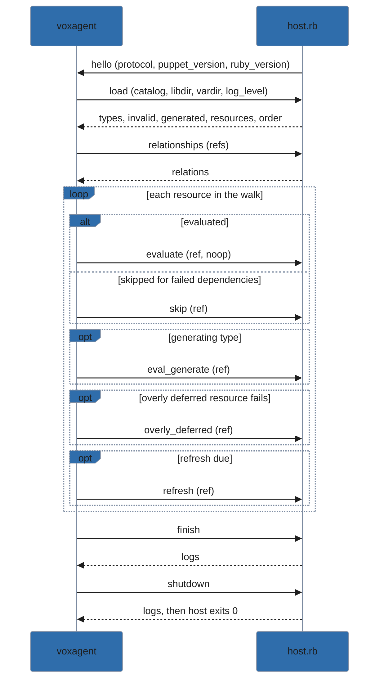

# The Ruby extension host: the protocol

For maintainers. Split out of the [extension host](extension-host.md) notes. Ruby citations are against Puppet 8.10.0. Back to the [README](../../README.md).

Transport and framing (`frame.go`): a 4-byte big-endian length, then a UTF-8
JSON object. A frame over 64 MiB (`MaxFrame`) is refused on both read and
write, and the length is checked before anything is allocated. A stream that
ends exactly between frames is `io.EOF`; inside a frame it is
`io.ErrUnexpectedEOF`. Exchanges are strictly one request, one reply.

Handshake: the host speaks first with `{"hello": {"protocol", "puppet_version",
"ruby_version"}}`. voxagent speaks protocol 1 (`Protocol`) and refuses another.

A request is an object with one key, the operation. A reply is an object with
one key: the operation, or `error`. Every reply body carries `logs`.

| Operation | Request | Reply body (`messages.go`) |
|---|---|---|
| `load` | `catalog` (the bytes voxagent read), `libdir`, `vardir` (voxagent's `--vardir`), `log_level` (required; one of the host's accepted levels, else the host raises) | `types` (per type: `class` `tier3`, `tier2` or `missing`; `origin` `core` or `libdir`; `refreshable`; `eval_generates`; `self_refresh`, only ever on a `tier3` type), `metaparams`, `invalid` (a list of `{ref, message}`), `generated` (a generation, see [Generation](extension-host.md#generation): what the load-time `generate` pass added), `resources` (per ref: `provider_used`; `aliases`, the other refs the resource is known by; `puppet_ref` and `puppet_title`, Puppet's own ref and title when its type overrides title, which `checkLoad` requires to be a ref of the resource's own type that no other resource has; `unresolvable`, set only with `puppet_ref`, when Puppet's catalog cannot look the resource up by its catalog ref), `order` (every resource of the host's catalog, catalog and generated refs alike, in Puppet's catalog order after the generation pass), `logs`, `generate_logs`, `failed_to_generate` |
| `relationships` | `refs` | `relations`: per ref, `require`, `before`, `subscribe`, `notify`, each a list of the OTHER end's refs |
| `evaluate` | `ref`, `noop` | `events` (as `Event#to_data_hash`), `failed`, `skipped`, `unsuitable` (no suitable provider: failed, not skipped, no events, nothing logged), `invalidate_refreshes`, `logs` |
| `skip` | `ref` | the same shape as `evaluate` |
| `eval_generate` | `ref` | a generation, plus `existing` (the refs `eval_generate` returned that the catalog already held), `failed` (it raised), `logs` |
| `overly_deferred` | `ref` | `logs`: the overly-deferred handler's `Provider X is not functional on this host`, or none for a type with no provider, which `finish` then logs |
| `refresh` | `ref` | `refreshed`, `error` (the callback's message, or null), `logs` (the callback's own lines), `exception_logs` (`log_exception`'s lines for a failed callback; empty otherwise) |
| `finish` | none | `logs`: teardown's once-per-type "Could not find a suitable provider", then `post_resource_eval`'s |
| `shutdown` | none | `logs`, then the host exits 0 |

A generation (`Generation` in `messages.go`) is what one generator call did to
the host's catalog: `resources`, the new resources in catalog JSON shape
(`type`, `title`, `tags`, `exported`, `kind`, `parameters`); `containers` and
`generators`, each a map from a new resource's ref to its container's and to
the resource that generated it; `before`, the `{source, target}` values a
generator appended to `before`; and `overrides`, `{ref, parameters,
sensitive}` for each resource that already existed and whose parameters the
generator changed. There is no `generate` operation: `load` runs that pass.
`unsupported`, the earlier list of generating resources, is gone.

Points a reader will not guess:

- `load` is called once. It starts Puppet (`Puppet.initialize_settings` with
  run-private `--confdir` and `--codedir`, the configured `--libdir`, and
  voxagent's own `--vardir`), then classifies every non-container type before
  converting, because `to_ral` turns an unknown type without a `kind` into a
  component (`resource.rb:518-524`).
- The vardir is shared, as an agent run shares one, so what Tier 3 type code
  keeps under `Puppet[:vardir]` lands where the agent's does: simplib's
  `reboot_notify` keeps `reboot_notifications.json` there, and a filebucket a
  type backs up into lives there. `Puppet::Util::Storage` is never stored:
  the harness caches `checked` and `synced` in memory, and only
  `Catalog#apply` stores `state.yaml`, which the host never calls
  ([D-6](apply-spine.md#the-divergence-register)).
- Between reading the catalog and converting it, `load` runs Puppet's own `DeferredResolver.resolve_and_replace`, as `puppet apply --catalog` does (`application/apply.rb:357`):
  - each `Binary` becomes its bytes and a top-level `Sensitive` is unwrapped into `sensitive_parameters` (`pops/evaluator/deferred_resolver.rb:87-118`, `:154-172`)
  - every other rich value (`Timestamp`, `Regexp`, `SemVer`, ...) stays Puppet's own object, which the type's code then handles as on a Ruby agent
  - it is Puppet's code rather than a Go port because the host must hand the type exactly what an agent would
  - voxagent refuses a `Deferred` before the host starts (D-51), so the resolver calls no function and needs no facts.
- `load` converts resource by resource and lists every refusal in `invalid`.
  Puppet stops at the first. This is an improvement over Puppet and is logged
  as I-13 in `improvements.md`.
- `load` also runs Puppet's load-time generation pass (see [Generation](extension-host.md#generation)) and
  answers what it added as `generated`. A `generate` that raises is logged as
  Puppet logs it, makes the resource generate nothing, and sets
  `failed_to_generate`. Its lines are `generate_logs`; lines emitted while
  converting are `logs`. They are kept apart because they go to different
  places (see Lifecycle).
- The host answers refs in the catalog's own spelling. Puppet canonicalises
  `Class[main]` to `Class[Main]` when it reads one (`resource.rb:581-588`), so
  `convert` keeps a map from Puppet's ref to the catalog's.
- There is no `prefetch` operation. The host prefetches lazily inside
  `evaluate` and `skip`, once per provider class, as `transaction.rb:115` and
  `:252-257` do. A prefetch failure is therefore scoped to its provider class.
  `evaluate` on a resource of a failed class returns the event "Prefetch failed
  for T provider 'P'" with `skipped` true.
- `skip` is for a resource voxagent skips for failed dependencies. Puppet still
  runs `pre_process` for it (`transaction.rb:111-121`), so its provider class is
  still prefetched, and a failed prefetch still yields its failure event
  (`:333-339`). voxagent reproduces this through `skip`. It is a quirk, not
  something to simplify away: a resource that is never evaluated can still run
  its provider's prefetch.
- `invalidate_refreshes` travels beside the events because
  `Event#to_data_hash` drops it and `event_manager.rb:82` reads it.
- Events are serialised as the PuppetDB terminus serialises them, not as `Event#to_data_hash` alone would:
  - `event_hash` (`host.rb`) first coerces the event's `status`, `property`, `desired_value`, `previous_value` and `message` strings to UTF-8, with invalid bytes replaced by U+FFFD, the coercion `tests/spine/lib/puppet/reports/gatejson.rb:23-104` reproduces from the terminus
  - without it, an ASCII-8BIT String (a `Binary` parameter's bytes, or anything a provider reads as bytes) would be written as Base64 (`pops/serialization/to_stringified_converter.rb:97-103`)
  - it is the terminus's code because voxagent's report must carry what PuppetDB would receive, and the protocol accepts only valid UTF-8
  - the event gets new values; the strings it shares with its resource are left untouched.
- An `error` reply (`{"error": {"message": ...}}`) is for an exception outside
  Puppet's own rescue. It is `extension.CallError`, and unlike every other
  failure it leaves the host usable: an `evaluate` error fails that resource
  (a `resource_error`), a `load` error is could-not-run.
- Types are keyed lowercase. `load`'s `types` also classifies the types of
  generated resources, which the catalog may not name.

## Validation

`decodeStrict` (`strict.go`) is the deserialization point, and every reply goes
through it:

- bytes that are not valid UTF-8 are refused;
- a `\u` escape that is a lone UTF-16 surrogate is refused, because
  `encoding/json` would otherwise turn it into U+FFFD past the UTF-8 rule;
- an array with more than `MaxItems` (65,536) elements, an object with more
  than `MaxItems` members, or arrays and objects nested more than `MaxDepth`
  (64) deep are refused. `prescan` counts on the raw bytes, one counter per
  open container, before `encoding/json` decodes anything: a 64 MiB frame of
  `{}` would otherwise decode to tens of millions of values first;
- a field the Go struct does not declare is refused
  (`DisallowUnknownFields`);
- anything after the JSON value is refused;
- numbers decode as `json.Number`, so an integer reaches the report verbatim.

`host.go` then checks the decoded reply against the request:

- a reply has exactly one key, and it is the operation or `error`;
- the body is never `null`, which would decode as an empty successful reply,
  and an `error` body needs a non-empty `message`;
- a `refresh` reply either refreshed (`refreshed` true, `error` null) or
  failed (`refreshed` false, `error` set); the host sends only those two
  shapes, and sends `exception_logs` only with an `error`;
- every ref the host names must be in the catalog voxagent loaded (`known`),
  including the targets of auto-relations, and `relationships` must answer
  exactly the refs asked;
- `load`'s types must be in the catalog, with class `missing` and no origin, or
  `tier2`/`tier3` with origin `core` or `libdir`;
- log levels must be Puppet's, and a log line number cannot be negative;
- event statuses must be `success`, `failure`, `noop` or `audit`; `property`
  must be a string or absent, `redacted` a bool or absent; an event needs a
  `name` and a `time`;
- a generation (`checkGeneration`, for `load` and `eval_generate` alike) adds only well-formed resources:
  - a type and a title, no `[` or `]` in the type
  - the type capitalised as Puppet renders one (each `::` segment capitalised, the rest lower case, so `file[/x]` cannot sit beside `File[/x]`)
  - `kind` `compilable_type`, not exported, never a ref already known, an alias, or added twice
  - a `containers` or `generators` key must be a resource it added, and the value a ref known or added by the same generation, as must both ends of a `before` value
  - an override must name a known resource, and mark sensitive only parameters it changes
  - `eval_generate`'s `existing` must be known
  - the new refs join the known set only once all of this passes, so every ref the host names is either in the catalog or made by that same generation, and is never looked up;
- each alias must be a well-formed ref of its resource's own type, not a
  known ref, and not another resource's alias (`checkAliases`);
- `load`'s `order` must name known refs, generated ones included, each once,
  the catalog's own refs in the catalog's order (Puppet only inserts generated
  resources), and, when `invalid` is empty, every one of them (`checkOrder`). A refused
  load's order may omit refs, as the host's catalog holds only resources whose
  conversion succeeded;

A violation is a protocol error: the host is killed (see Lifecycle).

**`MaxItems` is a functional limit.** It applies to every list, including the
log lines one call returns. A resource whose evaluation, refresh or prefetch
logs more than 65,536 lines in one call is a protocol error and kills the host,
like any other violation; it is not raised silently.

**Case-insensitive keys.** `encoding/json` matches field names without regard to
case, so `{"Failed": true}` fills `failed`. This is left alone on purpose: Ruby's
JSON never emits a key in another case, and a case-variant key cannot carry a
value the declared field could not. It is recorded at `decodeStrict` in
`strict.go` and here so nobody mistakes it for an oversight. The `error` and
operation keys are matched exactly, because they are map keys.
