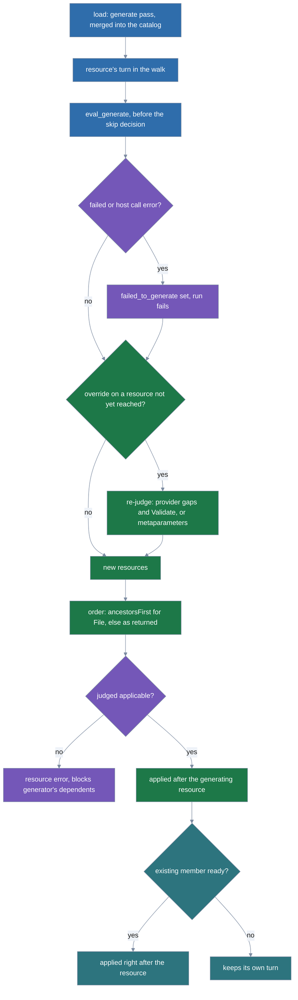

# The Ruby extension host

For maintainers. Back to the [README](../../README.md).

For maintainers. Operators want [the extension host usage page](../usage/extension-host.md). This page says how the code that exists works. Ruby citations are against
Puppet 8.10.0. Go citations are files in this repository.

voxagent applies the types its units serve natively: `augeas`, `concat_file`,
`concat_fragment`, `cron`, `exec`, `file`, `group`, `host`, `mount`, `notify`,
`package`, `service`, `ssh_authorized_key`, `ssh_config`, `sshd_config`,
`sshd_config_subsystem`, `sshkey`, `sysctl` and `user`
(`voxagent units` lists them; see [units.md](units.md)). A unit serves a type
natively only when its `Route` says so for the run, and delegates it here
otherwise, with a reason (the module types are native only against a measured
plugin tree, `user` and `group` only on the measured platform). Every other legacy `Puppet::Type.newtype` type, core or shipped by a
module, is a Tier 3 type and is applied by a Ruby process, the host, that runs Puppet's own
`ResourceHarness` on it. Evaluation, generation, Tier 3 name aliases and
`loglevel => notice` are implemented (see "Generation").

## Responsibilities

| voxagent (Go) | The host (`internal/extension/host.rb`) |
|---|---|
| Reads the catalog, pre-flight, validation and exit status | Converts the catalog with Puppet's own `from_data_hash` and `to_ral`, so Puppet's validation and munging run |
| Builds the graph: stated edges, auto-relations, containment | Answers each resource's four auto-relation blocks |
| Orders the walk, and decides which resources are skipped for failed dependencies | Evaluates one resource with `ResourceHarness#evaluate`, and prefetches lazily |
| Propagates refreshes and writes Puppet's "Triggered", "Would have triggered" and "Failed to call" lines | Runs the `refresh` callback |
| Assembles the report: counts, metrics, resource statuses | Returns each status's events and the log lines Puppet emitted |
| Never calls the host under `--noop` for a refresh | Sets `Puppet[:noop]` for an `evaluate` |

The provider that
fronts the host is `ral.Extension` (`internal/ral/extension.go`). The
walk reaches it through the optional `ral.Evaluator` interface
(`internal/ral/evaluator.go`), so a status Puppet produced is recorded verbatim
and not rebuilt from `Change`s, which would log every line twice and re-word
Puppet's messages. `Apply` on an `Extension` refuses.

Classification is the host's `load` answer, not a scan of the plugin tree
(`cmd/voxagent/extension.go`, `ingestExtensions`). It runs once per run. When
the catalog has no non-native, non-container type, no host starts and the run
is exactly what it was before the host existed.

## The protocol

Moved to [the protocol](extension-host-protocol.md). Its sections:

- [Validation](extension-host-protocol.md#validation)

## Lifecycle

```mermaid
%%{init: {'theme': 'base', 'themeVariables': {
  'primaryColor': '#2f6dab',
  'primaryTextColor': '#1e1e1e',
  'primaryBorderColor': '#7c8ba1',
  'lineColor': '#7c8ba1',
  'edgeLabelBackground': '#eef2f8',
  'tertiaryColor': 'transparent',
  'tertiaryTextColor': '#7c8ba1',
  'tertiaryBorderColor': '#7c8ba1',
  'clusterBkg': 'transparent',
  'clusterBorder': '#7c8ba1',
  'titleColor': '#7c8ba1',
  'noteBkgColor': '#eef2f8',
  'noteTextColor': '#1e1e1e',
  'fontFamily': 'system-ui, sans-serif'
}, 'themeCSS': '.node .nodeLabel{color:#ffffff!important;fill:#ffffff!important;}'}}%%
stateDiagram-v2
  [*] --> Staged: Launch writes host.rb
  Staged --> Refused: SHA-256 mismatch, directory removed
  Staged --> Running: ruby host.rb started
  Running --> Failed: Host.fail on I/O error, timeout, protocol error or validation failure
  Failed --> Failed: every later call returns the first cause
  Running --> Closing: Close sends shutdown
  Failed --> Closing: Close, host already killed
  Closing --> Closed: stdin closed, host exits
  Closing --> Closed: extension-timeout, host killed
  Closed --> [*]: directory removed
  Refused --> [*]
```



`extension.Launch` (`script.go`) stages and starts the host. The sequence:

1. The Ruby path must be absolute. It is configuration and is never looked up
   on `PATH`.
2. `host.rb`, embedded with `//go:embed`, is written to a fresh `0700`
   directory from `os.MkdirTemp`, with a `0700` `state` directory beside it. The
   written bytes are read back and their SHA-256 is compared with
   `HostScriptSHA256`. A mismatch removes the directory and refuses.
3. The host is run as `ruby host.rb <state-dir>`, with the environment from
   `HostEnv` (`env.go`).
4. `Close` removes the directory.

**Environment.** Exactly `PATH`, `HOME`, `LANG`, `LC_ALL`, `GEM_HOME` and
`GEM_PATH`, taken from voxagent's own, and nothing else. When none are set the
host gets an empty environment, never an inherited one (`exec.Cmd` reads a nil
`Env` as "inherit"). `GEM_*` passes because a gem-managed Ruby needs them to find the
puppet gem (measured on the rvm Ruby of the host that runs the G1 gate, see
"What the gates prove"); openvox's own Ruby
does not need them. `RUBYLIB`, `RUBYOPT` and `LD_PRELOAD` do not pass, because
they change what Ruby loads. `HOME` passes because the agent process keeps it;
Puppet strips it only from the commands it executes (`util/execution.rb:387`),
and the host's Puppet already does that.

**Channels.** The host's stderr is voxagent's stderr. The protocol runs on
private duplicates of the host's stdin and stdout, taken before anything else
(`host.rb`, the last block). Fd 1 is then pointed at stderr and fd 0 at
`/dev/null`, and `ARGV` is consumed, so module code that prints, reads `$stdin`
or calls `Kernel#gets` cannot corrupt the framing or read the state directory.
Ruby opens descriptors close-on-exec, so commands Puppet runs do not inherit the
duplicates. `TestHostSurvivesChattyProvider` pins this with `vox_value 'chatty'`.

**Timeouts.** Every call is bounded. `evaluate`, `skip`, `refresh` and
`eval_generate` use `--extension-evaluate-timeout` (default 1h, because
`evaluate` includes the lazy prefetch). Every other call, `load` and its
generation pass included, the handshake, and each half of `Close` use
`--extension-timeout` (default 5m).

**Death, without restart.** Any I/O error, timeout, protocol error or
validation failure goes through `Host.fail`, which records the first cause,
kills the process and closes the parent's ends of the pipes. Closing the pipes
is what unblocks a pending read, because a descendant of the host may hold the
other ends open past the kill. The failure is sticky: every later call returns
it. There is no restart, because Puppet's prefetch cannot be replayed mid-run.
The resources still awaiting evaluation then fail with a `resource_error` naming the
cause, their dependents are skipped, and native resources keep applying.

**Close is time-bounded.** A healthy host is sent `shutdown`; a dead one is
already killed. Then stdin is closed and the process is waited for, for at most
`--extension-timeout`, after which it is killed. `Close` is idempotent. It runs
before the `outcome=` line, which must stay the last line of stderr
(`cmd/voxagent/apply.go`, `done`).

**Where logs go.**

| Lines | Destination |
|---|---|
| `load`'s `logs` (emitted while converting, before any report exists) | stderr, as `voxagent: extension host: <level>: <message>` |
| `load`'s `generate_logs` | the report, first, as Puppet's `generate` runs at the start of `Transaction#evaluate` (`transaction.rb:99-100`) |
| `evaluate`, `skip` and `refresh` logs | the report, with the resource's status |
| `overly_deferred`'s logs | the report, when the walk fails the overly deferred resource, with its status |
| `eval_generate`'s `logs` | the report, at the generating resource's turn, before its new resources |
| `finish`'s logs (teardown: no suitable provider, `post_resource_eval`) | the report, last, as in Ruby's |
| `relationships` logs | validated and dropped |

`failed_to_generate`, and an `eval_generate` answering `failed`, are carried into
the report because Puppet fails the run for them (`transaction.rb:197`).

**Self-report.** After the walk voxagent prints one stderr line: host start-up
time, resources evaluated, time spent in the host. At
ingest voxagent also prints, per Tier 3 type, `N <type> resource(s) applied via
extension host (core|libdir)`. That line is the fallback rate.

**Failure cases before the walk** (`ingestExtensions`; all are could-not-run
with nothing applied):

- `--no-ruby` with a catalog that needs the host, naming the types;
- the host cannot start (no Ruby, bad handshake, hash mismatch);
- `load` or `relationships` fails;
- `generated` cannot be merged into voxagent's catalog (`catalog.MergeGeneration`,
  `internal/catalog/generation.go`, called from `ingestExtensions`), which would be a voxagent logic error, since
  the host already validated it;
- `order` cannot be applied to it (`catalog.ApplyOrder`, the same file), for the same
  reason;
- `invalid` is not empty: each is printed as Puppet's refusal. If voxagent's own
  `Validate` also refused the resource, voxagent's message is used.

A `tier2` (Resource API) type is not given a provider, so pre-flight refuses it
as unimplemented; stderr names it as a Resource API type.

## Auto-relations

```mermaid
%%{init: {'theme': 'base', 'themeVariables': {
  'primaryColor': '#2f6dab',
  'primaryTextColor': '#1e1e1e',
  'primaryBorderColor': '#7c8ba1',
  'lineColor': '#7c8ba1',
  'edgeLabelBackground': '#eef2f8',
  'tertiaryColor': 'transparent',
  'tertiaryTextColor': '#7c8ba1',
  'tertiaryBorderColor': '#7c8ba1',
  'clusterBkg': 'transparent',
  'clusterBorder': '#7c8ba1',
  'titleColor': '#7c8ba1',
  'noteBkgColor': '#eef2f8',
  'noteTextColor': '#1e1e1e',
  'fontFamily': 'system-ui, sans-serif'
}, 'themeCSS': '.node .nodeLabel{color:#ffffff!important;fill:#ffffff!important;}'}}%%
stateDiagram-v2
  [*] --> Unsuitable: no suitable provider
  Unsuitable --> SetAside: evaluate and skip answer unsuitable, nothing logged
  Unsuitable --> Failed: eval_generate member fails at once
  SetAside --> Offered: walk asks again at the next offer
  Offered --> SetAside: still unsuitable, other work placed
  Offered --> OverlyDeferred: a whole drain places nothing else
  OverlyDeferred --> Failed: overly_deferred records status, dependents blocked, never refreshed
  note right of OverlyDeferred: a chosen but unsuitable provider is logged here
  Failed --> Finished: host finish logs a type with no provider at all
  Finished --> [*]
```



`ral.AutoRelating` returns typed relations (require, before, subscribe,
notify). `transaction/build.go` (`autoRequireEdges`) merges them as
`graph/relationship_graph.rb:172-212` does:

- the first edge joining a pair wins, and an edge stated in either direction
  suppresses an automatic one. Automatic edges added earlier count too;
- per resource, in catalog order, the kinds run require, subscribe, before,
  notify;
- require and before edges carry no refresh; subscribe and notify refresh on
  every event.

The host answers `relationships` for every Tier 3 resource, and its answers are
already filtered to resources in the catalog (`type.rb:2076-2113`).

The native `File` also autorequires `User[owner]` and `Group[group]` by name
(`type/file.rb:403-418`; `internal/units/file/file.go`), skipping an owner that is all
digits, and the native `exec` autorequires `User[user]` for a `user` that is
not numeric (`type/exec.rb:642-648`; `internal/units/exec/exec.go`). `user` and
`group` are themselves native on the platform their contract was measured on
(the user and group units' `Route`, the [`user` and `group`](not-implemented.md#user-and-group) section)
and Tier 3 everywhere else, so these edges join two native resources there
and cross the boundary elsewhere; the graph orders them the same either way.

A catalog with a `User` whose `purge_ssh_keys` is anything but `false`, `"false"` or
`[]` sends every `User` to the host, so a native `Group` and host-applied
users can share one catalog (the mixed-routing case of
`tests/spine/report-diff-extension.sh`).

**No suitable provider.** Puppet never evaluates a resource that is not
`suitable?` (`type.rb:1923-1939`): `relationship_graph.rb:116-137` defers it,
and when a whole drain of the ready queue places nothing else
`transaction.rb:124-136` marks it failed, not skipped, with no events and no
time, whatever its dependencies did. `evaluate` and `skip` both answer
`unsuitable` and log nothing; the walk sets the resource aside
(`graph.Walker`) and asks again at its next offer.

When the walk hands it back overly deferred, it calls `overly_deferred`, which
does what Puppet's handler does: a chosen but unsuitable provider is logged
then (`Provider X is not functional on this host`); a type with no provider
at all is logged once, at teardown (`Could not find a suitable provider for
X`), which the host emits from `finish`. The walk records the resource's
status, blocks its dependents, and never refreshes it. A member of an
`eval_generate` unit is failed at once, not deferred (D-56 in
apply-spine.md).

A failed refresh is logged in `event_manager.rb:160-165`'s order: the
callback's own lines, then the walk's "Failed to call refresh: ..." line, then
the lines `resource.log_exception` wrote. The host returns the first and last
groups apart (`logs`, `exception_logs`) so the walk can put its line between
them. G1 compares logs as a multiset, so it cannot see this order;
`TestEvaluatorRefreshFailure` and `TestRealHostRefreshFailure` hold it.

A Tier 3 type that does not respond to `refresh` (`refreshable` false) gets no
refresh and so no "Would have triggered" line (`event_manager.rb:73`).

A type declared `Puppet::Type.newtype(:x, self_refresh: true)`
(`type.rb:2186-2189`; `mount_core`'s `Mount`) answers `self_refresh` in
`load`'s `types`, and `checkLoad` refuses it on any class but `tier3`, because
`register_type` never passes it. After such a resource is evaluated, unless it
failed or its `ensure` is `absent`, the walk queues one refresh to the resource
itself per distinct event name, noop events included, as `event_manager.rb:79`
does. Those count beside what other resources sent, and the resource is
refreshed through `refresh` in the same step. A self-refreshing type with no
`refresh` method is D-58 in `apply-spine.md`.

## Generation



**Where it happens, and why it is Puppet's code.** Puppet generates in two
places. Before the walk, `Transaction#evaluate` runs `generate` on every
resource (`transaction.rb:99-100`), and the generator recurses into, tags,
contains and orders what it makes (`additional_resource_generator.rb:21-53`,
`:131-211`). During the walk, `eval_generate` runs at a resource's turn
(`:56-75`). The host runs both through Puppet's own
`AdditionalResourceGenerator`; voxagent never reimplements a generator.

The load-time pass is part of `load` (`generate_all` in `host.rb`) and covers every
resource in the host's catalog, native ones included; of voxagent's five original
native types none defines `generate` (in Puppet 8.10.0 only `user`, `resources` and
`tidy` do), and a native `concat_file` runs its own only when no host loaded the
catalog (see "`concat`", below). `eval_generate` runs when the walk asks for it.

voxagent observes
the effects: `observe` in `host.rb` reports what the generator call did to the
host's catalog (resources added, each one's container, `before` values
appended, parameters changed on resources that already existed). Puppet does
not track which resource generated which, so the host prepends a module to
its own generator instance that records `add_resource`'s `parent_resource`
(`:137`) and calls `super` with the same arguments.

**At load.** `ingestExtensions` merges `generated` into voxagent's catalog right
after `load` (`catalog.MergeGeneration`, `internal/catalog/generation.go`). New resources
are appended, each `containers` entry becomes a containment edge, `before`
values are appended to the source's `before`, overrides replace parameters, and
each new resource's `GeneratedFrom` is set from `generators`, so its report
status has Ruby's null `file` and `line` (`resource/status.rb:169-170`).

When
`invalid` is empty, the catalog's resources are then put in the host's `order`
(`catalog.ApplyOrder`): Puppet's `add_resource` puts each generated resource beside its
parent in the catalog array, before it for a depth-first type such as `tidy`
and after it, in generate order, otherwise (`additional_resource_generator.rb:36-50`,
`resource/catalog.rb:99-124`), so the walk's catalog-order keys follow Puppet's.

The needed types are then recomputed, because generation can add types the catalog
did not name. The merged catalog goes through pre-flight and validation like
any other, so a generated resource voxagent cannot apply refuses the run before
anything is applied. An override's `sensitive` marks are kept: `catalog.MergeGeneration` adds them to the
resource's own (`Resource.MarkSensitive`), so the merged catalog's event for
that property is redacted (D-8).

**In the walk.** A resource whose provider is a `ral.EvalGenerator` and whose
type has `eval_generates` is a unit, as a recursing native `File` is
(`visitHostUnit`, `internal/transaction/transaction.go`). At its turn, before
the walk decides whether to skip it for failed dependencies, the walk calls
`eval_generate`:

- the answer's logs go into the report at the resource, and `failed` sets
  `failed_to_generate`. A host call that fails is logged at the resource as
  `Failed to generate additional resources using 'eval_generate': <error>`, and
  sets it too;
- each override is applied to the resource if the walk has not reached it yet,
  which is then judged again, as pre-flight would judge it: a native resource
  by its provider's gaps and `Validate`, a resource the host evaluates only by
  the metaparameters the walk would have to honour. A resource that fails is
  refused at its turn, with the reason, as a resource error. An override of a
  resource already applied changes nothing;
- the new resources are applied after the resource, each through its own
  type's provider (`generatedProvider`; a type the catalog never named is
  prefetched at its first new resource, as `transaction.rb:243-260` prefetches
  lazily), and each is judged first, because pre-flight never saw it. They are
  applied in the order `eval_generate` returned them, except that a `File`
  waits for its nearest generated `File` ancestor (`ancestorsFirst`), which is
  the order of Puppet's priorities and ancestor edges
  (`additional_resource_generator.rb:119-135`). A failed new resource blocks
  the generating resource's dependents;
- `existing`, the catalog resources `eval_generate` returned, joins the unit (`visitHostUnit`):
  - a member every other predecessor of which has had its turn is applied right after the resource, and is skipped when the resource is skipped or failed
  - the resource's subscribers are refreshed through the unit, as in Puppet
  - one already applied is not applied again
  - the rest keep their own turn
  - `before` is dropped (`ral.Extension.EvalGenerate`), and so is `generators`: every new resource is marked generated by the resource the walk asked, which is the only parent the host passes to `add_resource`.

The registered limits, in `apply-spine.md`:

- **D-43, the sentinel.** Puppet moves the generating resource's other out-edges onto a `completed_<title>` sentinel that waits for everything `eval_generate` returned, and makes those resources depend on it. voxagent's unit reproduces that for a ready existing member, but its order is fixed before the walk:
  - it does not apply `before` values an `eval_generate` appends
  - a ready member is applied right after its generator, where Ruby keeps the member's own priority
  - a member not ready keeps its own turn and loses its dependency on the generator
  - It is observable for a raw `concat_file` (its `File` is an existing member), which the extension gate covers, and Ruby misbehaves when the returned resource has no edge from the generator, a shape left unmeasured (the detail is in [the divergence register](apply-spine.md#the-divergence-register)).
- **D-42, children voxagent cannot apply.** A new resource is a resource error,
  where Puppet applies it, when its type has no provider in voxagent at all,
  when its judgement refuses it, or when it generates in turn: nested
  generation is run at the new resource's turn, and a new resource whose own
  generation yields resources is refused rather than applied without them. A
  nested generator whose turn is skipped never generates, so its logs,
  `failed_to_generate` and overrides are lost.

**Aliases.** `load` reports, per resource, the other refs it is known by: a
title other than its name makes the name an alias (`catalog.rb:184-219`). The
host leaves out an alias equal to the resource's own ref, as a compiled
`Class[main]` with `name => main` has. `ral.Extension` implements
`ral.Aliasing`, and `resourceAliases` (`internal/transaction/build.go`) adds
them to `File`'s path aliases, so a relationship naming the alias reaches the
resource. A generated ref equal to an alias is a protocol error.

**`loglevel => notice`.** `notice` is Puppet's default level, and `concat`
copies it onto every `File` it generates, natively as well as through the
host. Pre-flight (`ral.ResourceGaps`) and
`ral.MetaparamGaps` accept exactly that value on any type; any other `loglevel`
is still a gap (`internal/ral/check.go`).

**`concat`.** `concat_file` and `concat_fragment` are native, not host types,
when `--libdir` holds puppetlabs-concat 9.1.0 or 10.0.1 (both type files match
a measured digest) and every resource of both types has a measured shape
(the concat unit's `Route`, D-89); then `concat_file`'s `generate` is voxagent's, and
runs only when the host did not load the catalog (`hostLoaded`), since the
host's `load` has already run Puppet's own on every vertex.

Otherwise both
types go to the host, which is the oracle for any release or shape not
measured, and `--no-ruby` refuses the catalog. When the host is loaded for
another type it converts the native concat resources as well and reports
Ruby's refusals beside native validation's, so a fragment `order => 2.0`,
which native alone accepts (D-84), is refused. The native design is in
`apply-spine.md`.

## Updating `host.rb`

`host.rb` is pinned by hash, so changing it takes three steps:

1. Edit `internal/extension/host.rb`.
2. Set `HostScriptSHA256` in `internal/extension/script.go` to
   `sha256sum internal/extension/host.rb`. `TestHostScriptHashIsPinned` fails
   until you do.
3. Run the Ruby tests with a Ruby that can load Puppet, and with the variable
   that makes their absence a failure:

   ```bash
   VOXAGENT_REQUIRE_RUBY=1 go test -count=1 ./internal/extension/...
   ```

Without `VOXAGENT_REQUIRE_RUBY` the tests in `ruby_test.go` skip when no such
Ruby is found (`extensiontest/ruby.go`), and a skip proves nothing about
`host.rb`. `task test` sets the variable through `scripts/run-tests.sh`, so the
suite cannot pass by skipping them. Then run `task dev:report-diff-extension`.

Keep the invariants in the file's own comments: the protocol duplicates are
taken before `require 'puppet'`; `load` runs once; citations are
`path:line` against Puppet 8.10.0.

## The fixture plugin tree

`internal/extension/testdata/libdir/puppet/` holds the host's test types. It
is a pluginsync-style `libdir`: the unit tests point `load` at it, and
`tests/spine/report-diff-extension.sh` copies it into the `libdir` both agents
load from.

| Type | What it exercises |
|---|---|
| `vox_value` | One property backed by a file; `value => fail` makes the setter raise, `chatty` prints to `$stdout`, `STDOUT` and a child process, `die` kills the host. A `refresh` that appends to a log file (and, for `refusing-refresh`, logs a notice then raises). All four auto-relations: autorequires the parent directory, autobefore `Notify[after-<name>]`, autosubscribe `Notify[before-<name>]`, autonotify the `peer` |
| `vox_prefetch` | Two providers. `good` prefetches successfully, and logs from `post_resource_eval`; `bad`'s prefetch raises. Exercises per-provider-class prefetch failure, the skip of the class's later resources, and `finish` |
| `vox_conf` | One provider, `never`, confined away (`confine false: true`). A resource naming no provider has none, one naming `never` has an unsuitable one; both exercise Puppet's deferral of unsuitable resources (`relationship_graph.rb:116-137`, `transaction.rb:124-146`, D-37) |
| `vox_gen` | `generate` returns a `Notify` when `make` is true, sets `before => Class[main]` and returns nothing when `make` is `before`, returns nothing otherwise, and raises when `make` is `raise`. Exercises the load-time generation pass, a generator's appended `before`, and the logged-not-fatal failed generate |
| `vox_evalgen` | `eval_generate` returns `make` (default 1) `Notify`s named `<title>-child-<n>`, and raises when `make` is `raise`. Exercises `eval_generate`, its order and its failure |
| `vox_die` | Its provider kills the host when its value is set, so a host lost mid-run is tested end to end |
| `vox_rapi` | Registered with `Puppet::ResourceApi.register_type`, so `load` classifies it `tier2` |
| `vox_deep` | A depth-first `generate` (`depthfirst?`, as `tidy`'s): Puppet inserts what it makes before the generator in the catalog |
| `vox_secret` | Echoes its parameters in every phase (munge refusals, `sync`, `generate`, prefetch, a failing `refresh`), so the scrubbing of what the host prints is tested |
| `vox_selfref` | `self_refresh: true`: refreshes itself after its own events; the refresh appends to a log under `--vardir`, which proves the host shares it |
| `vox_titled` | Overrides `title` (`name:bootmode`, as `kernel_parameter` does), so `puppet_ref` and `puppet_title` are exercised |

The G1 gate also uses `stdlib`'s `file_line` and `anchor`, and `concat`, from
the vendored modules (`task fleet:vendor`). Every concat in its catalog stays on
the host: it includes a `format => json` `concat_file` and a fragment with
`source`, which native delegates, and the two types move together. Native
concat is gated by G5's concat half and the SIMP gate.

## What the gates prove

`task dev:report-diff-extension` (`tests/spine/report-diff-extension.sh`;
part of `task check`) compiles one catalog, applies it with Ruby's
`puppet apply --catalog` and with voxagent from identical starting state, and
compares the reports with `gatekit compare-reports` and the same allowlist
`dev:report-diff` uses. Exit 0 agrees, 1 diverges, 2 could not run, so a
missing `puppet`, `ruby` or vendored stdlib is never mistaken for agreement.

- **G1** compares the first applies. Besides evaluation it covers generation (concat's cases exercise the host path only):
  - `concat_file`'s load-time `generate` of its `File`
  - `concat`'s `eval_generate` filling that `File`'s content from two fragments declared out of order, and, for a `concat` with no fragments and `create_empty_file => false`, overriding its `ensure` to `absent` over a seeded file
  - `vox_evalgen`'s two new resources and its raising `eval_generate`, and `ge`, whose `eval_generate` returns an existing `File` that is applied in its unit, with a subscriber refreshed through it
  - `vox_gen`'s generated `Notify`
  - `tidy`'s depth-first `generate`, and the `eval_generate` of a recursing `File`
  - a `concat_file` whose fragment `source` is missing, so its `eval_generate` fails on every run
  - a raw `concat_file` whose `eval_generate` returns `File[raw.conf]` as an existing resource, which notifies `Notify['after-raw']`
  - `Notify['needs-alias']`'s `require` of `Vox_value['vn']`, an alias of `Vox_value['vt']`
  - One fragment is `Sensitive`, which makes Ruby redact the generated `File`'s content event; voxagent redacts it the same way through the override's marks (D-8).
- **G2** compares each side's second apply with the other's, and then asserts that the resources which converge changed nothing in voxagent's second report.
  - `vox_prefetch`'s `good` provider never persists state, so `Vox_prefetch[ok]` changes on every run under both agents and the whole fixture cannot be held to "changed nothing".
  - The comparison alone would pass a resource that failed to converge under *both* agents.
  - So `File_line[add]`, `Vox_value[refreshed]`, `Vox_value[notifier]`, `Vox_value[refuser]`, `Vox_value[vt]`, `Vox_value[after-group]`, `Vox_value[after-ge]` and the files that converge must have changed in the first report and be absent (both sides drop a resource nothing happened to, as PuppetDB does) or unchanged in the second; `Anchor[mid]`, the target directory, the seeded file, the `Concat_file` and `Concat_fragment` resources, `Vox_evalgen[g]`, `Vox_evalgen[ge]`, `Vox_gen[loud]`, `Group[nobody]` and `User[nobody]` must be unchanged in both.

Last, both seeded files `concat` replaces or removes are bucketed under its
default `backup => 'puppet'`, and the two agents' clientbuckets must be
byte-identical. Ruby's must hold `c.conf`'s seeded content, or the gate could
not run (exit 2); a voxagent that made no clientbucket diverges (exit 1).

The comparison reports 1279 and 588 leaves compared with 0 divergent (measured
2026-11-20); the gate table in `apply-spine.md` records what it does not prove,
including `--noop`.

Then a `--noop` pass applies one `File` recursion from the reset state with each
side and compares the reports in full (149 leaves, 0 divergent, measured
2026-11-20, openvox 8.33.0): the unit's `Would have triggered 'refresh' from 3
events` notice, which the gate asserts Ruby logged, and every child's noop
event. The fixture's main catalog is not run under `--noop`: its Tier 3
resources agreed in a measured pass (2026-10-07), the native defects that held
it back are fixed (D-10, D-40; D-41 is retired), and it has not been
re-measured.

## What the host refuses

`tier2` (Resource API) types and types that are `missing`, at pre-flight. A
resource generated at load that voxagent cannot apply refuses the run at
pre-flight like a catalog resource; one `eval_generate` makes is a resource
error (D-42).

See also the SIMP gate (`dev:report-diff-simp`, [The SIMP gate](gate-evidence.md#the-simp-gate))
and the [performance note](performance.md).

## Divergences

The extension host's registered divergences are in `apply-spine.md`: D-36 (a
Tier 3 resource skipped for a failed prefetch has `evaluation_time` `0` where
Ruby writes `null`), D-38 and D-56 (a resource with no suitable provider), and
D-42 and D-43 (generation's limits, above), D-51 (a `Deferred` is refused
even on a Tier 3 resource), D-55 (a relationship to a title that Puppet fails to
look up, which `unresolvable` reports) and D-58 (`self_refresh` without `refresh`). Four more cover the host's harness and
report: D-6 (the host keeps Tier 3 checked and synced times in memory and never
writes `state.yaml`), D-39 (only the Tier 3 never-evaluated paths are untimed, so
a type all of whose resources were skipped has a `metrics.time` entry of `0`),
D-78 (the host redacts `Sensitive` values in its refusal and relayed phases) and
D-93 (the host sets no run mode, so a host-applied `augeas` gets lens path `""`
under both commands). The improvement it
records (listing every conversion refusal) is I-13 in `improvements.md`.
