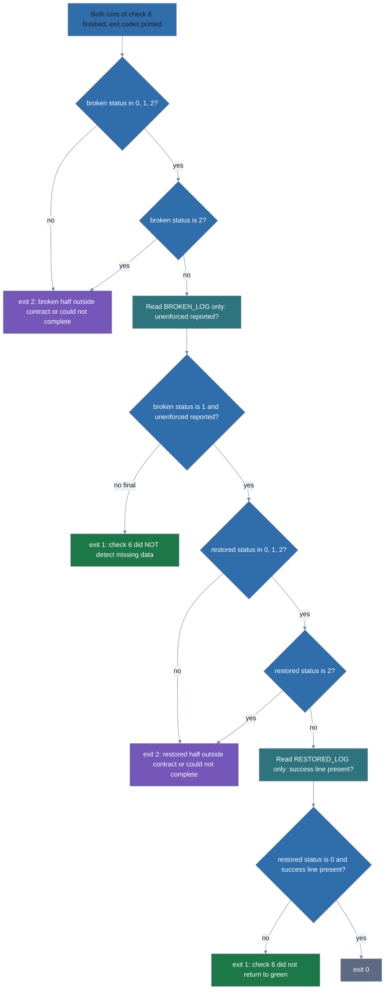
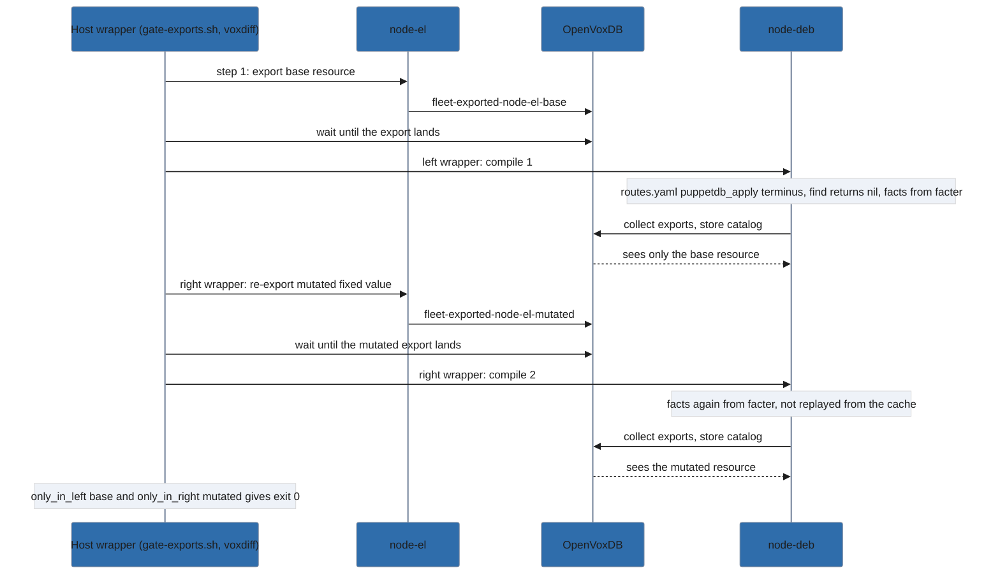
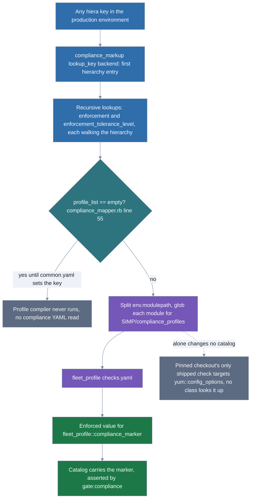
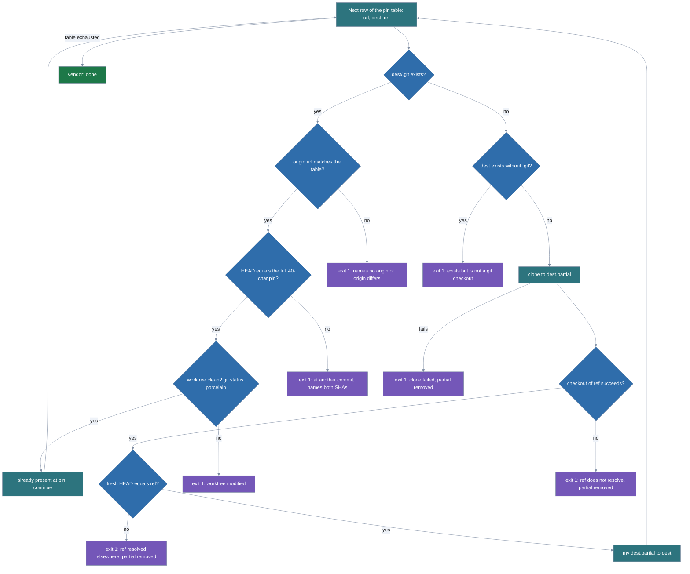

# Fleet harness internals

For maintainers. Back to the [README](../../README.md).

## Why this exists

The harness's completion gate required running `voxdiff` against "the target fleet's real modules
with real node facts". There is no target fleet. The gate was met against public Forge
modules with no hiera, one node, one implementation, and no exported resources — which
proved the harness works, not that the [two-field allowlist](harness.md#why-the-allowlist-is-exactly-two-fields)
holds against realistic data.

This fleet closes those four gaps.

## Environment constraints that are not obvious

Each of these was found by standing the stack up, and each produces a broken or silently
misleading fleet if changed.

- **`ghcr.io/openvoxproject/openvoxdb`, not `puppet/puppetdb`.** Docker Hub's image has
  no PuppetDB 8. OpenVoxDB also matches the OpenVox
  lineage the node images use.
- **`USE_OPENVOXSERVER: "false"`.** Without it the OpenVoxDB entrypoint blocks for up to
  360 seconds waiting for a puppetserver at `https://puppet:8140`. Stage 1, the masterless
  layout `fleet/compose.yml` describes, has no master.
- **`pg_trgm` must exist before OpenVoxDB starts.** Without it OpenVoxDB exits **0** after
  about six seconds. The clean exit code makes this look like success.
- **`logging: driver: k8s-file` on every service.** Podman defaults to journald and this
  environment has none, so `podman logs` returns nothing at all. This is what made the
  `pg_trgm` failure slow to diagnose. Note `log_driver:` is not a recognised compose key.
- **Healthchecks do not fire, so readiness is polled.** Podman schedules healthchecks from
  systemd transient timers and PID 1 here is `bash`, so they never run and
  `depends_on: condition: service_healthy` would wait forever. `compose.yml` therefore uses
  the plain list form of `depends_on`, which orders startup and nothing more, and `fleet:up`
  runs `fleet/bin/wait-for-openvoxdb.sh` to poll the status endpoint for the real readiness
  signal. The one healthcheck that is declared, on `postgres`, is correct on a systemd host
  and inert here — nothing waits on it.
- **Images are built by a script, not by a compose `build:` block.** Inside a nested container the kernel refuses to mount an overlay whose lower layer is itself an overlay with user xattrs, so `podman build` dies before creating any layer.
  - `fleet/bin/build-images.sh` tries the plain build first and retries under `fuse-overlayfs` **only** when the failure output contains `mounting an overlay over build context directory`.
  - The fallback is detected, never assumed: a normal host has working native overlay and may not have `fuse-overlayfs` installed at all, and any other build failure is re-raised rather than retried.

## Why the node layer keys on hostname, not certname

`%{trusted.certname}` derives from the agent certificate and does not populate the same way
in a local compile as it does under a master. `%{facts.networking.hostname}` is unambiguous
in both. If a master is introduced and certname-based data is wanted, that is the point to
revisit it.

## The gate's exit-code contract

`fleet/tests/fleet.venom.yml` drives eight checks, each a `bash` invocation of one script in
`fleet/bin/`. Checks are numbered 1 to 6 in the script headers: 1 is `gate:determinism`,
2 `gate:implementations`, 3 `gate:scan`, 4 `gate:exports`, 5 `gate:axes` and 6
`gate:compliance`; the two negative controls are not numbered. All eight give 2 the same
meaning. `gate:implementations` and `gate:scan` never exit 1, and the other six use all
three codes:

- **0** — the check ran and got the outcome it asserts.
- **1** — the check ran and the fleet did not behave as asserted. This is a *result*.
- **2** — the check could not run at all: a usage error, an unwritable output directory or
  stdout, a stopped container, a truncated scan, an export that never landed, a log that
  could not be read, or a nested run that exited outside this contract.

Keeping 1 and 2 apart is the point. An outage reported as a finding is a false claim about
the fleet, and 2 outranks 1 within a run for that reason: a run that could not complete says
nothing about what the gate can detect.

**Within a run** is the whole of the qualifier, and the two negative controls are where it
bites: each invokes its check twice, and a 2 from one half must not outrank a conclusive
verdict from the other. Both therefore adjudicate one half at a time — could this half
complete? then read *its* log, then judge it — rather than asking once about both. Asked
once, they reported `broken_exit=0`, check 6 staying green with its fixture deliberately
broken and the most alarming result a control can produce, as could-not-complete whenever the
restored half returned 2. That is the same conflation running backwards, a finding announced
as an outage.

The log reads are part of that ordering, not an exception to it, and this is the subtle half.
`fleet_log_contains` exits 2 on a log it cannot open, so a read hoisted above the guards can
end the script before the first half has been judged at all — which is exactly how the first
attempt at this fix reintroduced the defect it was closing. Each half touches only its own
log, and only after its own status has been cleared. The two `*_exit=` lines print before any
of it, because they need no file to be readable and the transcript is worth more than the
tidiness of one echo block.

Reading a gate's log is subject to the same rule everywhere else too. `grep -q` is
three-valued — 0 match, 1 no match, 2 could not read — so `if grep -q ...; then` silently
files an unreadable log under "found nothing". Use `fleet_log_contains` from
`gate-common.sh`, which exits 2 on any status above 1 rather than folding it into the `else`
branch. Call it directly: an `exit` inside a pipeline or subshell kills only that subshell,
which puts the outage straight back where it started.

**Writing is subject to it as well, and that one is easy to miss.** A failed `echo` exits 1
under `set -e`, so an unwritable stdout turns a green run into a finding — measured on
`gate-determinism.sh` with stdout on a full device: exit 1 before the guards, exit 2 after.

The nastier half is on stderr, where the failing command is the outage announcement itself:
`echo "... could not run" >&2` followed by `exit 2` exits **1** instead, so the line whose
only job is to report an outage is what converts it into a finding.

Every `echo`, `printf`,
`sed` and `cat` that writes to stdout or stderr in the gates therefore carries `|| exit 2`,
with two deliberate exceptions — writes inside an EXIT trap keep `|| :`, because an `exit` there
overwrites the status the trap exists to preserve, and `fleet_compile_args`' `printf` is
unguarded because it is only ever called inside `$( )`, where an `exit` would kill the
subshell rather than the gate. `gate-common.sh`'s header sets this out in full.

What each check does with a *result* differs, and deliberately so. The comment block above
the `gate:*` tasks in `.taskfiles/fleet.yml` is the authoritative table; in summary:

- `gate:determinism` — exits 1 when catalogs diverge. Two compiles of one node must agree.
- `gate:implementations` — exits 0 whether the implementations agreed or not. See below.
- `gate:scan` — exits 0 whether or not findings were produced. Findings are reviewed, not
  treated as errors.
- `gate:axes` — exits 1 when a node stops carrying its own hiera data.
- `gate:negative` — exits 1 when `gate:determinism` *fails* to detect a manifest this
  script deliberately broke. It is a test of a gate, not a gate.
- `gate:exports` — **inverted**: 0 when the catalogs *do* diverge, 1 when they do not.
  Every other check reports agreement, so this is the only evidence that the harness can
  detect anything at all. Its assertion is therefore the tightest in the tree rather than
  the loosest: it requires `fleet-exported-node-el-base` on the left and
  `fleet-exported-node-el-mutated` on the right, not merely "the catalogs differ".
- `gate:compliance` — exits 1 when `compliance_markup` enforcement does not reach the
  catalog. The parameter it asserts defaults to `unenforced`, so it asserts the *enforced*
  value rather than a successful compile. See below.
- `gate:compliance-negative` — exits 1 when `gate:compliance` *fails* to detect the module's
  compliance data being renamed away. A test of a gate, not a gate, like `gate:negative`.

### Why the Venom suite calls `bash`, not `task`

`task` does not pass a command's exit status through. Both `exit 1` and `exit 2` surface as
**201** (measured; `task --version` reports the installed Task), so every `result.code` assertion in the suite would
collapse to "non-zero" if the testcases ran `task fleet:gate:...`. The inverted
`gate:exports` code and the 1-versus-2 distinction the whole contract rests on would be
unobservable. The suite therefore invokes each script directly, which is what makes those
assertions mean anything. For a real code at the command line, use `task -x fleet:gate:...`
or run the script.

## What the gates hand to `gatekit`

Everything the gates parse or judge is done by `bin/gatekit` (see
`docs/maintainers/apply-spine.md` for the tool as a whole). `gate-common.sh`
resolves it as `$FLEET_GATEKIT` from its own location -- `GATEKIT` overrides
it -- and `fleet_require_gatekit` refuses a missing or stale one with exit 2,
before anything is compiled or mutated.

| Subcommand | Gate | What it decides |
|---|---|---|
| `fleet-axes RAW MESSAGE TIER PACKAGES` | check 5, `gate-axes.sh` | a node's catalog still carries its hiera axes |
| `fleet-compliance RAW EXPECTED` | check 6, `gate-compliance.sh` | compliance enforcement reached the catalog; 2 when the marker is absent |
| `fleet-facts FACTS NODE` | check 2, `gate-implementations.sh` | a fact capture is complete enough to normalise against |
| `pdb-exported URL TITLE` | `fleet_wait_for_export` | OpenVoxDB holds the export: 0 yes, 1 not yet, 2 the query failed |
| `manifest-mutate MANIFEST ORIGINAL MUTATED` | `gate-determinism-negative.sh` | replaces the one occurrence of the target line, or refuses |
| `fleet-certs DIR` | `task fleet:up`, `fleet_require_certs` (check 4) | when each certificate and the CRL expire; 1 once one has expired |

Three behaviours are easy to get wrong when changing these:

- **Catalogs are read the way voxdiff reads them.** `fleet.LoadCatalog` calls `compile.ExtractJSON`, voxdiff's own code, to skip the Notice line ahead of the JSON.
  - Invalid UTF-8 is accepted here, unlike in the report comparator, which refuses it: a corrupt byte inside a string decodes as U+FFFD and reads as a mismatch, a finding about the fleet; a corrupt byte in the structure is a read failure, exit 2.
  - One divergence from the Python reader: it split the output with `str.splitlines()`, which also breaks on U+2028, U+2029 and U+0085, so one of those raw inside any catalog string made it exit 2 ("Invalid control character"); `ExtractJSON` splits on `\n` only and reads such a catalog.
  - Real catalogs carry none (every gate matched its Python baseline).
- **The fact capture is checked on the host.** Only the voxdiff binary is
  mounted into the nodes, so `gate-implementations.sh` copies each capture out
  to `implementations-NODE-facts.json` in the output directory and checks it
  there. A capture that fails the check skips the node's normalised
  comparison, as before.
- **The manifest is rewritten in place.** It is bind-mounted into all three
  nodes, and a file replaced by rename would leave them reading the old one,
  so `manifest-mutate` truncates and writes the same inode.

## Why the suite lives in `fleet/tests/`, not `tests/`

`.taskfiles/integration.yml` runs `venom run "{{.ROOT_DIR}}/tests"` against the *directory*,
so Venom collects every suite underneath it. A fleet suite placed in `tests/` would silently
enrol itself into `task integration:venom` — the end-to-end suite, which needs no
containers — and would then fail for anyone who skipped `task fleet:up`, looking like a
regression in that suite. `task fleet:gate` names `fleet/tests/fleet.venom.yml` explicitly, so the two
suites cannot leak into each other.

## Why check 2 does not assert equality

Whether OpenVox and the `puppet` gem produce identical catalogs on this data is unknown.
Asserting `IDENTICAL` would convert an open question into a red build the moment reality
disagreed; asserting nothing would waste the run. So the check records the difference count
and asserts only that the comparison completed: it collapses `voxdiff`'s exit 0 and exit 1
into its own 0, and exits 2 — and only ever 2 — when a comparison could not run. It never
exits 1, because a gate that reported an outage with the code it uses for a finding would
make the finding unbelievable.

It compares **implementation and version together**: OpenVox against the puppet gem
(`puppet --version` in each image reports its own version). OpenVox forked and renumbered, so no matching gem version exists. A divergence
reported by this check must not be described as purely an implementation difference.

A third variable, the fact engine, is separated out rather than left in. Each RedHat node is
compared twice — `native`, where each side runs its own fact engine (openfact against
facter, which disagree on real values such as `processors.isa`), and `normalised`,
where both sides compile from one pre-captured fact set through the json terminus that
Puppet uses for facts. The delta between the two difference counts is the fact engine's contribution.
`node-deb` carries a single Puppet implementation by design and so is not compared here;
check 1 covers all three, because determinism is a per-node property.

## Why the exported-resource test mutates a fixed value

Two ordinary compiles of the collector agree, because PuppetDB is unchanged between them.
The negative test therefore drives the change itself. It uses a fixed variant string rather
than a timestamp, because a time-based export would pass or fail depending on how quickly
the two compiles ran — a flaky test in a harness whose purpose is trustworthiness is worse
than no test.

Driving that change costs one extra configuration file, and the reason is not obvious from
the outside. `storeconfigs = true` does not only enable exported resources; it also makes
OpenVoxDB a read-through cache for a node's *facts*, with no expiration. Left alone, that
cache replays `node-el`'s first fact set on every later compile, so writing a new external
fact changes nothing and the negative test quietly reports agreement — the one failure mode
this check exists to rule out. `fleet/code/routes.yaml` selects the
`puppetdb_apply` terminus, a cache terminus from openvoxdb-termini, whose `find` returns nil, so facts come from facter while
the catalog and its exports still reach OpenVoxDB.

This is also the only check that runs `voxdiff` on the **host**. Every other check execs
into a container. A container cannot `podman exec` a sibling, so only a host-side `-right`
wrapper can drive `node-el`'s re-export between the two compiles of `node-deb`. If that
arrangement ever stops working, the fix is not a file-compare mode in `voxdiff` — the design
rules that out — so stop and report instead.

## Why the axes check hardcodes what hieradata already says

`fleet/bin/gate-axes.sh` carries a table of expected messages, tiers and package titles that
restates `hieradata/`. That duplication is deliberate and must not be refactored away.

Every other check in this harness compares a node against itself. If a hiera layer stopped
contributing — a renamed `hieradata/nodes/*.yaml`, a container hostname that no longer
matches `%{facts.networking.hostname}` — all three nodes would converge on the same catalog
shape and every other check would still pass green. `fleet_profile`'s `fail()` cannot catch
it either: degrading to the common layer produces *valid* data, not absent data.

An expectation derived from the same YAML the catalog was compiled from would agree with
whatever that YAML produced, including the degenerate case. Only an out-of-band constant
carries information. The `tmux` vs `screen` column is the sharpest of them: it is the sole
evidence anywhere in the fleet that the per-node layer contributes at all, because `node-el`
and `node-el-alt` share an image, an OS family, and every other hiera layer.

`fleet/bin/gate-determinism-negative.sh` exists for the same reason at one remove. A
determinism gate that has never been observed red is indistinguishable from one that
compares nothing, so the repository re-proves it on every run rather than trusting a step
someone performed once by hand.

## What the `compliance_markup` result does and does not prove

`compliance_markup` is wired as the **first** hierarchy entry in
`fleet/code/environments/production/hiera.yaml`, as a `lookup_key` backend rather than a
data file, so every key in the environment passes through it.

It is genuinely consulted. `puppet lookup --explain` shows the entry running on every key
and issuing recursive `lookup` calls of its own before answering —
`compliance_markup::enforcement` and `compliance_markup::enforcement_tolerance_level`, each
walking the whole hierarchy again. (It rejects `lookup_options` itself with `throw :no_such_key`.) On top of that,
`lib/puppet/functions/compliance_markup/enforcement.rb:51` re-reads the mapper's Ruby from
disk and evaluates it (`instance_eval`) on **every** lookup, unconditionally. That is the
hardest thing the two-field allowlist has to survive, and it survives it: check 1 still
reports `IDENTICAL` for all three nodes with the backend in the hierarchy.

The data-loading path is also under test, but it took two changes to get there and both
were necessary. `lib/puppetx/simp/compliance_mapper.rb:47` looks up
`compliance_markup::enforcement` with a `default_value` of `[]`, and line 55 gates
everything below on `unless profile_list == []`, so until `hieradata/common.yaml` set that
key the profile compiler never ran and no compliance YAML was ever read.

Enforcing a profile alone would still have changed no catalog. The pinned checkout ships
exactly one check, `oval:com.puppet.forge.simp.yum.config_options`, targeting
`yum::config_options` — and no class in this fleet looks that key up. The gate would have
gone green having measured the machinery run rather than its output. So the fleet ships its
own check, in
`fleet/code/environments/production/modules/fleet_profile/SIMP/compliance_profiles/checks.yaml`,
found because `compliance_mapper.rb:166-208` splits `env.modulepath`, globs each module
directory, and reads `SIMP/compliance_profiles` (or lowercase `simp/`) from every hit. That
glob is itself worth having under check 1: module iteration order across a globbed
modulepath is precisely the kind of ordering non-determinism this harness exists to detect.

The parameter it enforces, `fleet_profile::compliance_marker`, is set by **nothing else**.
That is not tidiness. The enforcement backend is first in the hierarchy, so it outranks
every layer beneath it; enforcing `message`, `packages`, `export_resources` or
`collect_resources` would override the per-node and per-OS-family data `gate:axes` pins and
collapse the fleet's two axes — the exact silent degradation this harness was built to
catch, self-inflicted. Its default, `unenforced`, names its own absence, and
`gate:compliance` asserts the *enforced* value, so a modulepath change or a renamed
`SIMP/` directory turns the check red instead of passing quietly.

`gate:compliance-negative` re-proves this on every run: it renames the module's
compliance data away, requires check 6 to exit 1 reporting `unenforced`, restores it, and
requires exit 0 again. Removing `compliance_markup::enforcement` produces the same red and
was verified by hand, but it is not the control, because it only re-proves the
`profile_list` gate that `compliance_mapper.rb:55` makes obvious from its source. The
control exercises discovery instead.

**Read the result narrowly, still.** The compiled profile map holds two parameters —
`fleet_profile::compliance_marker` and the module's own `yum::config_options` — of which
one is ever looked up here.

So what is proven is discovery and evaluation: the compiler
walks the modulepath, reads YAML off disk, merges two modules' compliance data, and lands a
value in a catalog the gate compares, deterministically, on every lookup.

What is *not*
covered is everything above a single scalar check on a single profile: configuration
elements (`ce`), per-check `confine` keys (which match facts or module name and version),
knockout prefixes, `enforcement_tolerance_level`, JSON compliance data,
and any case where two modules' checks contend for the same parameter. A scalar value from
one contributor cannot expose a merge-ordering difference — only a discovery failure. That
is the new boundary.

One related non-feature, recorded so it is not "restored" later: this hierarchy entry was
originally written with `options: {enforcement_defaults: true}`. **That key does
not exist in the module.** It appears nowhere in the pinned checkout and nowhere in its git
history. It was dropped rather than committed as a plausible-looking setting that does
nothing.

## Certificate expiry

`fleet/bin/make-certs.sh` mints the fleet's TLS material once and afterwards
skips whenever the files exist; it does not look at their dates. They do not all
live long:

| File | Lifetime |
|---|---|
| `ca.crl` | **30 days** (the CRL's next-update) |
| node and OpenVoxDB certificates | one year (`--ttl 8760h`) |
| `ca.crt` | five years |

The CRL is the one that bites. Measured on 2026-10-03, a month after minting:
Puppet refused it ("The CRL issued by 'CN=Puppet CA: fleet-ca' has expired"),
and `gate-exports.sh` -- the one gate that talks TLS -- failed with only "base
export failed to compile (exit 1)". Every other gate passed, because none of
them uses TLS.

Expiry is now visible. `gatekit fleet-certs fleet/.certs` lists when each file
expires, warns when one is due within a week, and exits 1 when one has expired.
`task fleet:up` runs it before starting the stack, and `gate-exports.sh` calls
`fleet_require_certs`, which stays quiet while everything is current, prints the
report when something is due or expired, and exits 2 -- could not run -- on an
expiry.

Re-minting is deliberate rather than automatic, because it replaces the CA under
a running stack. From the repository root:

1. `task fleet:down`
2. `rm -f fleet/.certs/ca.crt fleet/.certs/ca.crl`
3. `task fleet:certs`
4. `task fleet:up`

Step 2 sends make-certs.sh down its full-mint path, which replaces the CA directory and
every certificate.

## Vendored module pins

`fleet/bin/vendor.sh` pins all six clones to full 40-character commit SHAs. None of these
repositories publishes tags this fleet can rely on, so raw SHAs are the strongest pin
available. The six are `simp-webrick`, `openvox-ca`, and the four modules under `modules/` (`stdlib`,
`concat`, `simplib`, `compliance_markup`). The four module pins were branch names (`main` or `master`) until they were
replaced with the commits checked out when the eight-check gate was last green — read out of
the working checkouts, so the pinned tree is the tested tree rather than merely a
contemporaneous one.

**Updating a pin is a deliberate act.**

1. Re-vendor from scratch.
2. Run `task fleet:gate`.
3. Record the new commit only once it is green.

Six things stop a pin from quietly failing to
bind. `fleet/tests/vendor-pins.sh` holds every one of them in place — offline, against local
origins, so it is safe to run against a live fleet — via `task dev:vendor-pins`.

- *A pin that stops resolving* cannot degrade into a branch checkout. The guarded `git
  checkout` exits 1 before the `mv`, and the destination is never created — so the fleet has
  no module tree at all rather than the wrong one. Guarded rather than left to `set -e`,
  which carried git's own 128 out of the script and named neither repository nor reason.
- *A checkout that is already there* is compared against its pin on every run, and a mismatch names both SHAs and exits 1.
  - Without that, editing a ref would be a no-op against a populated `fleet/.vendor/`: the script skips any destination that already has a `.git`, so the gate would keep measuring the old trees while `vendor.sh` claimed otherwise.
  - That is the likeliest of the six, and the one that bites hardest when several pins change at once.
  - The comparison is an exact match on the full SHA, so a pin truncated below 40 characters fails loudly rather than binding to whatever happens to be checked out.
- *A checkout from a different origin* is refused. Repointing an entry at a fork or a mirror
  is the same no-op as editing a ref, one column over: nothing read `remote.origin.url`
  until this check existed.
- *A checkout that is at the pin but has been edited* is refused. A commit id names a tree; it does not prove the tree on disk is still that one.
  - This is the sharpest of the six, because `fleet/.vendor/modules` is the modulepath every node compiles against — an added `.pp` reaches every catalog the gate measures, and it is code that exists in no repository at all.
  - `--porcelain` covers untracked files too, which is the half that matters most here — though **not ignored ones**, and Puppet's modulepath does not consult `.gitignore`, so the guarantee is "tracked modifications and non-ignored untracked files", not "nothing has changed".
  - Measured; no live instance, since none of the six vendored trees ignores a Puppet autoload path today.
- *A fresh clone whose ref resolves elsewhere* is refused. `git checkout` accepts an annotated
  tag's own object SHA and a branch name, landing on a commit that is not the pin; the
  creating run now compares HEAD before the `mv`. This is the path every clean checkout and
  every CI runner takes, because `fleet/.vendor/` is gitignored.
- *A destination that exists but is not a checkout* is refused before the clone. It falls
  past the `.git` test, and `mv` into an existing directory **nests** rather than failing —
  measured: exit 0, the clone parked one level down, `vendor: done` printed over a tree
  nothing had replaced. Checked explicitly rather than with `mv -T`, which is GNU-only and
  would make `vendor.sh` depend on a non-POSIX feature it does not otherwise need.

What pinning does and does not buy, stated plainly because a harness about trustworthiness
should not overclaim: a full SHA fixes tree content **given an honest server and an
uncompromised transport**, and git's own object verification rejects content served under a
mismatched id. It attests nothing about *who* produced the commit — there is no signature
check and no pinned remote fingerprint. Pinning here is reproducibility, not authenticity.

**The same debt extends past `vendor.sh`, and this is what is left of it**, worst first:

1. `fleet/images/Dockerfile.el` builds `FROM quay.io/centos/centos:stream10` — a rolling tag
   on a rolling distro. It can move the system ruby and OpenSSL underneath the *gem* Puppet
   install, which is the half of check 2's cross-implementation comparison that the pinned
   `puppet` and `facter` gems exist to protect. Largest remaining hole.
2. Both node images install `openvox-agent` (and `openvoxdb-termini`) from a release
   repository rather than at a version, so the OpenVox version is what a build *produced*, not
   what it *guarantees* — and that is the reference implementation check 2 measures against.
3. `compose.yml` pulls `ghcr.io/openvoxproject/openvoxdb:latest`, which check 4 depends on.
   It also pulls `docker.io/library/postgres:16`, a floating major-version tag.
4. `Dockerfile.deb` builds `FROM docker.io/library/debian:12`; smaller blast radius, since
   that node carries only the agent.
5. Transitive gems beneath `puppet -v 8.10.0` float. `facter` is pinned because it decides
   check 2's headline measurement; the rest do not affect fact values.

The two gems named above are the only versions in the image builds that are pinned
explicitly, and `fleet/images/Dockerfile.el` says why.
