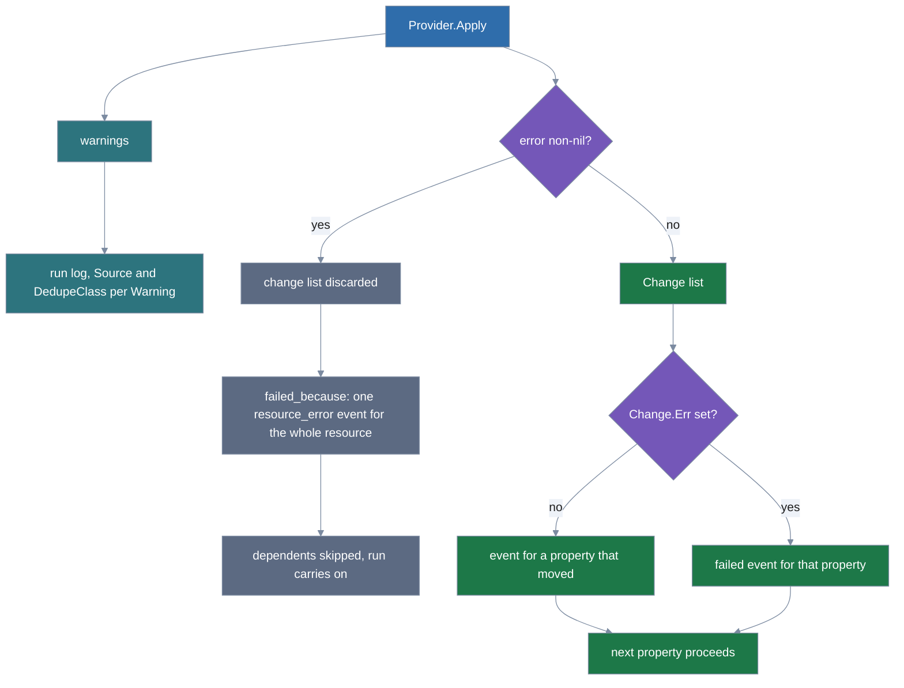

# Maintainer notes: the provider boundary

For maintainers. Split out of the [apply spine](apply-spine.md) notes, which define the terms used here (G1 to G5, Tier 3). Back to the [README](../../README.md).

`ral.Provider` is the only interface the transaction sees, and
`Apply(ctx, r, noop) (changes []Change, warnings []Warning, err error)` has three
return values carrying three different kinds of answer. Which one a provider
reaches is not a style choice; each maps to something different that Puppet's
transaction does with it.

**A `Change` is one property that moved, or one property that was attempted and
failed.** `Change.Err`, when non-nil, means the latter: `Was` and `Is` then
describe the transition that was *tried*, and the transaction builds Puppet's
`change from X to Y failed: …` wording from them. `resource_harness.rb:123`
`sync_if_needed` wraps each property's sync individually and its rescue at `:147`
records a failure event for *that* property and lets the next one proceed — so a
provider must keep going after one property fails rather than returning early.

`Change.WasDisplay` and `IsDisplay` belong to the same value: they change how
`Was` and `Is` are rendered **into the message** without changing the values the
event carries. This is Ruby's `is_to_s`/`should_to_s`, which `previous_value` and
`desired_value` do not go through. Measured: an `owner` event carries
`previous_value` as the integer `1000` while its message reads `'llm'`. Without
the split there is no way to be right about both at once — and getting it wrong
produces a report that looks correct to a human reading the message and is wrong
to anything reading the fields.

`Change.DisplayVerbatim` makes the transaction use `WasDisplay` and `IsDisplay`
exactly as given, empty strings included and with no quotes added, in the
failure line (`change from <was> to <is> failed: …`) and nowhere else; the
provider then owns Ruby's quoting. `user` sets it on every change but `ensure`,
and `group` on `members` only (not `ensure` or `gid`). Their `is_to_s`/`should_to_s` print some values bare and some quoted, and a
group with no members fails as `change from  to nosuchuser failed: …` (M39,
two spaces), which no quoting rule applied by the transaction can produce.

**A bare `error` return means only that no property can be blamed.** It is
Ruby's `status.failed_because` (`resource/status.rb:140`), which synthesizes a
`resource_error` event for the resource as a whole. It is a result about the resource, not about the run:
the transaction records it, skips the resource's dependents, and carries on.
Returning a non-nil error **discards the accompanying change list**, so a
provider must never rely on reporting both — an attributable failure belongs in a
`Change.Err` instead.

**`warnings` exist because a provider had no channel to the run log at all.**
Ruby's `warnonce` (`util/warnings.rb:17`) goes through `Puppet.warning`, the
global logger, so the entry belongs to no resource: it is logged at level
`warning` with source `Puppet` rather than at the resource's path. `package`
made both halves of that sentence too narrow, so `Warning` now carries its own
`Source` and its own `DedupeClass`, independently:

- **Source**, because a warning raised on a *provider instance* is not sourced
  at the resource's path either. `log_source` returns `path` only for a
  `Puppet::Type` or `Puppet::Parameter` (`util/logging.rb:298-302`), and a
  provider is neither, so it falls through to `to_s`, `Package[foo](provider=dnf)`. Only a
  warning raised at class level, as `provider/package/yum.rb:129` does, is sourced
  at the bare class name, measured verbatim as `Puppet::Type::Package::ProviderDnf`.
- **Dedupe**, keyed on the class *and* the message together, which is what
  `maybe_log`'s `@stampwarnings` does (`util/warnings.rb:26-29`: the hash is
  keyed by class at `:28` and tested against the message at `:29`). An empty
  `DedupeClass` means the warning is logged every time it is
  raised, because plain `Puppet.warning` — what package providers actually call
  — does not dedupe at all.

So a condition every `file` in the catalog hits is still reported once rather
than once per resource, and two providers raising different warnings no longer
collide. A provider returns its warning every time it applies and never tries to
remember whether it already has; it is stateless and could not. Reaching Ruby's
*count* is not always the same job as reaching its dedupe: for `package`'s
check-update warning it took resolving once in `Prefetch` as well, because a log
key cannot unspawn a subprocess (D-16).

## Failed flushes, per-run state and prefetch at a type's first turn

The augeasproviders types (below) needed three optional things of the engine
that no earlier type did: a provider that implements none of them behaves as
before. They also turned up two report fixes that hold for every type.

- **A failed flush keeps its changes.**
  - `Apply` may return its changes **and** a `*ral.FlushError`
    (`internal/ral/ral.go`), the one exception to "a non-nil error discards the
    change list" above.
  - Ruby's `resource_harness.rb:23-31` calls `flush` after the properties synced
    and fails the resource on its exception, so the property's `success` event
    is already recorded.
  - The transaction records the changes (lines and events), then the
    `resource_error` event and `Could not evaluate: <message>`, marks the
    resource failed, queues none of its events (no refresh) and blocks its
    dependents.
  - The status is `changed: true`, `failed: true`, `change_count` 1 and
    `out_of_sync_count` 2 (measured: M5, M8). I-35 records that this is a report
    that claims a change the failure undid.
  - Pinned by `internal/transaction/transaction_test.go:TestFlushErrorKeepsChangesThenFails`,
    `TestFlushErrorQueuesNoRefresh`, `TestFlushErrorBlocksDependents`.
- **Per-run state and its teardown.**
  - `Prefetch` still returns the primed provider, and the contract still says it
    does not change during the walk, with one amendment: a primed provider may
    hold a pointer to per-run mutable state that the unprimed value created (the
    augeas handles, sysctl's prefetch table). Only the walk goroutine mutates it.
  - A provider that holds such state implements `ral.RunEnding`, and the
    transaction calls its `EndRun` once after the walk, whether the walk
    finished, was cancelled or a prefetch failed (`Transaction.endRun`).
  - `EndRun` must be idempotent, because primed copies share the state.
  - Pinned by `TestEndRunCalledOnceAfterWalk`,
    `TestEndRunAfterPrefetchFailureAndCancel`, `TestEndRunNotRequiredOfOtherProviders`.
- **Prefetch at a type's first traversed resource.**
  - A provider that implements `ral.TurnPrefetching` is not prefetched before
    the walk. The walk calls its `Prefetch` at the first resource of that type
    it traverses, whether that resource is then evaluated or skipped (failed
    dependency, tag, schedule), as Puppet's `pre_process` does
    (`transaction.rb:110-115`). The code is the lazy path `generatedProvider`
    already used.
  - A prefetch that fails fails every resource of the type, as for any other
    type.
  - This matters for `sysctl`: prefetching before an earlier resource that
    writes `/etc/sysctl.conf` would leave a stale tree that the first save
    writes back over that resource's content.
  - Pinned by `TestTurnPrefetchSeesEarlierResourcesChanges`,
    `TestTurnPrefetchRunsForSkippedResource`, `TestTurnPrefetchFailureFailsEveryResource`,
    `TestTurnPrefetchNotEager`.
- **Two report fixes the type's gate found, which hold for every type.**
  - A resource skipped because its type's prefetch failed was never evaluated,
    so Ruby writes a null `evaluation_time` and `calculate_time_metrics` skips
    it: such a type has no `metrics.time` entry, where voxagent wrote the type
    with 0 (`TestPrefetchFailedTypeHasNoTimeMetric`, commit 601e9b7).
  - `noop_pending` is true when any resource status holds a `noop` event
    (`transaction/report.rb:203-205, :223`), not when the run is `--noop` and a
    resource is out of sync, which a failure event also makes true
    (`internal/report/report_test.go:TestNoopPendingIsAnyNoopEvent`, commit
    d89c82f).
  - In Ruby a resource's own `noop => true` makes a live run record noop events
    too; that path is unreachable here, because a per-resource `noop` stays a
    pre-flight gap (`internal/ral/ral.go`, the engine attributes), so in a live
    run `noop_pending` is false.

## The augeasproviders types

`sysctl`, `ssh_config`, `sshd_config` and `sshd_config_subsystem`
(augeasproviders_core 4.2.0, _sysctl 4.1.0, _ssh 7.0.0) are applied by
`internal/units/augeasproviders_sysctl` (`sysctl*.go`), `internal/units/augeasproviders_ssh`
(`ssh_config.go`, `sshd_config.go`, `sshd_subsystem.go`), over the shared mixin in
`internal/units/augeasproviders_core` (`augeas_mixin.go`), through a cgo
`dlopen` of openvox's own libaugeas, never linked and never the system
`augeas-libs`. Ruby links that same library, so running it on the same files
gives the same lens behaviour, node formatting and error texts by construction;
what voxagent reimplements is the provider code and ruby-augeas' return-value
mapping, so both are fingerprinted (D-91).

- **Routing.**
  - The `Route` of `augeasproviders_sysctl` and `augeasproviders_ssh`
    (`internal/units/*/manifest.go`) answers per type, in this order: the
    fingerprints and provider directory, then the environment and the libdir's
    form, then the library probe (only after the environment is known clean, so
    libaugeas never reads an `AUGEAS_*` override), then the value shapes, then
    for `sysctl` the platform and the command. D-91 lists the conditions.
  - `nativeProviders` (`cmd/voxagent/apply.go`) calls `unit.RouteAll` and
    appends the providers of the native types; the probe is one `augeas.Session`
    (`Env.Augeas`) the units share, so it runs at most once per run and only
    when a unit gets as far as the probe.
  - A type that is not native is delegated as before, with the debug line naming
    the first condition that failed.
- **Handles.** One handle per provider class per run, opened at the class's
  first use with `aug_init(NULL, <loadpath>, AUG_NO_MODL_AUTOLOAD)`. The
  loadpath is Ruby's: `<libdir>/augeas/lenses` when that path exists, else
  NULL, so SIMP's `ssh.aug` is reproduced by libaugeas itself, never read by
  voxagent. `parsed_as?` opens its own short-lived handle with a NULL loadpath.
  `sshd_config` and `sshd_config_subsystem` therefore edit one file through two
  handles with independent trees, as Ruby does. Every call is made from the walk
  goroutine; every handle is registered with the run's `EndRun`.
- **Lazy prefetch.** `sysctl` implements `TurnPrefetching`: at its
  first `Sysctl` it reads every title from the first resource's target through
  the shared handle and runs `sysctl -e` over cumulative slices of the titles;
  `sysctl -n` runs per resource at apply. The other three prefetch nothing.
- **Trace replay is the contract.** The native code must call libaugeas as Ruby
  does, reads included, in the same order with the same arguments and handles.
  - `testdata/augeas/traces/<case>.txt` of the unit that tests the case
    (`internal/units/augeasproviders_sysctl` for 01, `augeasproviders_ssh` for
    02-04 and 07, `internal/units/augeas_core` for the generic augeas cases;
    `augeasproviders_core` keeps copies of the few its tests replay) holds
    Ruby's calls for 36 recorded cases, one call per line (`h<N> <function>
    <args> [=> <rc> <results>]`, the grammar is in
    `internal/lib/raltest/trace.go`).
  - A fake library replays each trace against the native provider and fails on
    any call that differs, and on a trace not fully consumed
    (`TestSysctlReplays01a`, `TestSshConfigReplays07b`,
    `TestSshdConfigReplays03f`, `TestSubsystemReplays04d` and the rest of the
    `Test*Replays*` family; `TestAugopenReplays01aFirstResource` and
    `TestFlushReplays01a` for the mixin).
  - Treat a trace file as read-only: when Ruby's behaviour is in question,
    re-record it.
  - A trace is recorded by an `LD_PRELOAD` interposer that wraps thirteen
    `aug_*` functions, plus five more it logs as `UNEXPECTED` (the `aug_error*`
    family and `aug_label`), and appends one line per call to the file named by
    `AUGTRACE`. Run the real `/opt/puppetlabs/puppet/bin/puppet apply --catalog
    <case>/catalog.json --libdir <libdir>` with `LD_PRELOAD` set, once, live, in
    a fresh container of the augeas image ("G5's augeas half", below) set up as
    the gate sets the case up (modules, libdir, seed). Call `puppet` itself, not
    the `puppet` wrapper script, which unsets `LD_PRELOAD`.
  - The interposer and the recording script are
    `tests/spine/augeas/trace/aug-trace.c` and `trace.sh`; its README says how to
    rebuild the image and re-record a case into the traces directory.
- **Value semantics worth knowing.** A native `sysctl -w` runs before the save,
  so a new key whose live apply fails is not persisted, while an existing key's
  edit stays pending in the shared handle and the next `Sysctl`'s save writes it
  (I-36). Prefetch reads every title from the first resource's target (I-37).
  A failed flush reports a success event beside the failure (I-35). All three
  are Ruby's behaviour, kept because parity is the contract. D-92 records the two
  places the order of observable output differs.

## The generic `augeas` type

`augeas` (augeas_core 2.1.0) is applied by `internal/units/augeas_core/augeas_generic.go` and
`augeas_generic_params.go`, through the same libaugeas and the same trace-replay
contract as the types above. It is routed by the `Route` of `augeas_core`
(`manifest.go`) and is decided on its own: the four augeasproviders types
can be native with `augeas` on the host and the reverse.

- **Routing.** Same order and probe as the four. Its fingerprints are augeas_core's
  type, provider and `puppet_x/augeas/util/parser.rb` plus the shared
  `puppet/feature/augeas.rb` (D-91), and `puppet/provider/augeas/` may hold
  nothing but `augeas.rb`; augeasproviders_core is not required. Absent from
  the libdir, the host cannot load the type either, so pre-flight refuses it as
  before. `parseAugeas` is the shape check; routing and the run share it, so a
  native run never meets a parse error.
- **Lens path by command.** The `augeas_core` `Route` takes the voxagent command
  (`cmd/voxagent/apply.go`). `aug_init` gets `"/"`, the lens path, and flags 64
  (`NO_MODL_AUTOLOAD`) with `incl`, else 32 (`NO_LOAD`). The path is
  `<libdir>/augeas/lenses` for `agent` when it exists, else `""` (D-93).
- **Run contract.**
  - One handle per resource evaluation, opened in retrieve and closed by a
    `defer` in `Apply` where Ruby closes it: in retrieve when nothing needs to
    run, under `--noop` or on any failure, else after sync.
  - Retrieve is Ruby's dry run: `Set /augeas/save newfile`, the commands,
    `Save`, then `/augeas/events/saved` decides whether anything changed, and
    each `<file>.augnew` is deleted (a failure carries libc's `strerror` text,
    as Ruby's `Errno` does).
  - Sync is `Set /augeas/save overwrite`, `Load`, the commands, `Save`.
  - A failed `aug_match` raises Ruby's `Matching path expression` error
    wherever it occurs.
  - `Refreshable()` is false: the type has no `refresh`, and Ruby's event
    manager skips such a target.
  - `show_diff` never prints a diff, as in `file` ([Writing files](apply-spine.md#writing-files)).
  - The binding gained `aug_mv`, the 13th symbol, for `mv` and `move`.
- **Stays on the host.** The type goes to the extension host when any resource
  has a shape native does not reproduce, each for a reason measured or
  unreproducible:
  - `onlyif` (Ruby's Onigmo `=~` and encoding comparisons)
  - `force` (always crashes Ruby)
  - `setm`, `clearm` and `rename` (unmeasured, and ruby-augeas maps their
    failures to silence)
  - `get`, `values`, `match`, `size`, `include`, `not_include` and the
    comparators
  - a `changes` parse error (Ruby's stray `puts` is not reproduced)
  - `changes` that parse to zero commands (unmeasured)
  - a `root` other than `/`
  - a non-empty `load_path`
  - a `type_check` other than `false`
  - a non-zero `returns`
  - `lens` without `incl` or the reverse
  - any byte outside printable ASCII in a command argument, `context`, `incl` or
    `lens` (so no NUL reaches C and Ruby's `Array#inspect` in messages is
    exact)

  An empty argument is printable ASCII and stays native. `incl => ''` counts as
  set, as Ruby's truthiness test treats the empty string
  (`TestAugeasEmptyInclIsSet`); `context => ''` stays `''` even with `incl`.
- **Gates.** G5's augeas half runs the 06 cases (the kmod and resolv.conf
  shapes, SIMP's among them), the run-time failure subset of 06h as
  `augeas-runtime-errors`, `augeas-notified` (no refresh line) and four
  `refuse-augeas-*` cases that must be applied by the host on both sides. The
  SIMP gate asserts `augeas` is not among the hosted types and compares
  `/etc/modprobe.d/blacklist.conf` byte for byte; `/etc/resolv.conf` is a mount
  there, so its resource fails the save on both sides and the reports carry that.
