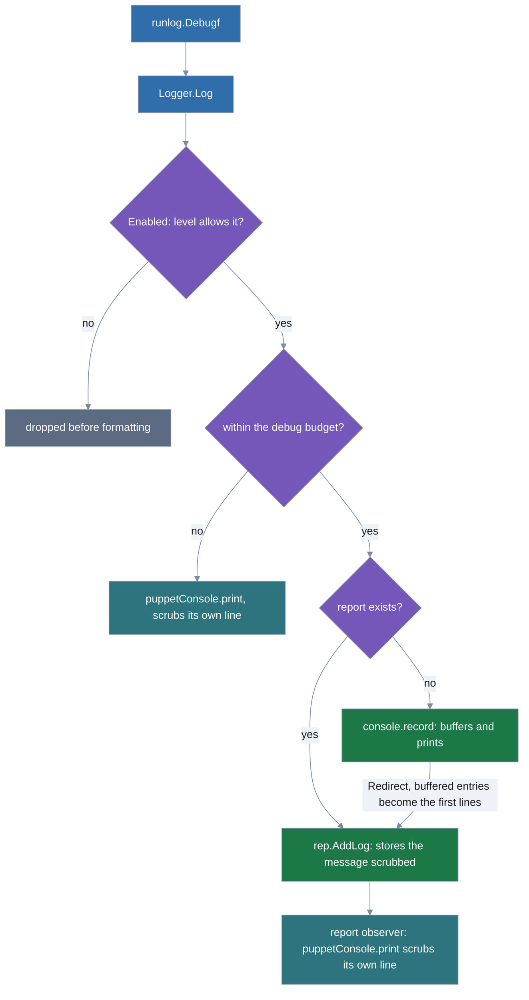

# The run logger

For maintainers. Back to the [README](../../README.md).

How `--verbose` and `--debug` reach the console and the report, and how to add
a debug line. The decisions behind it are D-78 and D-80 to D-82 in
[apply-spine.md](apply-spine.md).

## Wiring



One `*runlog.Logger` serves a whole run. It is carried on the `context.Context`
(`runlog.WithLogger`, `runlog.From`), so a provider emits a line without a
logger argument, and a nil logger is a valid no-op.

```
runlog.Debugf -> Logger.Log (level filter, debug budget)
  -> record: report.AddLog, called as rep.AddLog on the run's report (console.record before it exists)
       stores the message scrubbed (report.SetScrubber)
       -> report observer -> puppetConsole.print scrubs its own line
  -> debug line past the budget: puppetConsole.print only (scrubs it)
```

- **Level.** `logLevel(verbose, debug)` in `cmd/voxagent/console.go` gives
  `notice`, `info` or `debug`; `--debug` wins whatever the flag order. `Enabled`
  drops anything below it before a message is formatted, so `Debugf` with debug
  off allocates nothing (`TestDebugfDisabledAllocatesNothing`'s
  `AllocsPerRun` check in `internal/runlog/runlog_test.go`).
- **Record, then print.** `Log` hands an entry to `record`. The report's
  observer (`report.Report.Observe`, set to `puppetConsole.print` in
  `applyCatalog`) prints every entry the report stores, so a line is stored and
  shown by one path and `rep.Log` calls elsewhere in the transaction print
  without being rewritten. The logger prints directly only a debug line the
  budget refused.
- **Before the report exists.** `agent`'s SSL, pluginsync, facts and catalog
  phases run before `applyCatalog` has a report. The logger records into
  `puppetConsole.record`, which buffers the entry and prints it.
- **`Redirect`.** `applyCatalog` calls `Logger.Redirect` to point the same
  logger at `rep.AddLog` once the report exists, and passes the buffered
  entries to the report as its first lines. Redirect keeps the debug bytes
  already counted, so the budget is one per run, not one per phase.
- **Budget (D-81).** `reportDebugBudget` (16 MiB) counts the bytes of debug
  messages recorded. The first debug line past it is not recorded; one warning
  at source `voxagent` is recorded in its place, and every later debug line is
  printed only. Info and above are never held back.
- **Scrub once per sink (D-78).** `redact.Scrubber.Scrub` is not idempotent, so each sink scrubs exactly once.

  ```mermaid
  %%{init: {'theme': 'base', 'themeVariables': {
    'primaryColor': '#2f6dab',
    'primaryTextColor': '#1e1e1e',
    'primaryBorderColor': '#7c8ba1',
    'lineColor': '#7c8ba1',
    'edgeLabelBackground': '#eef2f8',
    'tertiaryColor': 'transparent',
    'tertiaryTextColor': '#7c8ba1',
    'tertiaryBorderColor': '#7c8ba1',
    'clusterBkg': 'transparent',
    'clusterBorder': '#7c8ba1',
    'titleColor': '#7c8ba1',
    'noteBkgColor': '#eef2f8',
    'noteTextColor': '#1e1e1e',
    'fontFamily': 'system-ui, sans-serif'
  }, 'themeCSS': '.node .nodeLabel{color:#ffffff!important;fill:#ffffff!important;}'}}%%
  sequenceDiagram
    participant P as agent.Prepare
    participant C as puppetConsole
    participant A as applyCatalog
    participant H as extension host load
    participant G as native loadGenerate
    participant E as stderr writers
    participant R as report
    P->>C: decode, scrubber built, scrub set
    Note over C: fetch lines and the Prepare error line scrub here
    A->>A: catalog.Decode, rescrub
    A->>C: scrub set again
    A->>E: stderrf and host stderr use the current scrubber
    A->>H: ingestExtensions
    H->>E: scrubber rebuilt with generated resources
    A->>A: rescrub after host load
    A->>C: scrub set again
    opt host did not load
      A->>G: loadGenerate
      G->>E: scrubber rebuilt after generation
      A->>A: rescrub after native generation
      A->>C: scrub set again
    end
    A->>R: SetScrubber, stores messages scrubbed
    R->>C: observer hands the entry unscrubbed
    Note over C: print scrubs its own line, once
  ```

  - `applyCatalog` builds the scrubber from the decoded catalog (`redact.New`), points `puppetConsole.scrub` at it, and gives the report `SetScrubber(sc.Scrub)`, which scrubs the messages it stores.
  - The observer is handed the entry unscrubbed and `puppetConsole.print` scrubs its own line, which covers the over-budget lines, since they never reach the report's scrubber.
  - `stderrf` scrubs the stderr lines written after the catalog decodes, the whole line, so a title equal to a marked value reads `[redacted]` there (accepted over-redaction).
  - `applyCatalog` rebuilds the scrubber (`rescrub`) after the extension host loads and after native load-time generation, so the host's generated resources' marks count; forms are never removed.
  - On the agent path, `runAgent` points `puppetConsole.scrub` at a scrubber built when `agent.Prepare` decodes the catalog (`RunConfig.Decoded`), so the lines logged before `applyCatalog` (the source fetch's) and `Prepare`'s error line are scrubbed too.
  - The extension host's raw stderr bypasses the logger; D-78 describes the line writer that scrubs it.
- **Extension host.** `load` carries `"log_level"` (`notice`, `info` or
  `debug`), and `host.rb` sets `Puppet::Util::Log.level` from it, so Ruby's own
  debug lines reach the host's log stream only under `--debug`.
  The entries the host returns are already built, so the transaction and
  `applyCatalog` pass them to `runlog.AddLogs`, which sends each through
  `Logger.Entry`: the same level filter and debug budget as `Log`, keeping the
  entry's time, source, file and line. A context with no logger adds them to the
  report unchanged.
- **Command output (D-80).** Not the logger's job: `internal/lib/command/command.go`
  caps every command at 64 MiB and logs the truncation warning through the same
  logger.

## Lines a privilege-dropped helper causes

The `voxagent asuser` helper ([Privilege drop (`voxagent asuser`)](not-implemented.md#privilege-drop-voxagent-asuser)) runs as a user
who can ptrace it, so it never logs: an op logs nothing (`asuser.Write` runs
the flat write under a discarding logger), and the child prints only its
closed `<step> <errno>` result. The parent renders every line the in-process
path would log from that result (`Creating <dir> as <user>`, the flat write's
`err`, the relabel warning) with the same strings and the same `Logger`. A
child-supplied string never reaches the logger, so it can neither forge a line
nor slip a value past the scrub.

## Console format

`puppetConsole.print` writes `<Level>: <message>` for source `Puppet` and
`<Level>: <source>: <message>` otherwise, with no colour. Notice, info and debug
go to stdout; warning and worse go to stderr. `voxagent: outcome=...` is
written by the exit path, after the logger is done, and stays the last stderr
line.

## Adding a debug line

1. **Find the act and its owner.** Read the Ruby line you are matching and the
   voxagent code path that does the same act. If voxagent does not do it, do
   not emit the line: add it to D-82 instead (the register lists what is not
   emitted and why).
2. **Pick the source.** Ruby's source is the object that called `debug`.
   - A provider reads it from `sources.SourcesFrom(ctx)` (`internal/lib/sources`), which the transaction sets before each Apply, Refresh or Evaluator call (type-wide `Prefetch` has no resource, so its `Sources` is zero):
     - `.Resource` for the containment path (`/Stage[main]/Main/Exec[x]`, a parameter or property appends `/<name>`)
     - `.Provider` for the provider form (`Exec[x](provider=posix)`)
     - `.Ref` for `Exec[x]`
   - A line Ruby logs through `Puppet.debug` has source `"Puppet"`.
   - A class method, such as `yum.rb`'s `self.check_updates`, names the provider class (`Puppet::Type::Package::ProviderDnf`), not the resource.
   - Check the source in a measured Ruby `--debug` log, not from memory.
3. **Emit it with `runlog.Debugf(ctx, source, format, args...)`.** voxagent's
   own lines use source `voxagent` and name no parameter value, file content,
   header, certificate, key or HTTP body.
4. **Sensitive check.** If the line interpolates a value the catalog can mark `Sensitive`, it must show Ruby's redacted form when the attribute is marked: look the attribute up with `ral.MarkSensitive` (or the provider's existing `marked` set) and format it through `rubyvalue.RedactIf`.
   - Ruby's forms are `Executing '[redacted]'`, `Executing check '[redacted]'`, `Executing: '[redacted]'`, `'[command redacted]' won't be executed because of
     failed check '<check>'` and one `[output redacted]` line for guard output.
   - A line with fixed text and no interpolated value is not redacted (D-78).
   - The scrub at the sink is a backstop, not a substitute: keep the call-site redaction.
5. **Test the exact text.** Add a unit test beside the provider that pins the
   source and the message verbatim, with a marked case and an unmarked case for
   any line that can carry a value. Then run
   `go test ./cmd/voxagent/ -run TestNoSensitiveMarkerLeaks -count=1`: it
   applies a catalog of marked attributes under `--debug` for `apply`, `apply
   --noop` and `agent`, and fails if a marker reaches the console or the
   report. Add a case there if the line is reachable and names a new
   attribute.
