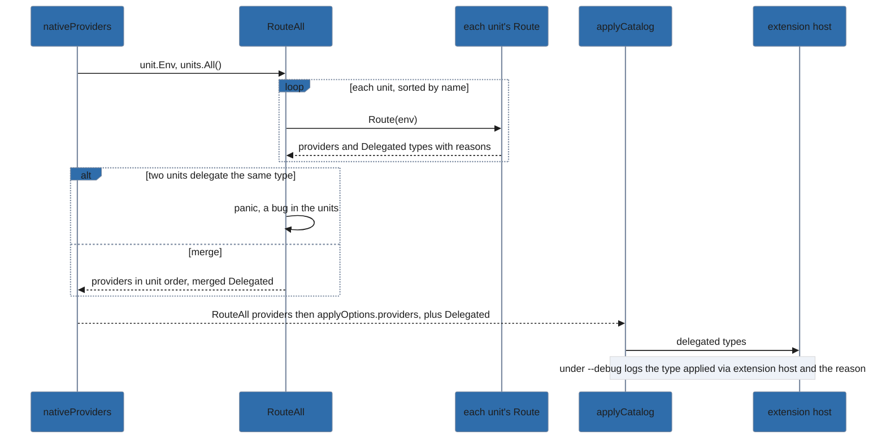
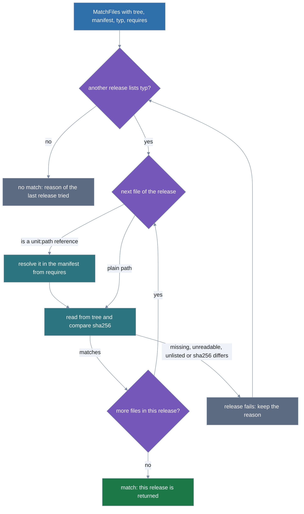

# Units

For maintainers. Back to the [README](../../README.md).

For maintainers. Operators want [the units usage page](../usage/units.md). This page says how the code that exists works: what a
unit is, how units are laid out and routed, and how to add one. Go citations are files in this repository.

## What a unit is

A unit is a Go package under `internal/units/<name>` that reproduces one Ruby origin: either Puppet itself (one unit per
core type: `exec`, `file`, `group`, `notify`, `package`, `service`, `user`) or one Ruby module (`concat`, `cron_core`, `host_core`, `sshkeys_core`, `mount_core`, `augeas_core`,
`augeasproviders_sysctl`, `augeasproviders_ssh`). `augeasproviders_core` is a library unit: it serves no type, and holds
the run object, mixin and fingerprinted files its two dependents share. A unit supplies two things through
`unit.Unit` (`internal/unit/unit.go`):

- `Manifest()`: what it reproduces and which Ruby files it was measured against.
- `Route(env *Env) Decision`: per run, which catalog types it serves natively (`Decision.Providers`) and, for each
  catalog type it leaves to Ruby, why (`Decision.Delegated`). `Delegated` holds only types the catalog contains.

Every unit package exports `Manifest` (a `unit.Manifest` variable in its `manifest.go`) and `Unit` (the `unit.Unit`
that `units.All()` lists). Package clauses drop underscores (`augeasproviders_core` is `augeasproviderscore`);
`internal/units/package` is `pkg` because `package` is a keyword.

## Layering

```text
internal/units/<u>  ->  internal/unit  ->  internal/ral  ->  internal/lib/*
```

`TestImportsWithinRequires` (`internal/units/units_test.go`) reads the imports of every Go file and enforces:

| Package | May never import |
|---|---|
| `internal/lib/*` (including `lib/raltest`, test support) | `internal/ral`, `internal/unit`, `internal/units/*` |
| `internal/ral` (its own files, not subdirectories) | `internal/unit`, `internal/units/*` |
| `internal/unit` | `internal/units/*` |
| `internal/units/<u>` | another `internal/units/<r>` unless `<r>` is in `<u>`'s `Manifest.Requires` |

The same test fails when a directory under `internal/units` is not in `units.All()`. A unit's own subpackage
(`augeasproviders_core/augeastest`) counts as the unit.

Consequences worth knowing before you move code:

- `internal/ral` is the engine: providers' interface, evaluator, transaction support, the extension-host type
  (`extension.go`). `TestRalHoldsNoTypes` fails if any other non-test file declares a `Type() string` method.
  `internal/ral/augeas_checks.go` is the one place that holds the type-neutral checks for augeas routing (`AugeasRunChecks`,
  `AugeasProviderDir`, `HeldAugeas`), because the augeas units (`augeas_core`, `augeasproviders_ssh`, `augeasproviders_sysctl`) use them. `internal/ral/parsedfile_provider.go` is
  the run of the ensurable ParsedFile provider (`PrefetchParsedFile`, `ParsedFileRun.Apply`) for the same reason: host and
  sshkey share it (cron only its prefetch binding), and `lib/parsedfile` cannot hold it because it returns `ral.Change`.
- `internal/unit` cannot import `internal/units`, so `unit.RouteAll` takes the list as a parameter and
  `internal/units/units.go` (`units.All()`) supplies it. `units` is the only package that imports every unit.
- A library cannot import `ral`, so a helper a library needs that is pure (no engine state, no engine-owned interface)
  lives in the library and `ral` imports it (`puppetpath` is one). `plugintree.LibdirTree` is an example of the
  other direction: the cgo probe in `lib/augeas` reads the tree, so the implementation is in `internal/lib/plugintree`;
  outside tests only `lib/augeas` and `cmd/voxagent/apply.go` import it, and `ral` holds just the `PluginTree` interface.
- A package's internal tests cannot import a test-support package that imports that package. Such a test is an
  external test (`package x_test`) or moves to the package it really tests.

### Shared libraries (`internal/lib`)

| Package | Holds |
|---|---|
| `rubyvalue` | Ruby/Puppet value rendering and coercion (`Inspect`, `Integer()` parsing), parameter access, `UnimplementedValue` |
| `puppetpath` | Puppet's clean-absolute-path and file-mode rules, used by `file`, `concat`, `exec`, `augeasproviders_core` and `ral` (`augeas_checks.go`) |
| `suid` | Identity resolution as Ruby's SUIDManager does it: a user and group to a `syscall.Credential`, with Sensitive redaction; used by `exec` and `sshkeys_core` |
| `asuser` | the `voxagent asuser` helper's three file ops (`Mkdir`, `Write`, `Chmod`), its closed `<step> <errno>` result protocol (`ParseResult`) and `ProcStarter`, which runs it as a user and never as uid 0; used by `sshkeys_core` and `cmd/voxagent` (`docs/maintainers/apply-spine.md`, "Privilege drop") |
| `sources` | the per-resource `Sources` context value |
| `command` | running external commands, output capping, shadow and argv runners, `ExecFailure`, executable checks, `RubyWhich` (`Puppet::Util.which`, shared by sysctl and cron) |
| `nameservice` | libc NSS access through cgo (`nss_linux.go`) for `user`, `group` and `cron` (`PosixUID`, `UserByID`, `AllUsers`) |
| `parsedfile` | Puppet's ParsedFile engine: a line grammar, per-run records, targets, and the crontab and flat filetypes. It knows no catalog or unit; `cron_core` (crontab filetype), `host_core`, `sshkeys_core` and `mount_core` (flat filetype) are its consumers (`docs/maintainers/apply-spine.md`, "`cron` and the ParsedFile engine", "`host`", "`sshkey`", "`ssh_authorized_key`", "`mount`"). A consumer's `LineType` (`grammar.go`) may carry two hooks, both `func(*Record) error`. `PostParse` runs on every record of the type after the line parses (Ruby's `fp:276`): returning `ErrNoRecord` makes the line not a record, which fails the parse with a `ParseError` for that line; any other error aborts the whole parse and is returned unchanged (sshkey's leading-whitespace abort, the parsedfile-types design, not kept in the repo). `PreGen` runs on a shallow copy of the record before its line is generated (`fp:341-344`), so it may edit `Fields` and `Flags` without touching the stored record; an error aborts the generation and is returned unchanged (`Grammar.ToLine`). `Run.Flush(ctx, rec, shouldTarget, hasShould)` writes every modified target, as Ruby does; `Run.FlushTargets(ctx, rec, shouldTarget, hasShould, own)` writes only the modified targets in `own` or equal to `rec.Target`, and leaves the others marked for a later flush (D-102 in [apply-spine.md](apply-spine.md)). Only `sshkeys_core`'s sak flush calls `FlushTargets` |
| `plugintree` | `LibdirTree`, reading the plugin tree under `--libdir` |
| `augeas` | the libaugeas `dlopen` probe and `Session` (libaugeas is probed at most once per run) |
| `redact` | scrubbing of the values a catalog marks Sensitive out of text (`Scrubber`); the Go twin of the extension host's redaction in `host.rb`; used by `cmd/voxagent`, not by units |
| `raltest` | test support: fakes, catalog builders, the libaugeas trace replay (`trace.go`). Never imports `ral` or a unit |

`augeasproviders_core/augeastest` is test support inside a unit, not a library: it needs the unit's `Run`, so it cannot
live in `lib`.

## The manifest

`unit.Manifest` (`internal/unit/unit.go`):

| Field | Meaning |
|---|---|
| `Name` | the unit; equals its directory name under `internal/units` |
| `Version` | the unit's own semver, independent of voxagent's (see "Versioning") |
| `Source` | `Origin{Implementation, Version}`: the Ruby implementation reproduced. Core units: `puppet` `8.10.0`. Module units: the module name and an empty `Version` (the versions are in `Releases`) |
| `Oracle` | `Origin` the behaviour was measured against: `openvox` `8.33.0` for every unit but `host_core`, `sshkeys_core` and `mount_core`, measured on `8.34.0` |
| `Types` | the catalog types the unit serves, lower case. Empty for a library unit |
| `Requires` | names of units this one imports; the layering test allows imports of exactly these |
| `Platforms` | `[]ral.OS` the unit's parity was measured on; never empty. `unit.AnyPlatform` (`[]ral.OS{{ID: "*"}}`, matches without reading os-release) for a unit with no platform limit; `user`, `group`, `augeasproviders_sysctl`, `cron_core`, `host_core`, `sshkeys_core` and `mount_core` declare `{ID: "rhel", Like: true, MinMajor: 10}`: RHEL family (`ID` `rhel`, or `rhel` among `ID_LIKE`'s words), `VERSION_ID`'s major at least 10, not Fedora (it has no `ID_LIKE`). Each unit's routes check its own list with `ral.OnPlatform`, which reads `/etc/os-release` and falls back to `/usr/lib/os-release` when that file does not exist; an unreadable or unparsable os-release matches no entry other than `*` |
| `Releases` | `[]Release{Version, Files, Types}`: one entry per measured version of the module's Ruby files |

`Release.Files` lists `FileDigest{Path, SHA256}` (lowercase hex, path relative to the plugin tree). `Release.Types` maps
each served type to the files that must all match for that type: a path in this release's `Files`, or
`"<unit>:<path>"` for a file listed by a required unit's manifest (`augeasproviders_ssh` uses
`augeasproviders_core:puppet/type/augeasprovider.rb`). Manifests use empty slices, not nil (see "Adding a unit"); `nonNil` in `cmd/voxagent/units.go` is a guard that makes the units command print
any nil one as `[]` rather than `null`.

Digests are written once, in the `manifest.go` of the unit whose release lists them. `puppet/feature/augeas.rb` is
listed by both `augeas_core` and `augeasproviders_core` because both measured it.

### The origin rule

`Source` is what the Go reproduces; `Oracle` is what the test evidence was taken against. A core unit's `Source` is
Puppet's own release (no files to fingerprint, so `Releases` is empty). A module unit's `Source.Version` is empty and its
`Releases` is not: a module's Ruby may be any version a site ships, so the unit says which releases it matches and
delegates the rest. `TestManifestsWellFormed` refuses a manifest with neither a `Source.Version` nor a release.

## Routing



`cmd/voxagent/apply.go:nativeProviders` builds one `unit.Env` per run (catalog, `Libdir`, `Tree` from
`plugintree.LibdirTree`, `Platform`, `Environ`, `Command`, `Vardir`, `Sources`, and `Augeas`, a `*augeas.Session` over the
run's libaugeas probe, `LookupEnv`, `os.LookupEnv` over the agent's environment, and `Stderr`, the scrubbed stream a native
provider copies a command's output to) and calls `unit.RouteAll(env, units.All())`.

`RouteAll` (`internal/unit/route.go`) sorts units by name, calls each `Route` once, concatenates the providers in that
order and merges the `Delegated` maps. It panics if two units delegate the same type, because that is a bug in the
units. `nativeProviders` returns RouteAll's providers followed by `applyOptions.providers` (extra providers only tests set), and returns `Delegated` to `applyCatalog`, which sends
the delegated types to the extension host and, under `--debug`, logs `<type> applied via extension host: <reason>` for
each, sorted by type (`cmd/voxagent/apply.go`).

### Fingerprinting: `unit.MatchFiles`



Module units decide whether the libdir's plugin tree is one they measured with
`MatchFiles(tree, manifest, typ, requires)` (`internal/unit/match.go`). It tries each release that lists `typ` and
returns the first whose files all read from the tree with the measured sha256. Every file of one release must match, so a
tree mixing two releases matches neither. Otherwise it returns the reason the last release tried failed:

- `<typ>: no measured release lists it`
- `<path>: not listed in the <unit> manifest`
- `<path>: <read error>` (missing, unreadable, oversized)
- `<path> has sha256 <got>, not the measured <want>`

That text is the debug line's reason, verbatim. `requires` supplies the manifests a `"<unit>:<path>"` reference resolves
in. `concat` matches `concat_file` and passes `nil` for `requires` (`concat_route.go:nativeConcat`); the two augeasproviders
units pass `core.Manifest`.

### After the fingerprint

Each unit's remaining checks are its own, and every failure is a `Delegated` reason, never an error:

- `concat`: value shapes the native parser does not implement (`rubyvalue.UnimplementedValue`) and two `Concat_file`s
  sharing a path (`concat_route.go`).
- `user`, `group`: the measured platform and libuser (`group.UnmeasuredReason`), a `provider` other than
  `useradd`/`groupadd` (`group.ForeignProvider`), and value shapes the native parser does not implement; `user` also
  `purge_ssh_keys`. `user` requires `group`, whose helpers it calls.
- `augeas_core`, `augeasproviders_sysctl`, `augeasproviders_ssh`, checked in this order:
  - fingerprints
  - provider directory (`ral.AugeasProviderDir`)
  - the environment (`ral.AugeasRunChecks`: no `AUGEAS_*`/`LD_*` override, clean `--libdir`)
  - the probe
  - value shapes
  - then (sysctl) the unit's `Platforms` (`ral.OnPlatform`) and an executable `sysctl` on `PATH`, `/usr/sbin` or `/sbin` (`command.RubyWhich`: `PATH` entries first, then those two, first executable wins)
  - The probe comes after the environment checks so libaugeas never reads an `AUGEAS_*` override. `Env.Augeas.Probe()` runs the probe at most once per run, however many types hold it, and the sysctl and ssh units get one shared run from `core.SharedRun(env.Augeas, libdir)` (`augeasproviders_core/augeas_mixin.go`, whose `Run.EndRun` closes every handle).
- `cron_core`, checked in this order:
  - the measured platform (the unit's `Platforms`, `ral.OnPlatform`)
  - an executable `crontab` (`command.RubyWhich`: `PATH` entries first, then `/usr/sbin` and `/sbin`, first executable wins, a `~` entry before a hit delegates)
  - a `provider` other than `crontab` (`group.ForeignProvider`; the unit requires `group`)
  - the plugin tree (none of the three files is in `--libdir`, so the 1.3.0 that openvox itself ships (the "vendored" copy) applies natively; otherwise `MatchFiles` for 1.3.0 or 2.1.0; and no second provider file under `puppet/provider/cron/`)
  - a `Resources` purge of `cron`
  - then value shapes (`rubyvalue.UnimplementedValue`)
  - The release it found is passed to the provider (`cron_core/manifest.go:Route`, `pluginRelease`). It also reads `Env.LookupEnv` and `Env.Stderr`, which no other unit uses.
- `host_core`, checked in this order:
  - the measured platform (the unit's `Platforms`, `ral.OnPlatform`)
  - `/etc/hosts` existing, following symlinks (`ral.Platform.FileExists`, Ruby's `confine exists:`)
  - a `provider` other than `parsed` (`group.ForeignProvider`; the unit requires `group`, and `file` for `file.BucketBackup` and `file.RelabelHook`)
  - the plugin tree (none of the two files is the vendored 1.3.0, else `MatchFiles` for 1.3.0, and no provider file under `puppet/provider/host/` but `parsed.rb`: `checkTree`)
  - a `Resources` purge of `host`
  - value shapes (`rubyvalue.UnimplementedValue`)
  - One release covers both openvox's vendored 1.3.0 and SIMP's 2.1.0, whose two files are the same bytes (`host_core/manifest.go:Route`).
- `sshkeys_core`, each type decided on its own, checked in this order:
  - the measured platform (the unit's `Platforms`, `ral.OnPlatform`; neither type has a confine)
  - a `provider` other than `parsed` (`group.ForeignProvider`; the unit requires `group`, `file` for `file.BucketBackup` and `file.RelabelHook`, and `user` for `user.PurgeKeepsNative`)
  - the plugin tree (neither of the type's two files is the vendored 2.5.0, else `MatchFiles` for 2.5.0 or 3.1.0, and no provider file under `puppet/provider/<type>/` but `parsed.rb`: `typeRelease`)
  - a `Resources` purge of the type
  - for `ssh_authorized_key`, any `User` whose `purge_ssh_keys` generates keys
  - value shapes (`rubyvalue.UnimplementedValue`) under the release found
  - Each type is fingerprinted by its own two files; the release found selects 3.1.0's `sshkey` `key` check and is passed to the provider (`sshkeys_core/manifest.go:Route`, `routeSshkeyType`, `routeSakType`).
- `mount_core`, checked in this order:
  - the measured platform (the unit's `Platforms`, `ral.OnPlatform`)
  - executable `mount` and then `umount` (`command.RubyWhich` over `PATH`, as the provider's `commands` confine resolves them; the resolved paths are passed to the provider)
  - a `provider` other than `parsed` (`group.ForeignProvider`; the unit requires `group`, and `file` for `file.BucketBackup` and `file.RelabelHook`)
  - the plugin tree (none of the three files is the vendored 1.3.0, else `MatchFiles` for 1.3.0 or 2.1.0, and no provider file under `puppet/provider/mount/` but `parsed.rb`: `pluginRelease`)
  - a `Resources` purge of `mount`
  - value shapes (`rubyvalue.UnimplementedValue`)
  - then, when the catalog holds a `File`, every valid Mount's munged name a portable regular expression (`portablePattern`: Ruby compiles it into each `File`'s autobefore pattern). A Mount that fails validation is skipped in that last check: Ruby refuses it at catalog conversion, before compiling any pattern (`mount_core/manifest.go:Route`).
- `exec`, `file`, `notify`, `package`, `service`: native on every run.

D-87, D-89, D-91, D-94 and D-98 in [apply-spine.md](apply-spine.md) say what is measured and why each condition delegates.

## Versioning and changelog

Each unit starts at `1.0.0` and bumps only when its own behaviour or manifest changes; it is independent of voxagent's
version. The changelog is a `Changelog:` line in the unit's package doc comment (for example `internal/units/file/file.go`:
`1.0.0 — moved from internal/ral`). `TestManifestsWellFormed` checks `Version` is semver; nothing checks the changelog,
so a reviewer must.

## Adding a unit

1. Create `internal/units/<name>/` with the type code, a package clause that drops underscores, and a package doc with a
   `Changelog:` line.
2. Write `manifest.go`: `Manifest` (`Name`, version `1.0.0`, `Source`, `Oracle`, `Types`, `Requires`, `Platforms`, `Releases`; use `[]string{}`
   and `[]unit.Release{}` rather than nil), `Unit`, and a `Route`. For a module, put the measured Ruby files under
   `testdata/lib` (so they are in the layout `--libdir` has) and list their digests in `Releases`; use `unit.MatchFiles`
   in `Route`.
3. Register it in `units.All()` (`internal/units/units.go`), in name order.
4. Add a row for each type to `nativeFixtures` in `internal/units/units_test.go`: the minimal resource that makes the type
   route native.
5. Import only `ral`, `lib/*`, `unit`, `catalog`, `runlog`, `report` and the units named in `Requires`. If a helper you need is in `ral` and pure, move it
   to a library rather than breaking a layering rule.

The unit-wide tests then impose, with no further wiring:

| Test (`internal/units/units_test.go`) | Requires |
|---|---|
| `TestImportsWithinRequires` | the layering above; the unit is in `units.All()` |
| `TestManifestTypesAreRoutedTypes` | with every unit's `testdata/lib` assembled into one libdir, `RouteAll` returns a provider for each `Types` entry and delegates nothing |
| `TestDigestsOwnedByManifests` | no empty digest; each digest appears in the Go sources only in the `manifest.go` of the units listing it |
| `TestManifestsWellFormed` | unique names, semver, directory exists, `Requires` are listed units, `Platforms` is not empty, module units have releases; for a unit that has releases, `Types` equals the union of its releases' types and no type lists no files (a core unit with no releases is not checked) |
| `TestRalHoldsNoTypes` | no `Type() string` in `ral` outside `extension.go` |

The `voxagent units` output ([units usage page](../usage/units.md)) is the manifests, so a new unit appears in it with no further change
(`cmd/voxagent/units.go`, tested by `cmd/voxagent/units_test.go`).

## Adding a platform to a unit

1. Measure the unit on the new platform's oracle image, as the unit's measurements README does for the current one.
2. Add the `ral.OS` entry to that unit's `Platforms` only. Set `Like` only when derivatives keep the parent's numbering.
3. Add a route-test row for that platform.
4. Run the unit's G5 half on that image (G5 is the container gate described in [What the gates do and do not prove](gate-evidence.md)).
5. Bump the unit's `Version` minor and add a changelog line.
6. When `augeasproviders_sysctl`'s list changes, update its delegation reason in `internal/units/augeasproviders_sysctl/manifest.go` (it names RHEL family 10 or later and "Fedora excluded") and the matching expectation in `TestRoutesHonourOwnPlatforms`.
