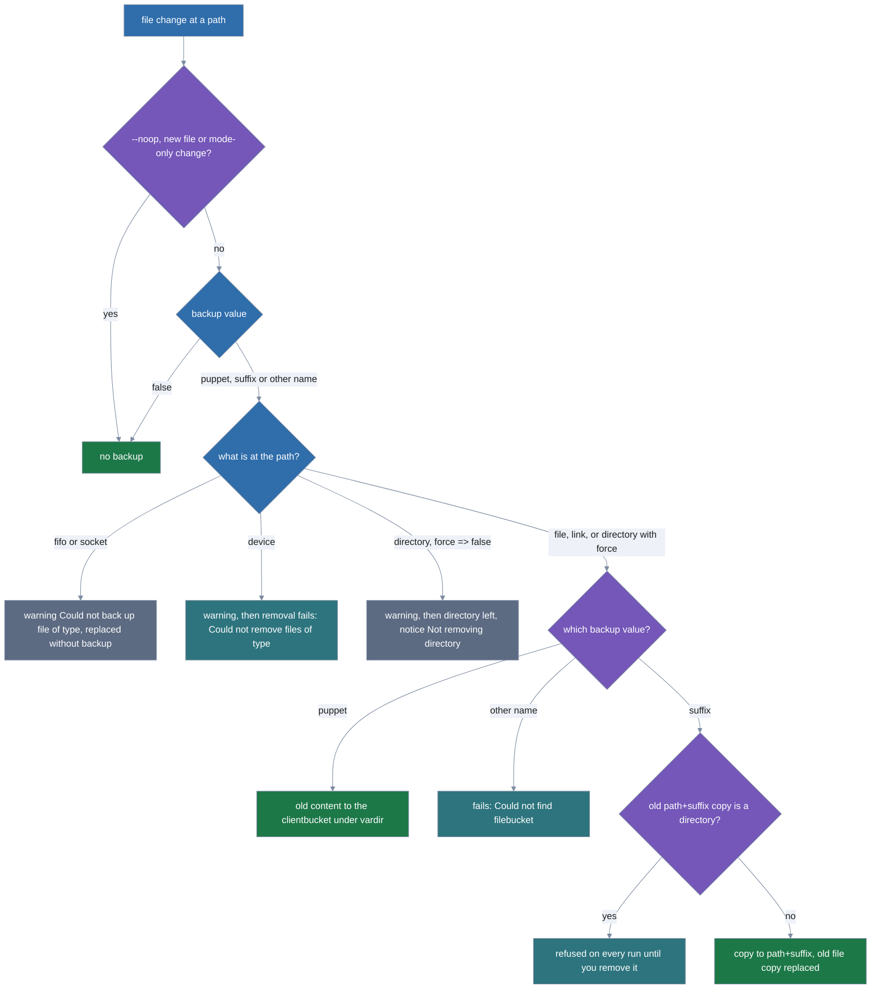

# File backups and validation



For operators. Back to the [usage index](README.md).


`backup` defaults to `false`, as in Puppet 8. A backup is taken just before a
`file` replaces or removes what is at its path, or rewrites an existing file's
content; never for a new file or a mode-only change, and never under `--noop`.
A backup that cannot be made fails that change and leaves the path as it was.
The exception is a path Puppet cannot back up at all, under any `backup` value
but `false`. A fifo or socket there only gets the warning `Could not back up
file of type <type>` and is then replaced without a backup, as Puppet does. A
device gets the same warning, but its replacement then fails with `Could not
remove files of type <type>`. A directory without `force => true` also gets the
warning, and is then left in place with the notice `Not removing directory; use
'force' to override`.

- **A suffix** (`true` is `.puppet-bak`) copies the path to `<path><suffix>`,
  keeping mode, owner and times; a directory is copied whole, but only with
  `force => true`. An old copy that is a file is replaced. One that is a
  directory refuses the resource on every run with `Will not remove directory
  backup <path><suffix>; use a filebucket`, as Puppet does, until you remove it.
  Do not follow that advice: declaring a `filebucket` refuses the whole catalog
  (see `puppet` below). Remove the directory, or use `backup => 'puppet'`.
- **On a filesystem where root does not own the directories it makes** (NFS
  with `root_squash`), a suffix backup of a directory is refused: voxagent
  cannot tell the directory it made from one swapped in by someone else, so it
  writes nothing into it and leaves it, empty and `0700`. Later runs then meet
  the refusal above. Remove it with `rmdir '<path><suffix>'` (which only removes
  an empty directory), and give such a resource `backup => false` or
  `backup => 'puppet'`.
- **`puppet`** stores the old content in the local clientbucket,
  `<vardir>/clientbucket`, byte for byte as Puppet writes it (the
  [gates](../dev/gates.md) compare the two).
  - Set the vardir with `--vardir` (default `/opt/puppetlabs/puppet/cache`,
    Puppet's); it is created if missing.
  - A directory's files are bucketed one by one.
  - A symlink anywhere under the clientbucket fails the resource instead of
    being followed (Puppet follows it).
  - Any other bucket name fails the resource with `Could not find filebucket
    <name> specified in backup`.
  - A catalog that declares a `filebucket` resource is refused before anything
    is applied (exit 2, or 1 under `--detailed-exitcodes`), even one named `puppet`: `file`'s backup implements
    only the default bucket, so it could not use the declared one.

`validate_cmd` runs before new content replaces a file, against a temp file
beside it, and the file is replaced only when the command exits 0. Every
`validate_replacement` (default `%`) in the command becomes the temp file's
path; without one the command runs with no file argument and validates
nothing, as in Puppet. The command runs as the user running voxagent, in its
working directory, with no timeout, as Puppet runs it; nothing runs under
`--noop`. Its environment drops `HOME`, `USER`, `LOGNAME` and the locale
variables and sets `LANG=C` and `LC_ALL=C`. Its `PATH` is voxagent's own:
Puppet appends any missing `/usr/sbin` and `/sbin`, voxagent does not, so name
the validator by its full path. For example:

```puppet
file { '/etc/sudoers.d/ops':
  content      => "%ops ALL=(ALL) NOPASSWD: ALL\n",
  validate_cmd => '/usr/sbin/visudo -c -f %',
}
```
