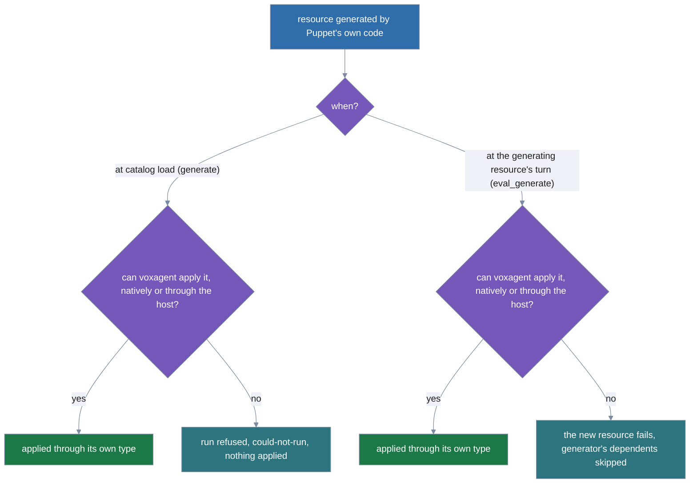

# Ruby extension host

For operators. Back to the [usage index](README.md).


A catalog may hold types voxagent does not apply natively on this run: `User` and
`Group` off the platform they were measured on, module types whose plugin tree
it does not recognise, other types that modules ship, `file_line` from stdlib. If they are legacy
`Puppet::Type.newtype` types (called Tier 3 types below), voxagent starts one Ruby process, the extension
host, which loads them and evaluates each with Puppet's own code. voxagent keeps
the ordering, refresh propagation and the report. A catalog with only native
types never starts Ruby.

```bash
./bin/voxagent apply --catalog catalog.json \
  --ruby /opt/puppetlabs/puppet/bin/ruby \
  --libdir /opt/puppetlabs/puppet/cache/lib
```

| Flag | Default | Meaning |
|---|---|---|
| `--ruby <path>` | `/opt/puppetlabs/puppet/bin/ruby` | Interpreter for the host. Must be an absolute path and able to load the `puppet` gem. It is never looked up on `PATH` |
| `--libdir <dir>` | `/opt/puppetlabs/puppet/cache/lib` | The pluginsync directory the host loads types from. voxagent does not read `puppet.conf` |
| `--vardir <dir>` | `/opt/puppetlabs/puppet/cache` | Puppet's vardir, shared with the host. `backup => 'puppet'` keeps the old content in `<dir>/clientbucket`, as Puppet's `clientbucketdir` does, and Tier 3 types keep their own state there (below). The default is root's openvox cache, so a run as another user that backs up to `puppet` (every `File` concat generates does), or that applies Tier 3 types, needs `--vardir` set to a directory it can write |
| `--no-ruby` | off | Refuse any catalog that needs the host, naming the types. No interpreter is started |
| `--extension-timeout <d>` | `5m` | Limit for each host request other than evaluating a resource |
| `--extension-evaluate-timeout <d>` | `1h` | Limit for each resource's evaluation, which includes the provider's prefetch |

Durations are Go durations (`90s`, `5m`) and must be positive.

What to expect:

- stderr names each type the host will apply, with its resource count and where
  the type came from (`core` or `libdir`), and, after the last resource, prints one
  line giving the host's start-up time, the resources it evaluated and the time
  spent in it. The `outcome=` line stays the last line on stderr; its value is
  `applied`, `changed`, `failed` or `could-not-run`.
- The host shares `--vardir`, as an agent run does, so Tier 3 types write
  their own state there, such as simplib's `reboot_notify` and its
  `reboot_notifications.json`. A non-root run with Tier 3 types therefore needs
  a writable vardir. voxagent never writes Puppet's `state.yaml` there.
- The host runs with only `PATH`, `HOME`, `LANG`, `LC_ALL`, `GEM_HOME` and
  `GEM_PATH` from your environment. Module code runs as the user running
  voxagent, with the trust that Puppet places in pluginsynced code. The host's own
  stdin is `/dev/null`, and what module code prints goes to stderr.
- Puppet's own log lines for those resources are in the report. A host that
  fails or does not answer in time is killed, not restarted: the Tier 3
  resources not yet evaluated fail, their dependents are skipped, native
  resources keep applying, and the run reports failures.
- Resources a type generates are applied. A type can generate resources before
  the run (`generate`), which the host does when it loads the catalog, or during
  the run (`eval_generate`, which `concat` uses), which the host does at the
  generating resource's turn. Either way Puppet's own code generates them, and voxagent
  applies each new resource through its own type, natively when it is one of
  the native ones. A resource `eval_generate` makes that voxagent cannot apply
  fails, and the generating resource's dependents are skipped, rather than
  being half-applied; one generated at load refuses the run (below).
- A Tier 3 resource can be referred to by its name as well as its title, as in
  Puppet.
- Refused before anything is applied, with could-not-run: `--no-ruby` on a
  catalog that needs the host, a host that cannot start (no Ruby, or one that
  cannot load Puppet), a resource Puppet itself would refuse (every one is
  listed, where Puppet stops at the first), a Resource API type, an unknown
  type, and a resource generated at load that voxagent cannot apply.



Exit codes follow Puppet's, measured rather than assumed. Plain `puppet apply`
exits 0 for changes *and* for failures — its status says only that the tool ran
— so voxagent does the same, and `--detailed-exitcodes` carries the verdict as
Puppet's 0/2/4/6 bitmask. "Could not run" takes the value each mode leaves free:
`2` plain, `1` under the flag. Every run prints `outcome=` to stderr so you
can read the status without knowing whether `--detailed-exitcodes` was passed.

One case differs from Puppet on purpose. A relationship naming a Tier 3
resource by a title Puppet cannot look up, because the resource's type
rewrites its title (`Kernel_parameter[fips]`, which Puppet names
`Kernel_parameter[fips:all]`), is refused before anything is applied, as
could not run (`2`, or `1` under `--detailed-exitcodes`):
`voxagent: Failed to apply catalog: Could not retrieve dependency '<ref>' of
<ref>; nothing applied`. Puppet prints the same error, applies nothing,
writes a failed report and exits `0`, even under `--detailed-exitcodes`.
