# Running against an OpenVox server

For operators. Back to the [usage index](README.md).


`voxagent agent` is one Puppet agent run: it enrols with the server's CA,
fetches what the catalog needs, applies the catalog with the same spine as
`voxagent apply`, and reports back. There is no daemon; run it from a timer
(below).

```bash
sudo ./bin/voxagent agent --server puppet.example.com --detailed-exitcodes
```

On a new node the first run submits a certificate request and exits
could-not-run (with the default `--waitforcert 0`), applying no catalog: sign
the request on the server (`puppetserver ca sign`, or autosign), then run the
agent again.

One run does, in Puppet's order:

1. **SSL bootstrap** under `--ssldir`: downloads the CA, the CRL and, on a
   first run, submits a CSR for `--certname` and fetches the signed
   certificate. A steady-state run does not request a certificate.
2. **Node request**: the server's classification may override
   `--environment`.
3. **Pluginsync** of the `plugins` and `pluginfacts` mounts into `--libdir`
   and `--pluginfactdest`.
4. **Facts** from `facter`, sent with the catalog request.
5. **Catalog request**, then every `puppet:///` source in it is fetched
   before anything is applied.
6. **Apply**, through the Go spine and, for Tier 3 types, the Ruby extension
   host.
7. **Report**: `PUT` of the run's report to the server.

Run it as root, on a node with `openvox-agent` installed: `facter` and the
Ruby the extension host loads come from that package, at the default paths in
the table below.

| Flag | Default | Meaning |
|---|---|---|
| `--server` | `puppet` | Server host name. The server certificate must name it. |
| `--serverport` | `8140` | Server port. |
| `--certname` | the FQDN, lower case | This node's certificate name. |
| `--environment` | `production` | Environment to request; the server's node classification may override it. |
| `--ssldir` | `/etc/puppetlabs/puppet/ssl` | CA bundle, CRL, key and certificate. |
| `--ca-fingerprint` | unset | Pin the CA; see below. |
| `--waitforcert` | `0` | Poll interval while the certificate is unsigned, in Puppet's syntax: seconds (`120`) or a number with `s`, `m`, `h`, `d` or `y` (`30s`, `2m`). `0` exits instead of waiting. Puppet's default is `2m`. |
| `--facter` | `/opt/puppetlabs/puppet/bin/facter` | Absolute path of the facter binary. |
| `--libdir` | `/opt/puppetlabs/puppet/cache/lib` | Pluginsync target; the extension host loads types from here. |
| `--pluginfactdest` | `/opt/puppetlabs/puppet/cache/facts.d` | Pluginsync target for external facts. |
| `--vardir` | `/opt/puppetlabs/puppet/cache` | Holds the run's downloaded `puppet:` sources and the clientbucket. |
| `--ruby` | `/opt/puppetlabs/puppet/bin/ruby` | Ruby for the extension host. |
| `--no-ruby` | off | Refuse catalogs that need the extension host. |
| `--extension-timeout` | `5m` | Limit per extension host request other than evaluate. |
| `--extension-evaluate-timeout` | `1h` | Limit for each evaluate request sent to the extension host. |
| `--http-timeout` | `2m` | Limit per HTTP request, including reading the response. |
| `--noop` | off | Report what would change without changing it. |
| `--detailed-exitcodes` | off | Puppet's exit bitmask. |
| `--verbose` | off | Also log info-level lines, to the console and the report. |
| `--debug` | off | Also log debug-level lines; implies `--verbose`. See [Log levels](logging.md). |
| `--report-dir` | unset | Also write the run's report to this directory. |

Defaults are Puppet's compiled-in settings; `puppet.conf` is not read.
`voxagent agent --help` is the authority on the flags.

**Console output.** The run's log lines are printed as Puppet's console prints
them, without colour: `Notice: <message>`, or `Notice: <source>: <message>`
for a resource's line. Notice, info and debug lines go to stdout; warnings and worse
(`Warning:`, `Error:`, ...) go to stderr. The level is Puppet's default,
notice; `--verbose` lowers it to info, for the console and the submitted
report alike, so `--verbose --detailed-exitcodes` is the equivalent of
`puppet agent -t`; `--debug` lowers it to debug. voxagent's own progress and
error lines go to stderr prefixed `voxagent: `, ending with the

```mermaid
%%{init: {'theme': 'base', 'themeVariables': {
  'primaryColor': '#2f6dab',
  'primaryTextColor': '#1e1e1e',
  'primaryBorderColor': '#7c8ba1',
  'lineColor': '#7c8ba1',
  'edgeLabelBackground': '#eef2f8',
  'tertiaryColor': 'transparent',
  'tertiaryTextColor': '#7c8ba1',
  'tertiaryBorderColor': '#7c8ba1',
  'clusterBkg': 'transparent',
  'clusterBorder': '#7c8ba1',
  'titleColor': '#7c8ba1',
  'noteBkgColor': '#eef2f8',
  'noteTextColor': '#1e1e1e',
  'fontFamily': 'system-ui, sans-serif'
}, 'themeCSS': '.node .nodeLabel{color:#ffffff!important;fill:#ffffff!important;}'}}%%
stateDiagram-v2
  [*] --> DownloadCA: first run, no saved ca.pem
  DownloadCA --> PinCheck: ca.pem received, fingerprint logged
  PinCheck --> CouldNotRun: --ca-fingerprint mismatch, nothing saved
  PinCheck --> SubmitCSR: match, or no pin given
  SubmitCSR --> Unsigned: certificate not yet signed
  SubmitCSR --> SteadyState: certificate already signed
  Unsigned --> Unsigned: --waitforcert above 0, poll at that interval
  Unsigned --> CouldNotRun: --waitforcert 0, sign the request and rerun
  Unsigned --> SteadyState: request signed
  SteadyState --> PinCheck: ca.pem loaded or CA refreshed, pin rechecked
  class DownloadCA,PinCheck,SubmitCSR,Unsigned sysA
  class SteadyState sysB
  class CouldNotRun sysF
  classDef sysA fill:#2f6dab,color:#ffffff,stroke:#7c8ba1
  classDef sysB fill:#1d7848,color:#ffffff,stroke:#7c8ba1
  classDef sysC fill:#7457b8,color:#ffffff,stroke:#7c8ba1
  classDef sysD fill:#2d747e,color:#ffffff,stroke:#7c8ba1
  classDef sysE fill:#4d68c4,color:#ffffff,stroke:#7c8ba1
  classDef sysF fill:#5c6a82,color:#ffffff,stroke:#7c8ba1
```

`voxagent: outcome=<status>` line.



**Trust on first use.** Like Puppet, voxagent downloads the CA certificate on
first contact without being able to verify it, and logs its fingerprint. A
network attacker present at that moment could substitute their own CA, so pass
`--ca-fingerprint` on the first run (and keep passing it): the SHA-256 of the
root CA certificate's DER, in hex, colons optional.

```bash
openssl x509 -in ca.pem -outform DER | sha256sum
```

Run it on a copy of the root CA certificate that you obtained out of band, for
example by copying the CA certificate file from the server. Do not use the
`certs/ca.pem` under `--ssldir` that the agent saves on its first run: it was
downloaded unverified.

`openssl x509` reads the first certificate in the file; if the CA has an
intermediate, use the self-signed root.

This is **not** Puppet's `ca_fingerprint` setting, which digests the PEM of
the whole bundle; a value copied from Puppet will mismatch. A mismatch saves
nothing and the run exits could-not-run. The pin is also checked every time
`ca.pem` is loaded and on every CA refresh. After the first run, every request
to the server is verified against the saved CA, the server's name, and the CRL,
except the CA and CRL refreshes, which (as Puppet) do not check revocation.

Because the agent runs as root and loads pluginsynced Ruby, it refuses to run
if `--libdir`, `--pluginfactdest`, `--vardir`, the facter binary, or any
parent directory of them is writable by anyone but root or the running user,
or if the key, the node certificate, `ca.pem` or `crl.pem` is owned by someone
else or writable by group or world, or if the private key is world-readable.
Pluginsync fails closed: any error stops the run before facter or the
extension host loads anything.

Exit codes are those of `voxagent apply`, described in [the extension host page](extension-host.md). Any failure before
the catalog is applied (network, TLS, pluginsync, a source that cannot be
fetched, a compile error) is could-not-run, nothing is applied, and no report
is sent. A report that cannot be sent is logged and does not change the exit
code.

Scheduling: with systemd, a oneshot service and a timer; with cron, a line.
Both examples run `/usr/local/bin/voxagent`: install the binary there first,
for example with `sudo install -m 0755 bin/voxagent /usr/local/bin/voxagent`.

```ini
# /etc/systemd/system/voxagent.service
[Service]
Type=oneshot
ExecStart=/usr/local/bin/voxagent agent --server puppet.example.com --ca-fingerprint <sha256> --detailed-exitcodes
SuccessExitStatus=2

# /etc/systemd/system/voxagent.timer
[Timer]
OnBootSec=2min
OnUnitActiveSec=30min
RandomizedDelaySec=5min
[Install]
WantedBy=timers.target
```

After writing the units, run `sudo systemctl daemon-reload` and then
`sudo systemctl enable --now voxagent.timer`.

For cron, an `/etc/cron.d/voxagent` line does the same (cron ignores the exit
status):

```text
*/30 * * * * root /usr/local/bin/voxagent agent --server puppet.example.com --ca-fingerprint <sha256> --detailed-exitcodes
```

`SuccessExitStatus=2` is because `--detailed-exitcodes` returns 2 for "changes
applied". `RandomizedDelaySec` stands in for Puppet's splay. Two runs at once
are allowed (there is no run lock); a oneshot unit cannot overlap itself.

Not implemented: daemon mode, splay, a run lock, cached catalogs (a down
server fails the run), `puppet.conf`, static catalogs, HTTP proxies
(proxy environment variables are ignored), `server_list` failover, certificate
renewal, CA rotation, `csr_attributes.yaml`, `last_run_summary.yaml`, and
SPIFFE or catalog signing. The deliberate differences from `puppet agent` are
registered as D-59 to D-77 in
[`docs/maintainers/apply-spine.md`](../maintainers/apply-spine.md); how it is
built is in [`docs/maintainers/agent-transport.md`](../maintainers/agent-transport.md).
