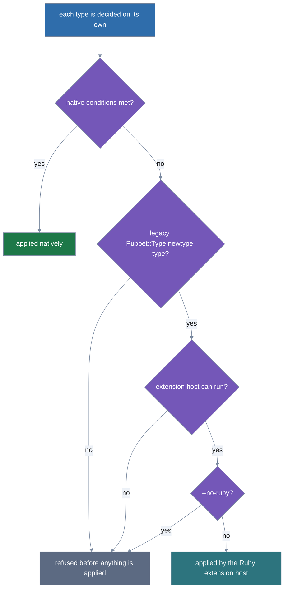
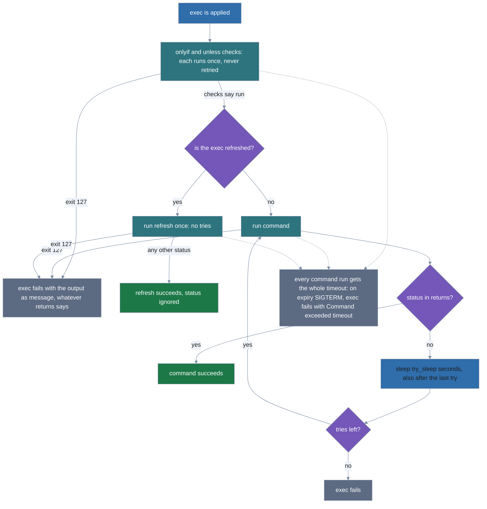

# What voxagent applies



For operators. Back to the [usage index](README.md).

Five resource types, each with a bounded attribute set:

- `notify` (`message`).
- `file` (`ensure`, `content`, `mode`, `owner`, `group`, `source`, `recurse`,
  `purge`, `path`, `replace`, `force`, `links`, `target`, `show_diff`, `backup`),
  with these details:
  - `mode` is octal (`0644`) or symbolic (`u+rwX,g-rwx,o-rwx`), computed for each path from
    its current mode and whether it is a directory, as Puppet computes it.
  - `source` is an absolute path or a `file:` URI, or a list of them.
  - `recurse`, `purge`, `replace` and `force` are `true` or `false`; `links` is `manage` or `follow`.
  - `ensure` also takes `link` (with `target`) or a path to link to.
  - `show_diff` is accepted and has no effect.
  - `backup` is `false`, `true` (the suffix `.puppet-bak`), a suffix starting with `.`, or
    `puppet`, the local clientbucket under `--vardir`.
  - `validate_cmd` checks new content before it replaces the file, run against a temp file
    beside it whose path replaces every `validate_replacement` (default `%`), and is
    refused with `recurse => true`.
  - `seluser`, `selrole`, `seltype`, `selrange` and `selinux_ignore_defaults` manage
    SELinux contexts, see below.
- `exec` (`command`, `path`, `cwd`, `returns`, `refreshonly`, `creates`, `onlyif`,
  `unless`, `logoutput`, `refresh`, `environment`, `umask`, `timeout`, `tries`,
  `try_sleep`, `user`, `group`, described below), with these details:
  - A `command`, or an `onlyif` or `unless` check, given as an argv array runs with no
    shell, a string through `/bin/sh -c`.
  - `logoutput` is `true`, `false` or `on_failure`, the default, and logs the command's
    output a line at a time at notice level, whenever it is `true` and when the exit
    status is not in `returns` if it is `on_failure`.
  - Output fails the exec, as Puppet does, when it is invalid in the locale's encoding.
    That encoding is US-ASCII unless `LC_ALL`, `LC_CTYPE` or `LANG` names a UTF-8
    codeset. Locales Ruby resolves differently are listed in D-79 of
    `docs/maintainers/apply-spine.md`.
- `package` (`ensure`, `name`, `provider`; dnf only).
- `service` (`ensure`, `enable`, `start`, `stop`, `status`, `restart`, `hasstatus`,
  `hasrestart`, `name`, `provider`), systemd only:
  - `enable` is `true` or `false` (`mask`, `manual` and `delayed` are refused).
  - A catalog with a `service` is refused whole on a host whose PID 1 is not systemd.

Two more, `user` and `group`, are applied natively, through shadow-utils (`useradd`,
`usermod`, `userdel`, `chage`, `chpasswd`, `groupadd`, `groupmod`,
`groupdel`) as Puppet's `useradd` and `groupadd` providers do, only on a
RHEL-family host of major release 10 or later that is not Fedora (Fedora has no `ID_LIKE`)
(`/etc/os-release` `ID` is `rhel` or `ID_LIKE` lists it; `/usr/lib/os-release` is read
instead only when `/etc/os-release` is missing, not when it is unreadable) and does not have
libuser's `/usr/sbin/luseradd` and `/usr/sbin/lgroupadd` both installed.

Each type is decided per
run, on its own: it stays with the Ruby extension host when any of its
resources names a `provider` other than `useradd` or `groupadd`, and `user`
does when any `user` sets `purge_ssh_keys` to anything but `false`, `"false"` or `[]`.

Every attribute either type declares is accepted, and those its provider
does not support (`forcelocal`, and the Solaris, AIX, BSD and macOS ones) are ignored, as
Puppet ignores them. Everywhere else `user` and `group` need the extension
host, and `--no-ruby` refuses a catalog that has them.

`cron` (puppetlabs-cron_core, the `crontab` provider) is applied natively, through `crontab -l` and
`crontab -`, on a RHEL-family host of major release 10 or later that is not Fedora (Fedora has no `ID_LIKE`), with `crontab` on `PATH`,
`/usr/sbin` or `/sbin`, when every `cron` leaves `provider` unset or sets it to `crontab`, and the libdir holds no cron_core
(openvox's vendored 1.3.0 applies) or holds cron_core 1.3.0 or 2.1.0 (identified by the digests of its type and two
provider files).

Every `cron` attribute is accepted. A `Resources` resource that may purge `cron`, and a few value
shapes Ruby fails with Ruby-version-specific texts (a non-String `command`, and under 1.3.0 a time-field element that is not a String or Integer and an
`environment` entry that is not a String), send the type to the extension host.

Elsewhere `cron` needs the extension
host, and `--no-ruby` refuses a catalog that has it. `--debug` logs why. Values are written as Puppet writes them:
a line break in a `cron` value becomes extra crontab lines, as under Puppet.

`host`, `sshkey`, `ssh_authorized_key` and `mount` (puppetlabs-host_core, sshkeys_core and
mount_core, over voxagent's ParsedFile engine) are applied natively on a RHEL-family host of major release 10 or
later that is not Fedora (Fedora has no `ID_LIKE`).

Each is decided on its own, and it needs: for `host`, `/etc/hosts` to exist; for `mount`,
`mount` and `umount` on `PATH`, `/usr/sbin` or `/sbin`, and, when the catalog holds a `File`, mount names that hold none
of `\`, `(?`, `{` and `[`; every resource leaves `provider` unset or sets it to `parsed`; a libdir that holds none of the module
(openvox's vendored release applies) or a measured one (host_core 2.1.0, mount_core 1.3.0 or 2.1.0, sshkeys_core 2.5.0
or 3.1.0, identified by file digests), and no other provider of the type; no `Resources` resource that may purge the
type; for `ssh_authorized_key`, no `User` whose `purge_ssh_keys` would purge; and no value shape the native parser
does not implement.

Elsewhere the type needs the extension host, and `--no-ruby` refuses a catalog that has it.
`--debug` logs why. As under Puppet, a line break in a value Puppet does not refuse is written verbatim
(`improvements.md`, I-39).

**Security note: `voxagent asuser`.** `ssh_authorized_key` writes a user's `authorized_keys` as that user, as Puppet
does. voxagent does it by starting a child, a hidden subcommand it runs from its own binary
(`/proc/self/exe asuser`), with the user's real and effective ids. The child creates the directory, writes the file
and sets its mode, and prints one `<step> <errno>` result line; the parent parses only that line and quotes nothing
else from the child.

The child never runs as uid 0 and refuses to start when its effective uid is 0. When voxagent
itself is not root, or already runs as the target user, the work happens in the parent with no child.

The child's
environment is `PATH` and `TMPDIR` only. It is not a command to run by hand. Maintainer detail:
[Privilege drop (`voxagent asuser`)](../maintainers/not-implemented.md#privilege-drop-voxagent-asuser).

`concat_file` and `concat_fragment` (puppetlabs-concat) are applied natively
when the synced module under `--libdir` is release 9.1.0 or 10.0.1 (voxagent
identifies it by the digests of its two type files) and every one of them in the
catalog uses a supported shape: `format` `plain` (the default), no fragment
`source`, `backup` not `true`, and clean, distinct absolute paths. Otherwise
both types stay with the Ruby extension host, and `--no-ruby` refuses a catalog
that has them. A fragment `order => 2.0` is accepted natively as `2`, but
refused as Ruby does when the host is loaded for another type in the same
run.

`tidy` is applied natively on any host. Every attribute it declares is
accepted: `path`, `recurse`, `max_files`, `matches`, `age`, `size`, `type`,
`rmdirs` and `backup`. Each path it selects is removed, as under Puppet, by a
`file` it adds to the catalog with `ensure => absent` and `force => true`, so
with `rmdirs => true` a selected directory goes with everything in it.
`backup` is accepted and has no effect: tidied files are never backed up, as
under Puppet. A value Puppet refuses (an `age` of `'10'`, an Integer `age`, a
`matches` without `recurse`) is refused before anything is applied, in
Puppet's words.

Every `tidy` goes to the Ruby extension host when any `tidy` in the catalog
has a `path` (or, without one, a title) that is not a String, is relative or
starts with `//`; a `size` that is not a String, or not digits optionally
followed by a unit word (`'10k'`, `'10kb'`, `'5megabytes'`; the word's first
letter is the unit); a line break in `age`, `size`, `recurse`, `max_files`,
`type` or a `matches` element; a `matches` element that is not a String; or a
rich value or value shape the native parser does not implement. `--no-ruby`
then refuses the catalog, and `--debug` logs why.

A natively applied `tidy` confines its removals to the directory at its
`path`: if that directory, or one in it, is replaced by a symlink during the
run, removing a file below it fails instead of following the link (D-104 in
`docs/maintainers/apply-spine.md`). The confinement starts at `path`: a
directory above it is not protected, as under Puppet.

`sysctl`, `ssh_config`, `sshd_config` and `sshd_config_subsystem`
(augeasproviders_sysctl and augeasproviders_ssh) are applied natively, through
the libaugeas 1.15.0 that openvox bundles
(`/opt/puppetlabs/puppet/lib/libaugeas.so.0`), when all of these hold: openvox
8.33.0 or 8.34.0 is installed with that library; the synced modules under `--libdir` are
augeasproviders_core 4.2.0 with augeasproviders_sysctl 4.1.0 and
augeasproviders_ssh 7.0.0 (voxagent identifies them by the digests of their
type and provider files); none of `AUGEAS_ROOT`, `AUGEAS_LENS_LIB`,
`AUGEAS_DEBUG`, `AUGEAS_DEBUG_DIR`, `LD_PRELOAD` and `LD_LIBRARY_PATH` is set
in voxagent's environment; `--libdir` is an absolute, clean path; and every
resource of the type stays inside the supported shapes (no `comment`, no
`Sensitive` value, and for `sysctl` no `val`, `persist => false` or `ensure =>
absent`; the names, hosts, conditions and targets are plain strings of the
usual characters); and for `sysctl`, `ssh_config`, `sshd_config` and
`sshd_config_subsystem` alike, the type's provider directory under `--libdir`
holds no `.rb` file but `augeas.rb`.

`sysctl` also needs a RHEL-family host of major release 10
or later that is not Fedora (Fedora has no `ID_LIKE`), with `sysctl` on `PATH`, `/usr/sbin` or `/sbin`.

Each type is decided on its own; a type that is not native is applied by the
Ruby extension host, which is then required, and `--no-ruby` refuses a catalog
that has one. `--debug` logs why a type was delegated. Custom lenses in
`<libdir>/augeas/lenses` are used as Puppet uses them.

The generic `augeas` type (augeas_core 2.1.0) is applied natively under the
same library, environment and `--libdir` conditions, when `--libdir` holds
augeas_core 2.1.0 (identified by the digests of its type, provider and parser
files; augeasproviders_core is not needed) and every `augeas` resource has a
supported shape: `changes` of `set`, `rm`/`remove`, `clear`, `touch`,
`ins`/`insert`, `defvar`, `defnode` or `mv`/`move`, at least one command, all of
printable ASCII, `onlyif` unset or `''`, `force` unset or `false`, `root` unset
or `/`, `load_path` unset or `''`, `type_check` unset, `false` or `'false'`,
`returns` unset or `0`, `show_diff` a valid boolean, `provider` unset or
`augeas`, and `lens` and `incl` given together or not at all.

Anything else (`onlyif`, `force`, `setm`,
`clearm`, `rename`, a `changes` that does not parse, non-ASCII text) sends the
type to the Ruby extension host, and `--no-ruby` refuses it. `augeas` is decided
apart from the other four. It never prints a diff (`show_diff` has no effect).

`voxagent agent` loads `<libdir>/augeas/lenses` for `augeas` as Puppet's agent
does; `voxagent apply` does not, and does not read modulepath lenses. The
extension host never sets a run mode (Puppet defaults to `user`), so an `augeas`
resource it applies gets lens path `""` under both commands. Two changes follow:
an `agent` run whose libdir ships lenses (SIMP's `resolv.aug`) uses them,
which voxagent did not before this slice, and the lens path changes when the
type is routed to the host (for example by one resource with `onlyif`).

Of the metaparameters, `loglevel` is accepted on any resource only as `notice`,
Puppet's default, which `concat` copies onto every file it generates.

Any other type is applied by the Ruby extension host if it is a legacy
`Puppet::Type.newtype` type and the host can run (see
[the extension host page](extension-host.md)). Anything else is
refused **before** anything is applied, so a run either applies
the whole catalog or changes nothing. Declaring an attribute is a promise to
read it, so the refusal list is the honest statement of coverage — and doubles
as the porting roadmap.

Some catalogs Puppet itself would refuse are refused the same way, after the
coverage check and before anything is applied, and reported in Puppet's own
words. Today: a `file` whose path is not absolute, whose `source` is relative,
opaque or unparseable, or that sets more than one of `content`, `source` and `target`;
and an `exec`
with a relative `cwd` or `creates`, or an unqualified command and no `path`.
voxagent also refuses, before anything is applied, a `file` whose `source`
names a host, a `file` with `content` and `recurse => true`, a `file` with
`links => follow` and `recurse => true`, a `file` with a `target` and
`recurse => true`, a `file` with `ensure => link` and `recurse => true`, and a static catalog carrying inlined
file metadata.



`exec` runs each command, each `onlyif` or `unless` check and the `refresh`
command as Puppet does:

- `timeout` is in seconds, default 300, and `0` means none. Each run of a
  command gets the whole budget: every try, every check, the `refresh`
  command. On expiry the command's process group gets SIGTERM once, with no
  escalation, and the exec fails with `Command exceeded timeout`. A command
  that traps TERM keeps running. Only cancelling the run while a command is
  still running sends its process group SIGKILL (D-83 in
  `docs/maintainers/apply-spine.md`).
- `tries` (default 1) runs the command until its exit status is in `returns`,
  sleeping `try_sleep` seconds (default 0) after each failed try, the last one
  included, as Puppet does. Checks and the `refresh` command are not retried.
- `environment` is a `NAME=value` string or a list of them, set after `path`.
  Puppet's three warnings are reproduced: an element it cannot parse, a
  variable set twice (or `PATH` while `path` is set), and an empty value
  (once per variable per run, as Puppet does).
  Every command voxagent starts, including `service`'s and `package`'s, runs
  without `HOME`, `USER` and `LOGNAME`, as under Puppet.
- `umask` is an octal string (`'0027'`) for the command and its checks.
- `user` and `group` are names or numeric ids, and need the agent to run as
  root (a non-root agent may name only its own user). `cwd` is entered as
  root first, so a `user` command can start in a directory that user cannot
  enter. No `HOME` is set for the user. `user` gives the command the user's
  groups and its primary group, or `group`'s; `group` alone changes the
  primary group and keeps the agent's supplementary groups. An unknown user or
  group fails the exec without starting the command.
- `refresh` is run instead of `command` when the exec is refreshed: once, with
  no `tries` and no `logoutput`, after the same checks. Its exit status is
  ignored, so a `refresh` command that exits 1 is reported as a successful
  refresh. Only exit 127 (command not found) fails it. This is Puppet's rule,
  logged as I-31 in `docs/maintainers/improvements.md`.
- Exit status 127 from any of these commands fails the exec with the
  command's output as the message, whatever `returns` says.

A `Sensitive` value is redacted as Puppet redacts it. The properties it marks
show `[redacted]` in the report and the log, and an `exec` with a marked
`command`, `unless` or `onlyif` shows `[command redacted]` in its error text
and noop message and logs `[output redacted]` for its output. voxagent also
keeps a marked value out of the error text where Puppet prints it.

A parameter that is not a property (`cwd`, `environment`) cannot
be redacted automatically: voxagent warns on the console, as Puppet does,
`Warning: /Exec[x]: Unable to mark 'cwd' as sensitive: …` under `apply` and
`agent` alike, and leaves the warning out of the report. The value of such a parameter is not hidden, so a command that echoes a
marked `environment` value prints it. The file voxagent writes holds the
cleartext, and voxagent shows no diffs.

A `file` recursion child inherits owner,
group and mode from a parent whose values are marked but carries no marks, as in
Puppet, so its events show those values in the clear.

Rich catalog values (`__ptype` in the catalog JSON) are decoded as
`puppet apply` decodes them. An ASCII `Binary`, which openvox's compiler emits
for Facter's networking facts, becomes its string and applies on any resource.
Every other rich value (a `Binary` that is not ASCII, `Timestamp`, `Regexp`,
`SemVer`, `SemVerRange`, `URI`, `Timespan`, `Default`, `Symbol`, `LocalRef`, a
`Hash` with non-string keys, `Error`, a `Pcore` type, an `Object` type given as
a hash, a `Sensitive` map) applies only on a resource the Ruby extension host
applies (see [the extension host page](extension-host.md)), which hands it to the type's own code as Ruby does. On a native
resource it is refused before anything is applied, one line per parameter:

```
voxagent: <Ref>: parameter <name> holds a Binary value that is not ASCII, which voxagent does not support on a native resource
voxagent: <Ref>: parameter <name> holds a rich <Type> value, which voxagent does not support
```

A `Deferred` value is refused on every resource that is not a container,
before the host starts (Ruby never resolves one on a container either):
`voxagent: <Ref>: parameter <name> is Deferred; voxagent does not resolve
Deferred values`, then `voxagent: <n> Deferred value(s); nothing applied`.
An unknown `__ptype` name, or a `Binary` that is not valid base64, fails the
whole catalog with Puppet's own message.

```mermaid
%%{init: {'theme': 'base', 'themeVariables': {
  'primaryColor': '#2f6dab',
  'primaryTextColor': '#1e1e1e',
  'primaryBorderColor': '#7c8ba1',
  'lineColor': '#7c8ba1',
  'edgeLabelBackground': '#eef2f8',
  'tertiaryColor': 'transparent',
  'tertiaryTextColor': '#7c8ba1',
  'tertiaryBorderColor': '#7c8ba1',
  'clusterBkg': 'transparent',
  'clusterBorder': '#7c8ba1',
  'titleColor': '#7c8ba1',
  'noteBkgColor': '#eef2f8',
  'noteTextColor': '#1e1e1e',
  'fontFamily': 'system-ui, sans-serif'
}, 'themeCSS': '.node .nodeLabel{color:#ffffff!important;fill:#ffffff!important;}'}}%%
stateDiagram-v2
  [*] --> Pick
  Pick: Pick the first resource in catalog order whose dependencies are done
  Pick --> Applied: native, or a suitable provider exists
  Pick --> SetAside: host-applied, no suitable provider on this host
  Applied --> Pick: next resource
  SetAside --> Pick: other resources are still ready
  SetAside --> ReOffered: nothing else is ready
  ReOffered --> Applied: now suitable
  ReOffered --> Failed: still unsuitable
  Applied --> [*]: catalog finished
  class Pick,SetAside,ReOffered sysC
  class Applied sysB
  class Failed sysF
  classDef sysA fill:#2f6dab,color:#ffffff,stroke:#7c8ba1
  classDef sysB fill:#1d7848,color:#ffffff,stroke:#7c8ba1
  classDef sysC fill:#7457b8,color:#ffffff,stroke:#7c8ba1
  classDef sysD fill:#2d747e,color:#ffffff,stroke:#7c8ba1
  classDef sysE fill:#4d68c4,color:#ffffff,stroke:#7c8ba1
  classDef sysF fill:#5c6a82,color:#ffffff,stroke:#7c8ba1
```



Resources are applied in catalog order, the order the compiler evaluated the
manifest in, except where a relationship (`before`, `require`, `notify`,
`subscribe`, a chaining arrow, or a type's autorequire) says otherwise: like
Puppet, voxagent always applies, among the resources whose dependencies are
done, the one that comes first in the catalog. A class or defined type is
ordered as a whole, as Puppet orders it, and a resource a type generates takes
the place Puppet gives it. A resource the extension host applies whose type
has no suitable provider on this host is set aside until nothing else is
ready, offered again, and failed if it is still unsuitable, as Puppet does.

A symlink at a managed `file` path is not refused: under `links => manage`,
Puppet's default, `ensure => file` or `directory` replaces it, and under
`links => follow` the link's target is what is managed. A directory in the way
is replaced only with `force => true`; without it voxagent logs Puppet's
notice and the resource fails or, for `ensure => absent`, reports `removed`
while the directory stays, as Puppet does.

SELinux contexts are managed only on a host where SELinux is enabled (a
read-write selinuxfs and `/etc/selinux/config`); elsewhere the `sel*`
attributes do nothing.

A `file` gets the policy's default context unless
`selinux_ignore_defaults => true`, and a declared `seluser`, `selrole`,
`seltype` or `selrange` replaces that field. The defaults come from
`selabel_lookup`, so an SELinux-enabled host needs the `libselinux-utils`
package: without it a catalog with a `file` that needs a default (not a
removal, and not one declaring all four fields) is refused whole before
anything is applied. So is such a catalog when the policy's file contexts
cannot be opened (`Cannot get default context with nil handle`), as Puppet
fails its whole run then.

Each default is one `selabel_lookup` process, 4 ms or more; a recursion looks
its children's defaults up in batches through `matchpathcon` instead.
